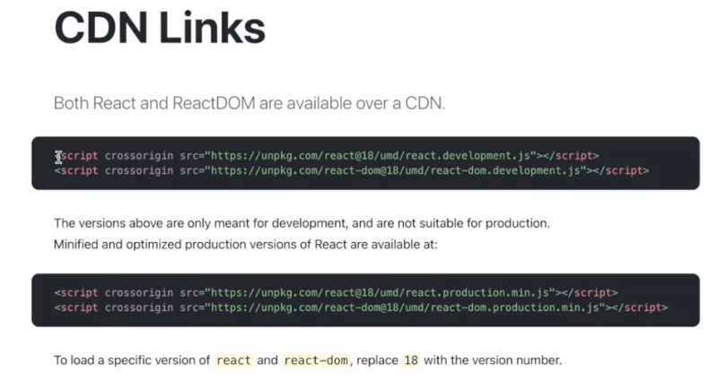
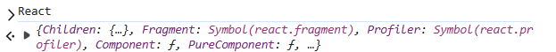
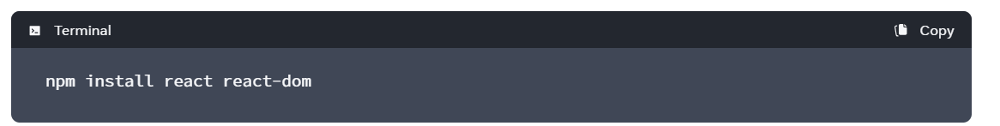
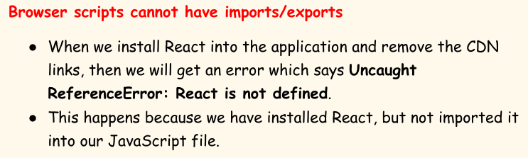
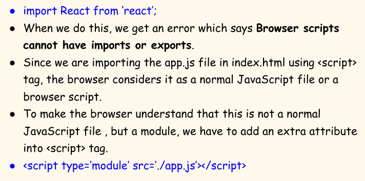

# 5.4 Injecting React

## Getting React in our project:

We can add React into our project by injecting CDN links in it (in  an .html file)

Both React and ReactDOM are available over a CDN.

Functionality of core react (this core library remains same for web, android, ios), This file contains the whole code of React which is written in

JavaScript:

Connection and communication between react library and BOM/DOM (react-dom library). Using this file, React interacts with the browser DOM.:

In app development, instead of react-dom we use react-native, which communicates between react and mobile.

react = 3000 lines code

react-dom = 29000 lines code

<body>

<!--this app.js file should be after react script files else it will give error: "Uncaught ReferenceError: React is not defined"

Putting this script tag in <head> renders nothing either -->

</body>

ReactDOM

*{**__SECRET_INTERNALS_DO_NOT_USE_OR_YOU_WILL_BE_FIRED**: {…}, **createPortal**: ƒ, **createRoot**: ƒ, **findDOMNode**: ƒ, **flushSync**: ƒ, …}*

| **What is crossorigin?**   - The crossorigin attribute in HTML is used to configure Cross-Origin Resource Sharing (CORS) requests for elements that load data from a different domain. It is applied to elements like <audio>, , <link>, <script>, and <video   - Due to security concerns, web browsers enforce a same-origin policy, which restricts how a document or script from one origin (combination of protocol, domain, and port) can interact with a resource from another.   - The crossorigin attribute helps loosen this restriction in a controlled way for legitimate cross-origin interactions, such as: An HTML document on example.com loading a script from a Content Delivery Network (CDN), like cdn.third-party.com.   - CORS or cross-origin resource sharing is a mechanism that allows memory resources (e.g., fonts, JavaScript, etc) on a webpage to be requested from another domain outside the domain from which the resource originated. **The attribute has two possible values:**   - anonymous: The browser will send a CORS request for the resource without sending user credentials, such as cookies, client-side SSL certificates, or HTTP authentication. This is the default behavior if the crossorigin attribute is present but has an empty or invalid value (e.g., <script crossorigin>).   - use-credentials: The browser will include credentials in the CORS request. This is necessary for resources that require authentication to access.For this to work, the server hosting the resource must also respond with **Access-Control-Allow-Credentials: true** in its HTTP response header. **How the process works: ** The crossorigin attribute works with a corresponding HTTP response header on the server side, **Access-Control-Allow-Origin.**   1. Browser initiates request: A browser requests a resource, for example, a script with the crossorigin attribute set.   1. Origin header added: The browser automatically adds an Origin header to the request, which specifies the domain from which the request originated.   1. Server checks for permission: The server receives the request and, if it's configured for CORS, checks the Origin header against its list of allowed domains.   1. Server responds: If the origin is allowed, the server responds with an Access-Control-Allow-Origin header in its response. The browser then grants the web page access to the resource. If the server doesn't allow the request, the browser blocks it and returns a CORS error. |
| --- |

## Using NPM:

CDN Links is not a preffered way to bring React into our project. It makes a costly network call to CDN. Better to manage it as a dependency in package.json. We instead use:

"dependencies": {

"react": "^19.1.1",

"react-dom": "^19.1.1"

}

import React from "react";

import ReactDOM from "react-dom/client"; // react@19 onwards import from client...

@parcel/transformer-js: Browser scripts cannot have imports

or exports.

💡 Add the type="module" attribute to the <script> tag.

