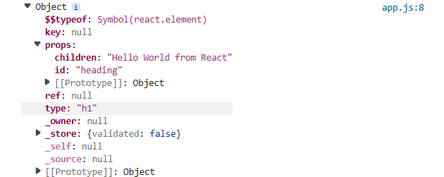
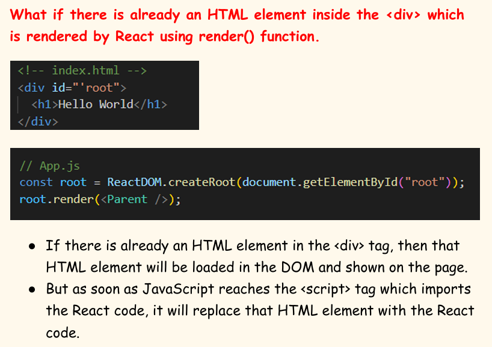

# 5.5 CreateElement

## React.createElement

**createElement****: *****ƒ  => ******createElementWithValidation(type, props, children)***

Create element takes three parameters:

TYPE = type of  React Element

PROPS = attributes

CHILDREN = inside of element (text, another element)

// Create a heading element using React

const heading = React.createElement(

"h1", // type aka tag

{id : "heading"}, // props : give attributes to tag here

"Hello World from React" // children

);

console.log(heading); //object

// Render the heading element to the DOM

const root = ReactDOM.createRoot(document.getElementById("root"));

root.render(heading);

heading  --> this heading is an JS Object of type React.Element

DOM Manipulation (creating, modifying, deletind DOM nodes) is a costly operation in interactive websites.

The costliest operation for a browser is when the browser needs  to manipulate the DOM. A problem which react solves.

React modifies DOM through JS directly. Any React element is nothing but a JavaScript object. This object contains a key known as  props  which stores  the children and other attributes of the React element in a key-value pair.

The render() function is responsible for taking the JavaScript  object (React element) as an argument, converting it into an HTML tag and putting it in the DOM.

React.createElement(Object) --- render --> HTML Element (BROWSER Understands)

<h1> Hello Top of Root </h1>

<h1> Already present heading! </h1>

<h1> Hello Bottom of Root </h1>

If this is the root element, then render is going to replace the content in the root. For a brief moment it will be visible before it is replaced by React. Because first of all browser prints the HTML and as soon as it goes to scripts, loads react and then react to app.js script, it renders the HTML through JS code. React takes control of div:root once app.js starts executing.

However the h1 top and h1 bottom remain as it is. This is why React is called a library and not a framework. It can be applied to any single element also. It can be applied to only footer, sidebar, root etc. It can work independently in a small porttion of our webapp also.
