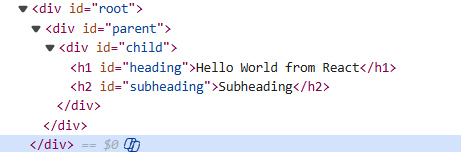

# 5.6 JSX, Babel

How to make nested HTML elements through React. Sibling elements are altogether passed as an array. Using only React, the code for nested elements is tough, fir which reason we need JSX:

/\*\*

\* 

\* 

\* <h1 id="heading">Hello World from React</h1>

\* <h2>Subheading</h2>

\* 

\* 

\*/

// Create a nested structure using React

**React****.****createElement****(****"div"****, {id: ****"parent"****},**

**React****.****createElement****(****"div"****, {id: ****"child"****},**

**      \[****React****.****createElement****(****"h1"****, {id: ****"heading"****}, ****"Hello World from React"****),**

**React****.****createElement****(****"h2"****, {id: ****"subheading"****}, ****"Subheading"****)**

**    \]**

**  )**

**);**

Warning: Each child in a list should have a unique "key" prop.

JSX:

export default function MyApp() {

return (

<h1>Welcome to my app</h1>

<MyButton />

);

}
