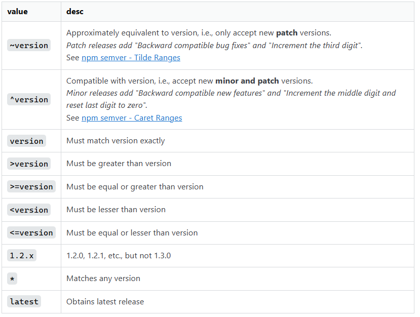
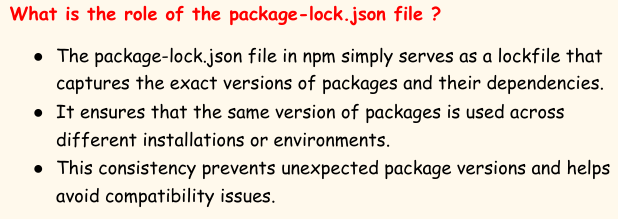
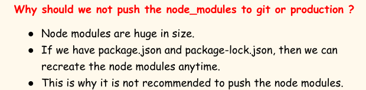
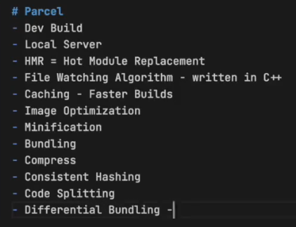
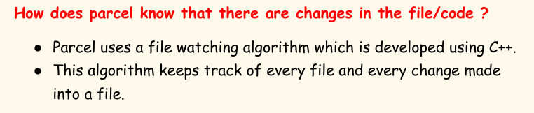
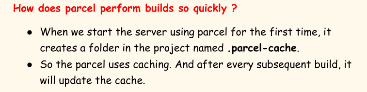

# 5.7 Bundler

## Building / Bundling :

For production code, we need to optimise files and images, minify/compress the files, bundle all the thousand files together. Bundling, Chunking, Code Splitting, Image Optimisation. This is done by bundler.

- **NPM : Node Package Manager**

  - NPM is a package manager for JavaScript. It's default package manager for NodeJS runtime enviroment. It is the world’s largest software registry.  Run packages without downloading using npx.

  - It consists of three components:

○  The website

○  The command line interface

○  The registry

- ** What is a package.json file ? **

  - The package.json file is a configuration file for npm. Packages are aka dependencies, and npm manages that.

  - It is the manifest file of any node.js project and contains the metadata of the project.

  - This metadata information can be categorized into below  categories:

    - Identifying metadata properties:  It basically consists  of  the properties to identify module/project such as the name of the project, current version of the module, license,  author of the project, description about the project, etc.

    - Functional metadata properties:  It consists of the functional values/properties of the project/module such as  entry/starting point of the module, dependencies in project scripts being used, repository link, etc.

  - There are 2 types of dependencies in the package we install: 1. Dev dependencies (for development phase) 2. Normal dependencies (used in production also)

VERSIONING IN package.json:

When you install or update packages using npm, it checks the package-lock.json file to ensure the specified versions are installed.

This lockfile is especially important when collaborating on projects as it guarantees that all the contributors use consistent package versions.

#### Transitive Dependencies

- When a dependency has its own dependencies and those dependencies have their own dependencies, then it is known as transitive dependencies.

- In the React project, inside node_modules, every dependency folder has its own package.json file which contains the dependencies and the description of that dependency.

- Node_modules contains the code of all the packages we fetched from npm and their transitive dependencies. Its like a database for our project.

- 

### Bundler:

What is a bundler ?

- A JavaScript bundler is a tool that puts your code and all its dependencies together in one JavaScript file.

- It is a development tool that combines many JavaScript code files into a single one that is production-ready loadable in the browser.

- Bundler packages/bundles our app (HTML, CSS, JS) perfectly so that it is ready for production.

- Create-react-app uses webpack bundler and babel behind the scenes.

- **BuildTools (js based):**

  - Webpack: module bundler for js apps

  - Parcel: fast, 0 config web app bundler -- devDependency

  - Vite

Even though package.json contains ^2.16.0 package-lock.json contains actual version: 2.16.9

package.json --->

"devDependencies": {

"parcel": "^2.16.0"

}

package-lock.json  --->

"node_modules/@parcel/bundler-default": {

"version": "2.16.9",

Parcel also requires babel.

"devDependencies": {

"@babel/core": "^7.22.11",

"@parcel/babel-register": "2.16.0"

}

## Build our app using Parcel

**npx parcel index.html**

npm --> install a package

npx --> executing a package

When you run npx parcel index.html, parcel does the following:

  - Development mode (default)

    - It starts a development server.

    - It serves the index.html file and watches for changes in your file.

    - It automatically reloads the browser when it detects the changes.

  - Build mode (with additional options)

    - If you specify a build option (e.g., npx parcel build index.html), parcel will create an optimized, production-ready bundle.

    - It minifies the code and optimizes assets for better performance.

- Parcel does HMR (Hot reloading) which exchanges, adds, or removes modules while an application is running, without a full reload.

- HMR speeds us development.

- How does it work in the application ?

  - The application asks HMR runtime to check for updates.

  - The runtime asynchronous downloads the updates and notifies the application.

  - The application then asks the runtime to apply the updates.

  - The runtime synchronously applies the updates.

What other things does the parcel do ?

1. Compressing files

2. Bundling

3. Image optimization

4. Minification

5. Consistent Hashing

6. Differential Bundling - support older browsers

7. Diagnostics

Removing “main” key from package.json

● Inside package.json, there is a key named “main” which has a value i.e**. file_name (App.js)**.

● This tells npm that App.js is the entry point.

● But since we use the parcel, we give an entry point, we get an entry point while executing the command itself. So in that case, this ‘main’ key is of no use.

● When we try to execute ‘npx parcel build index.html’, then it gives an error. Because, the entry point given in the command has a conflict with the value of ‘main’ key.

● So in that case, we should remove the ‘main’ key-value pair from package.json.
