# 5.8 Components

## Essentials:

  1. Components

  1. Data

  1. Events

  1. State

[Learning Components/Props/JSX in React 2024](<https://www.youtube.com/watch?v=HKX__TQ9ff0&list=PL9i39jUQljInNAIHUnnZhKrYhLbFt5I_6&index=2&pp=iAQB>)

## COMPONENTS

  - Reusable UI Building Blocks / foundations which are combined to create entire user interface

  - React Apps are combination of components. Components can be reused.

  - A component is a piece of the UI (user interface) that has its own logic and appearance. HMTL, CSS and related JS are wrapped and stored together in a component, and they control that specific component. Since JS influences the output, storing it with html makes sense.

  - Create small blocks and compose UI from them (also, reuse)

  - Separation of concerns: different components have different data and logic

| 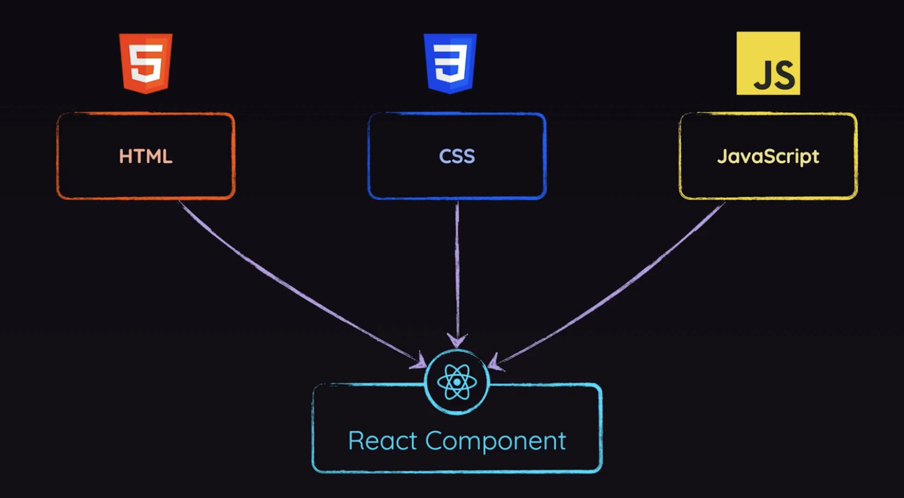 | 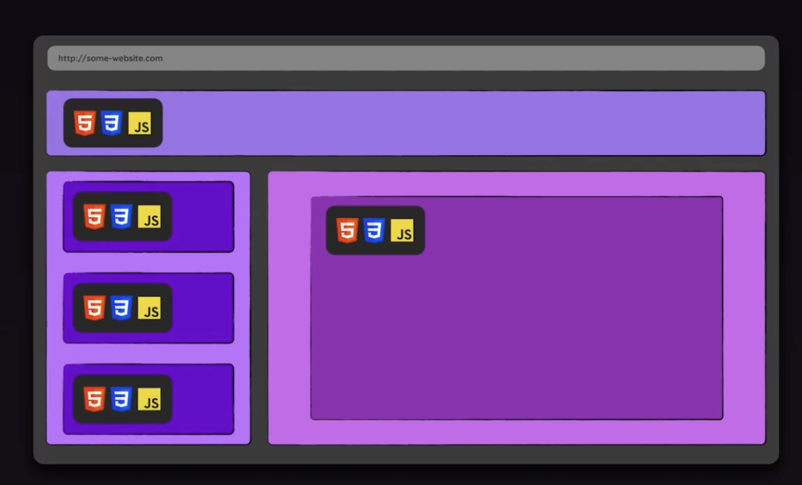 |
| --- | --- |

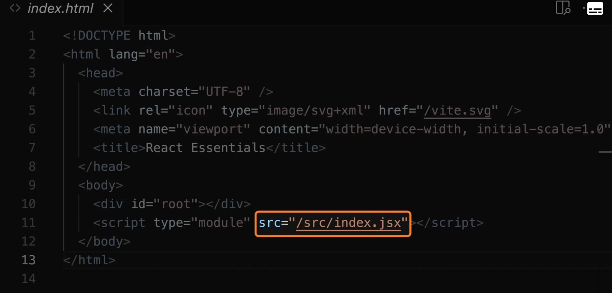

Index.html links the index.jsx file --->

<body>

 --> reqd for import/export feature of JS

</body>

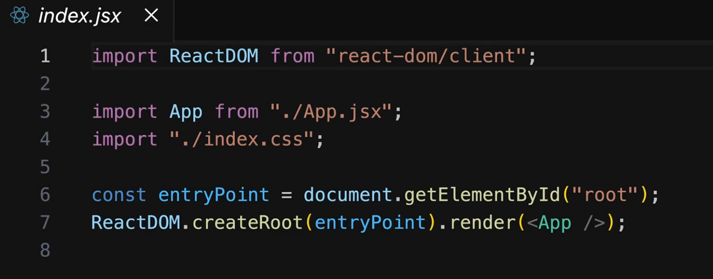

Index.jsx file renders the <App/> component.

In this app.jsx check the core concept component:

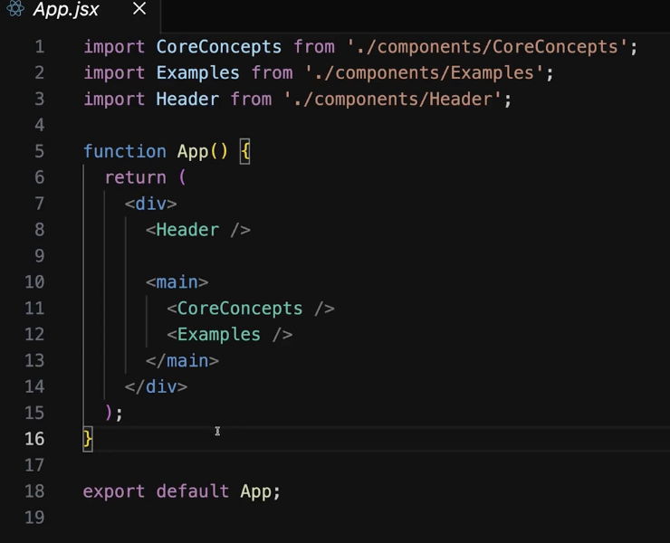

**Components are JavaScript function that returns markup (HTML)** **code**. Example:

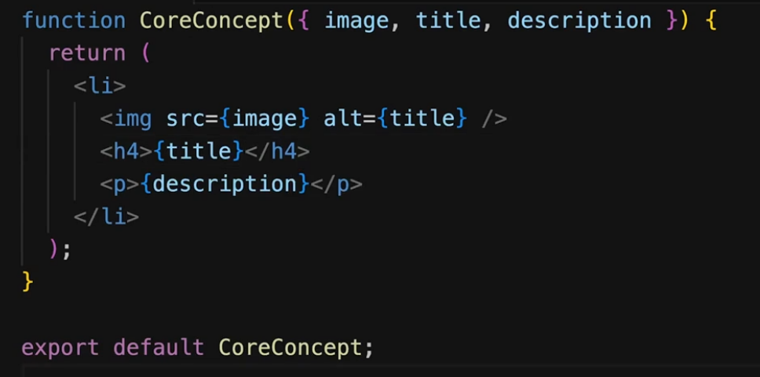

Once a component is declared, it can be nested into another component.  We almost every time use JSX code inside of component functions.

**Describe the target UI using JSX:**

With React, we write the target HTML structure, and not the steps to get there. (Declarative code)

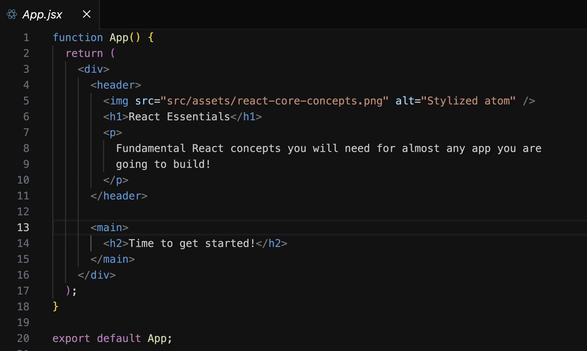

JSX file uses non standard javascript syntax, which browsers do not support. React build process transforms JSX code into compatible JS code. JSX used to describe and create HTML elements by writing markup in JavaScript code.

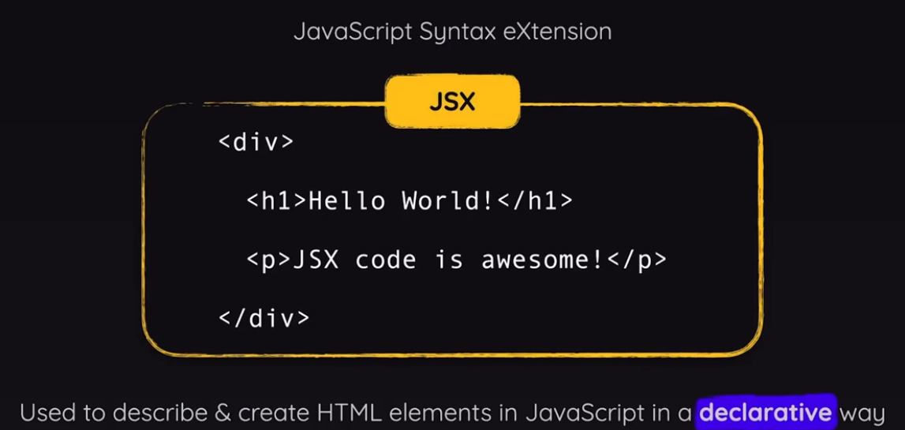

A REACT COMPONENT IS REALLY A JS FUNCTION. In order for a function to be recognised and used as a React component, it must follow two rules:

  1. Name starts with uppercase character:

    1. Multi-word names should be written in PascalCase (eg: <MyButton /> )

    1. React component names must always start with a capital letter, while HTML tags must be lowercase.

  1. Returns "rendurable" content ("displayed on screen" by React):

    1. In most cases: Return JSX. Also allowed: string, number, boolean, null, array of above

### CREATING A NEW <Header> COMPONENT:

The export default keywords specify the main component in the file.

Creating a header component:

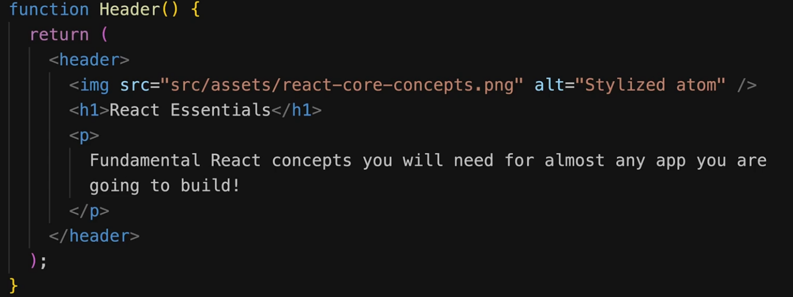

We do not have to execute the function, react does it by itself. We can use the Header() function/component as a **HTML element** inside of our APP react component:

| Use <Header> and </ Header> tag | Use self closing tag |
| --- | --- |
| 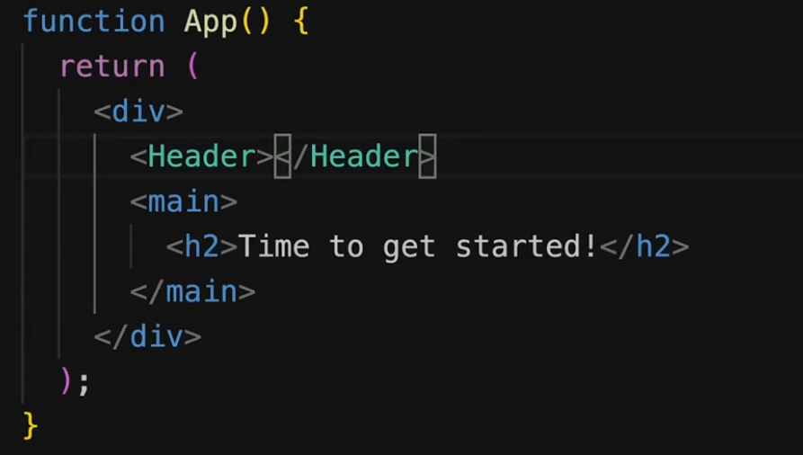 | 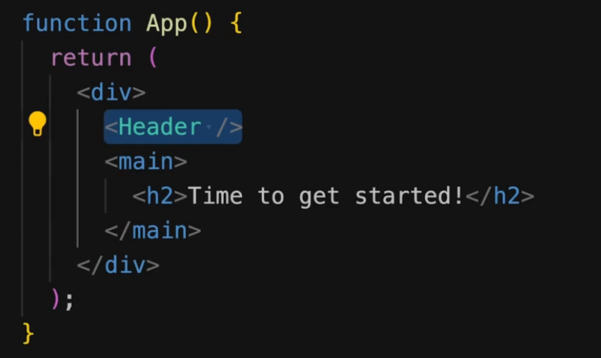 |

**HOW COMPONENTS GET RENDERED**

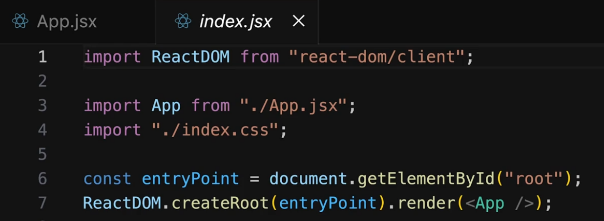

ReactDOM.createRoot(entryPoint).render() initializes a React application.

  - ReactDOM.createRoot(entryPoint) creates a root React rendering target inside the specified DOM element (entryPoint).

*"*

*createRoot lets you create a root to display* ***React components inside a browser DOM node****. *

*const root = createRoot(domNode, options?)*

*"*

  - entryPoint = the div container in index.html having id = "root"

  - .render(<App />) starts rendering the React component <App /> inside that root. Render method is called on an object (DOM element).

  - Eg: Header and Main

  - 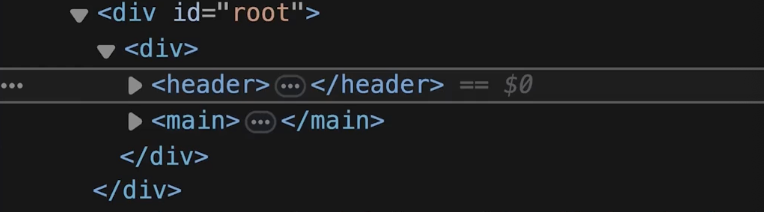

In index.jsx, we use <App /> component as an argument to render function. (and not JSX ode that we return). This is the first file that index.html loads, and this is where our React App boots up.

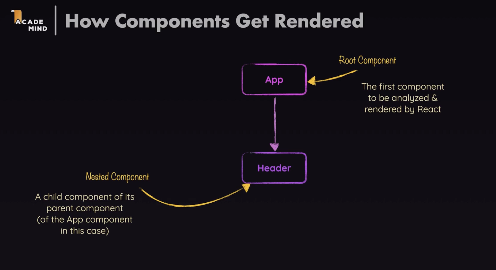

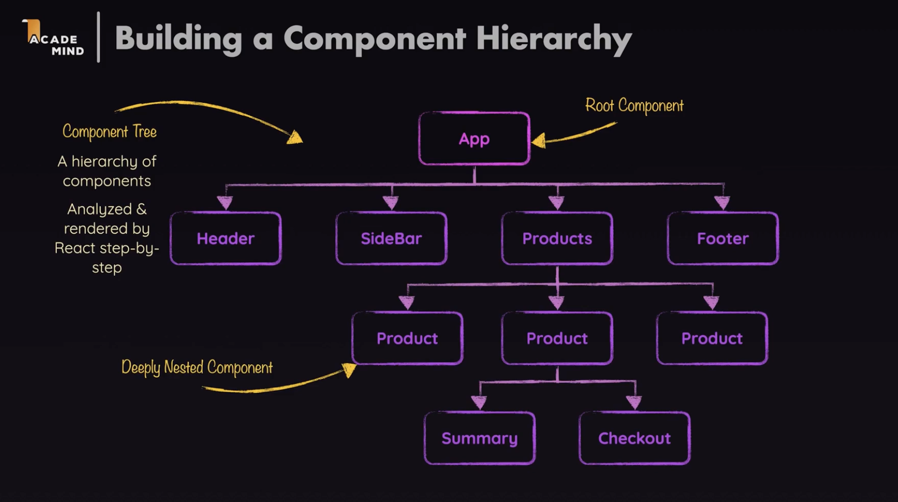

React Component Tree = Virtual DOM

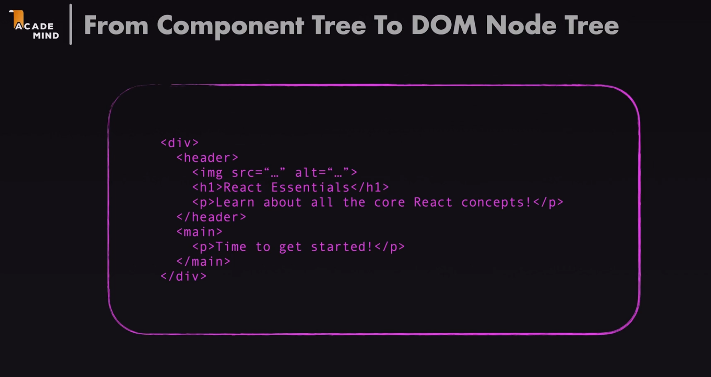

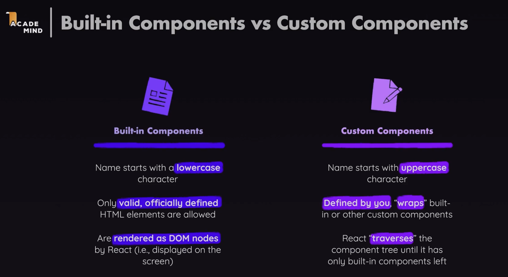

### DYNAMIC CONTENT WITH REACT:

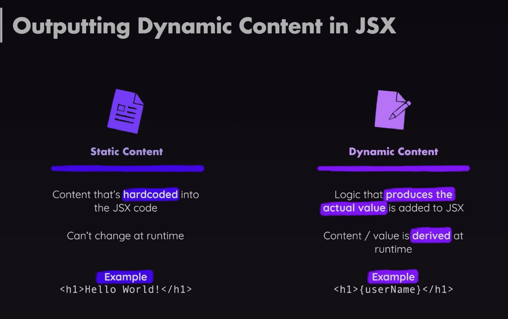

We can use this code to change the words randomly:

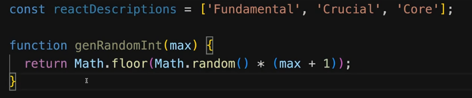

Curly Braces - used for outputting dynamic content, any js expression that directly produces a value can be put. Result of expression will be output on the screen.

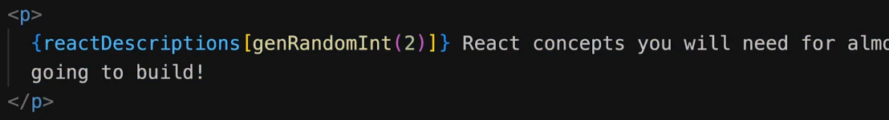

Good practice:

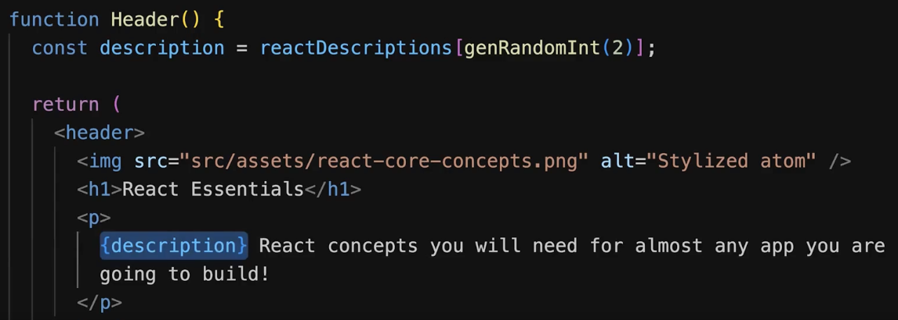

We can similarly set the HTML attributes dynamically as well. We can point to images differently instead of static path. How to load and include images so that they do not get lost in the bundling process during react-build = LOAD IMAGE AS A VALUE:

*Dynamic value syntax*

**Import reactImg from './assets/react-core-concepts.png';**

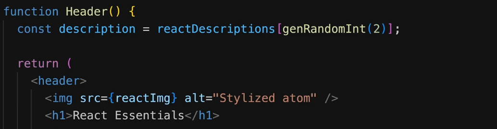

Image is loaded as a javascript object having a variable pointing to the path of actual image

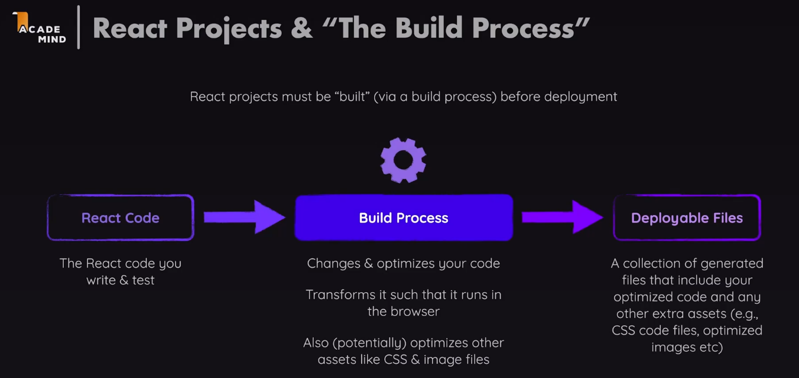

Build process supports imports like

**Import"./index.css" ;**

**Import reactImg from './assets/react-core-concepts.png';**

Files included here are present in the final deployable files after build process.
