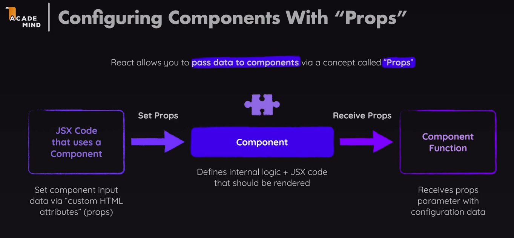
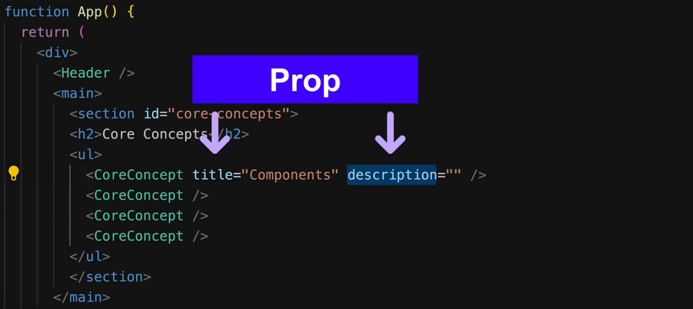
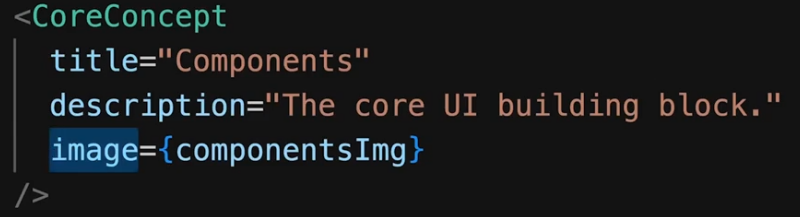
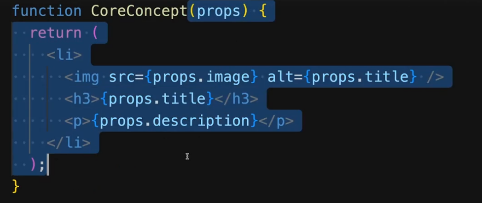
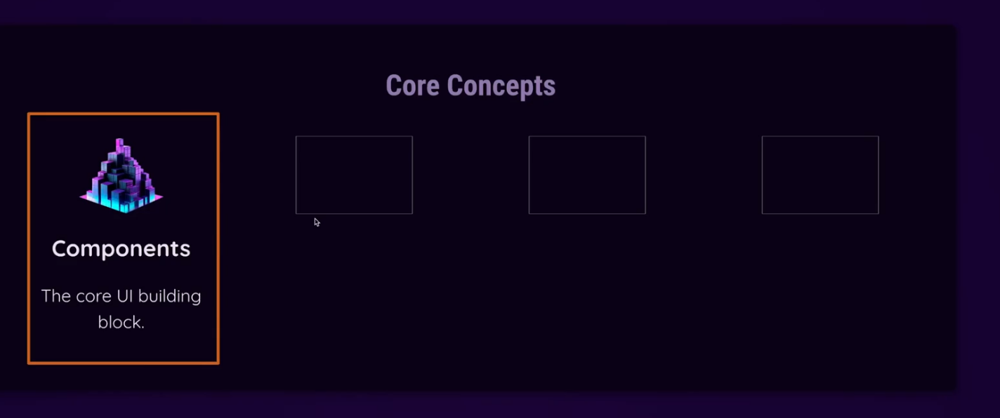
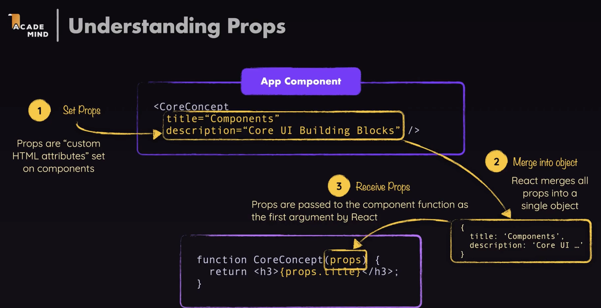
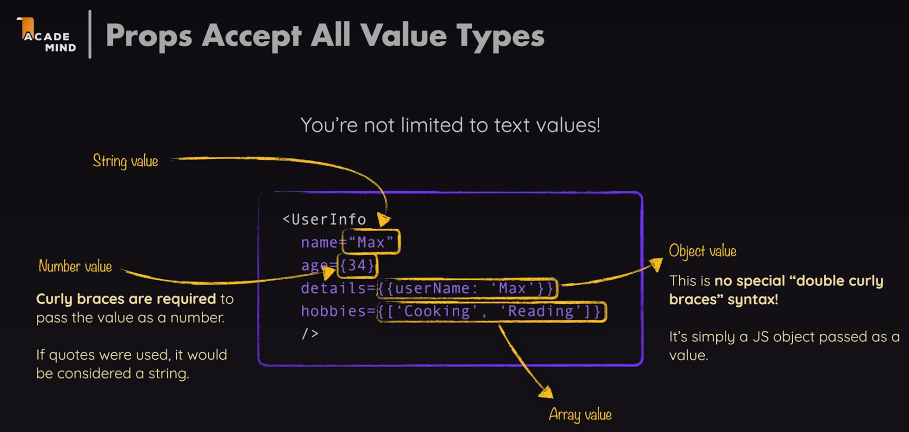
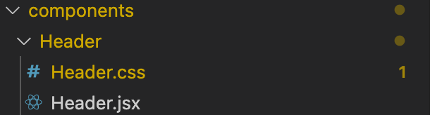

# 5.8.1 Props

- Make React Components reusable with props.

- Eg: CoreConcepts -> Header, CoreConcept-1, CoreConcept-2, …

- React allows to pass input data into components.

import componentsImg from './assets/components.png';

import propsImg from './assets/config.png';

import jsxImg from './assets/jsx-ui.png';

import stateImg from './assets/state-mgmt.png';

React will pass an object into the component function, which has all these custom attributes as a key-value pair. We can access the value by using the same key in the function as in the object, which is same as the attribute.

This FIRST COMPONENT will render as below and we can use other <CoreConcept /> tags with different attribute values to reuse this component with other values:

### Alternative props syntax:

Data.js

import componentsImg from './assets/components.png';

import propsImg from './assets/config.png';

import jsxImg from './assets/jsx-ui.png';

import stateImg from './assets/state-mgmt.png';

### named export -->

export const CORE_CONCEPTS = \[

{

image: componentsImg,

title: 'Components',

description:

'The core UI building block - compose the user interface by combining multiple components.',

},

{

image: jsxImg,

title: 'JSX',

description:

'Return (potentially dynamic) HTML(ish) code to define the actual markup that will be rendered.',

},

{

image: propsImg,

title: 'Props',

description:

'Make components configurable (and therefore reusable) by passing input data to them.',

},

{

image: stateImg,

title: 'State',

description:

'React-managed data which, when changed, causes the component to re-render & the UI to update.',

},

\];

App.js

import reactImg from './assets/react-core-concepts.png';

import { CORE_CONCEPTS } from './data.js';

| ## component function -->  object destructuring ## props = {image, title, description} function CoreConcept({ image, title, description }) { return ( <li>  <h3>{title}</h3> 
{description}
 </li> ); } OR function CoreConcept(props) { return ( <li>  <h3>{props.title}</h3> 
{props.description}
 </li> ); } |
| --- |

function App() {

return (

<Header />

<main>

<section id="core-concepts">

<h2>Core Concepts</h2>

<ul>

## openly assign:

<CoreConcept

title={CORE_CONCEPTS\[0\].title}

description={CORE_CONCEPTS\[0\].description}

image={CORE_CONCEPTS\[0\].image}

/>

## since prop names are same as property names of objects in data.js

## use spread operator . . .

<CoreConcept {...CORE_CONCEPTS\[1\]} />

<CoreConcept {...CORE_CONCEPTS\[2\]} />

<CoreConcept {...CORE_CONCEPTS\[3\]} />

</ul>

</section>

</main>

);

}

export default App;

| {...CORE_CONCEPTS\[1\]} | title={CORE_CONCEPTS\[0\].title} description={CORE_CONCEPTS\[0\].description}image={CORE_CONCEPTS\[0\].image} |
| --- | --- |

### Storing components in separate files:

  - If we store all components in a single file then it gets tougher to find those components when our project get large. So its better to store all component in single files.

  - Create a folder named components to store all the components we've made.

Components/Header.jsx

import reactImg from '../assets/react-core-concepts.png';

const reactDescriptions = \['Fundamental', 'Crucial', 'Core'\];

function genRandomInt(max) {

return Math.floor(Math.random() \* (max + 1));

}

export default function Header() {

const description = reactDescriptions\[genRandomInt(2)\];

return (

<header>

<h1>React Essentials</h1>

{description} React concepts you will need for almost any app you are

going to build!

</header>

);

}

Components/CoreConcept.jsx

export default function CoreConcept({ image, title, description }) {

return (

<li>

<h3>{title}</h3>

{description}

</li>

);

}

App.jsx

import Header from './components/Header.jsx';

import CoreConcept from './components/CoreConcept.jsx';

Now we can use them as we were using previously.

### Storing component styles in separate files next to components:

Components > Header > Header.jsx, Header.css

## import css file in header component file itself…

import reactImg from '../../assets/react-core-concepts.png';

import './Header.css';

Now the thing to note is that these styles are not scoped ONLY to the Header.jsx files only, they will be applied to any other element also that styles it. This splitting of styles files is so that we know which styles affect the concerned component.
