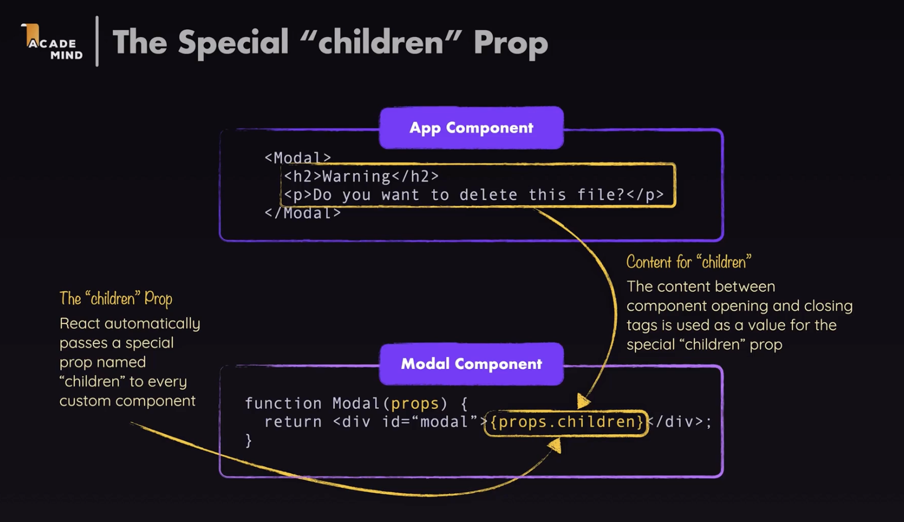
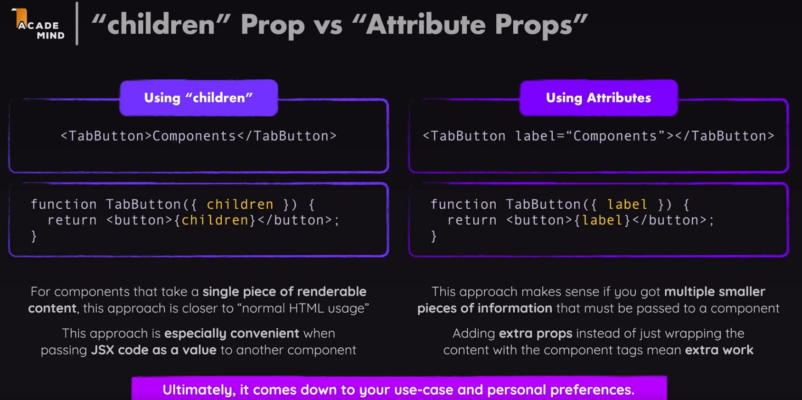

# 5.8.2 Children Prop

[Passing PROPS as Children and Functions || React Series 2024](<https://www.youtube.com/watch?v=BBgSB2bLy60&list=PL9i39jUQljInNAIHUnnZhKrYhLbFt5I_6&index=5&pp=iAQB>)

import TabButton from './components/TabButton.jsx';

function App() {

return (

<Header />

<main>

<section id="core-concepts">

..PREV CODE..

</section>

## examples tab section -->

<section id="examples">

<h2>Examples</h2>

<menu> # default html element

<TabButton>Components</TabButton>

<TabButton>JSX</TabButton>

<TabButton>Props</TabButton>

<TabButton>State</TabButton>

</menu>

</section>

</main>

);

}

tabButton.jsx :

## destructured children prop object

export default function TabButton({ children }) {

return (

<li>

<button>{children}</button>

</li>

);

}

We are using like this:

<TabButton title="Components" />

We can also do like this:

<TabButton>Components</TabButton>

By default this components text will not be outputted on page if we don't tell react to do so.

export default function TabButton(prop) {

return (

<li>

<button>{prop.children}</button>

</li>

);

}

Children prop is by default, even if we don't define any other prop. This prop can't be set by attributes. Children refers to the content between the  tags - any JSX content can be there

<TabButton> .. Children prop content .. </TabButton>

Through children prop, a component can wrap other component, and this is called **component composition.**

ATTRIBUTE PROP VS CHILDREN PROP

