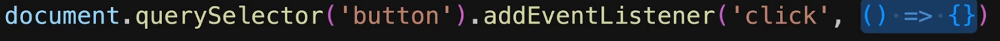

# 5.9 Events

How do we handle click events in vanilla JavaScript:

But this is imperative code. We don't want to interact with DOM, react will do it by itself.

For this we'll add onClick prop to button component (element = a built-in component that React understands). Value of any event prop is a (callback) function.

Click event: an interaction when a user clicks on a specific element. We can respond to clicks by passing a callback to the onClick event handler.

You can respond to events by declaring event handler functions inside your components.

export default function TabButton({ children }) {

**function handleClick = () => {**

**console.log('Hello World!');**

**  }**

return (

<li>

## we added a callback to onClick event handler

<button **onClick={handleClick}**>{children}</button>

</li>

);

}

Notice how onClick={handleClick} has no parentheses at the end! Do not call the event handler function: you only need to pass it down. React will call your event handler when the user clicks the button.

React.DOMAttributes<HTMLDivElement>.onClick?: React.MouseEventHandler<HTMLDivElement>

The advantage of defining the event handler functions inside of component function is that they then have access to the component's props and state.

function handleSelect() {

console.log('Hello World - selected!');

}

<menu>

<TabButton onSelect={handleSelect}>Components</TabButton>

<TabButton onSelect={handleSelect}>JSX</TabButton>

<TabButton onSelect={handleSelect}>Props</TabButton>

<TabButton onSelect={handleSelect}>State</TabButton>

</menu>

From outside the TabButton.jsx we want to pass the function that will be executed, so we pass it as a prop:

TabButton.jsx:

export default function TabButton({ children, onSelect }) {

return (

<li>

<button onClick={onSelect}>{children}</button>

## forwarding the value in onSelect prop to onClick prop

</li>

);

}

children --> Components/JSX/… text

onSelect --> handleSelect function

onClick = handleSelect (outside of this file)

function handleSelect(selectedButton) {

// selectedButton => 'components', 'jsx', 'props', 'state'

console.log(selectedButton);

}

<menu>

<TabButton onSelect={() => handleSelect('components')}>Components</TabButton>

<TabButton onSelect={() => handleSelect('jsx')}>JSX</TabButton>

<TabButton onSelect={() => handleSelect('props')}>Props</TabButton>

<TabButton onSelect={() => handleSelect('state')}>State</TabButton>

</menu>

Pass arrow function in onSelect with different function calls of handleSelect.

By default, React components execute only once. We have to tell react if a component should be executed again.
