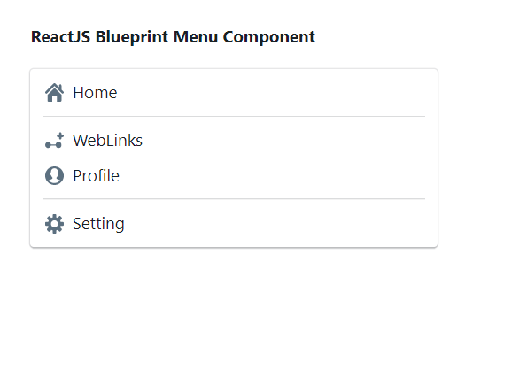
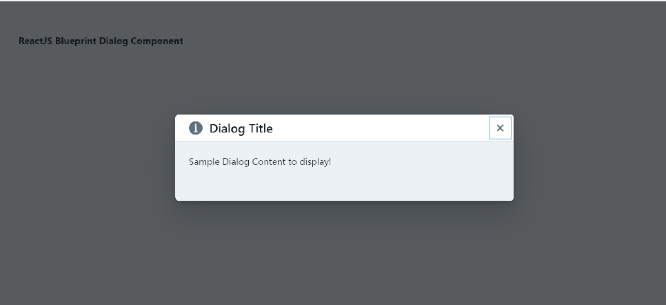

# 6.1 Introduction

- BlueprintJS is a React-based UI toolkit for the web. Very optimized for data-dense applications.

- It is written in Typescript and it is having its own ".d.ts" file (type declaration file). These files require TS2.3+.

[What Are \*.d.ts files? How to Use \*.d.ts Files in TypeScript?](<https://youtu.be/s_CZeWuEZ_s?si=iYxylSM4X8tXM9t8>)

- Blueprint is written in [TypeScript](<https://www.typescriptlang.org/>), a statically typed superset of JavaScript that compiles to plain JavaScript. TypeScript code looks exactly like ES2015+ code with the addition of type signatures.

- Blueprint is available as an NPM package @blueprintjs scope. It has over 40 components.

- Requires some ES15 features like Map, Set, prototype, polyfilll, dom4 (Blueprint relies on a handful of DOM Level 4 API methods: el.closest() and el.contains().)

**Installation**

| npm i @blueprintjs/core // or yarn add @blueprintjs/core react react-dom *TYPES FILE: install blueprint's dependencies* npm install --save @types/react @types/react-dom Peer dependencies: react, react-dom (must be installed alongside) |
| --- |

After installation, you'll be able to import the React components in your application like -

import { Button, Intent, Spinner } from "@blueprintjs/core";

// using JSX:

const mySpinner = <Spinner intent={Intent.PRIMARY} />;

For this button to be styled correctly in the DOM, it needs its associated CSS to be loaded on the page. Don't forget to include the main CSS file from each Blueprint package. Additionally, the resources/ directory contains supporting media such as fonts and images.

| // using node-style package resolution in a CSS file: @import "~normalize.css"; @import "~@blueprintjs/core/lib/css/blueprint.css"; @import "~@blueprintjs/icons/lib/css/blueprint-icons.css"; |
| --- |

The following example shows an index.html file; the same stylesheets should be loaded if you use a bundler like Webpack. Add the below link inside head section of the page.

| <!-- or using plain old HTML --> <head> <!-- include dependencies manually --> <link href="path/to/node_modules/normalize.css/normalize.css" rel="stylesheet" /> <!-- NOTE: blueprint icons.css file must be included alongside blueprint.css! --> <link href="path/to/node_modules/@blueprintjs/icons/lib/css/blueprint-icons.css" rel="stylesheet" /> <link href="path/to/node_modules/@blueprintjs/core/lib/css/blueprint.css" rel="stylesheet" /> <!-- add other blueprint-\*.css files here --> </head> |
| --- |

*TYPESCRIPT:*

// variables

const variableName*:* *varType*;

const name*:* *string*;

const disabled*:* *boolean*;

// functions (and function variables)

function funcName(arg1*:* *argType*, arg2*:* *argType*)*:* *returnType* {}

const funcName*:* *(**arg1**:* *argType**)* *=>* *returnType*;

function split(str*:* *string*, delim*:* *string*)*:* *string**\[\]* {}

function map*<**T**,* *U**>*(array*:* *T**\[\]*, iterator*:* *(**item**:* *T**,* *index**:* *number**)* *=>* *U*)*:* *U**\[\]*;

// interfaces describe plain objects

// (we use the convention that interfaces begin with "I")

interface IOption {

label*:* *string*;

value*:* *string*;

}

const option*:* *IOption* = { label: "Name", value: "Gilad" };

**BUTTON COMPONENT:**

| **import** React **from** 'react' **import** '@blueprintjs/core/lib/css/blueprint.css'; **import** { Button } **from** "@blueprintjs/core"; **function** App() {     **const **handleClick= () => {         console.log("Button clicked");     }     **return** (         <Button intent="success" text="button content" onClick={handleClick} />     ); }; **export** **default** App; |
| --- |

**MENU COMPONENT**

| **import** React **from** 'react' **import** '@blueprintjs/core/lib/css/blueprint.css'; **import** { Menu, Classes, MenuItem, MenuDivider,      Icon } **from** "@blueprintjs/core"; **function** App() {     **return** (         
            display: 'block', width: 400, padding: 30         }}>             <h4>ReactJS Blueprint Menu Component</h4>             <Menu className={Classes.ELEVATION_1}>                 <MenuItem icon={<Icon icon="home" />} text="Home" />                 <MenuDivider />                 <MenuItem icon="new-link" text="WebLinks" />                 <MenuItem icon="user" text="Profile" />                 <MenuDivider />                 <MenuItem icon="cog" text="Setting" />             </Menu>         
     ); } **export** **default** App; |
| --- |

**DIALOG COMPONENT**

| **import** React **from** 'react' **import** '@blueprintjs/core/lib/css/blueprint.css'; **import** { Dialog, Classes } **from** "@blueprintjs/core"; **function** App() {     **return** (         
            display: 'block', width: 400, padding: 30         }}>             <h4>ReactJS Blueprint Dialog Component</h4> \| <Dialog                 title="Dialog Title"                 icon="info-sign"                 isOpen={**true**}             > \\| 
 
 Dialog Content to display! 
 
 \\| \\| --- \\| </Dialog> \| \| --- \| 
     ); } **export** **default** App; |
| --- |

|  |
| --- |

|  |
| --- |

|  |
| --- |

|  |
| --- |

|  |
| --- |

|  |
| --- |

|  |
| --- |

|  |
| --- |

|  |
| --- |

|  |
| --- |
