# 1.2.1 What is System Design?

**What is System Design?**

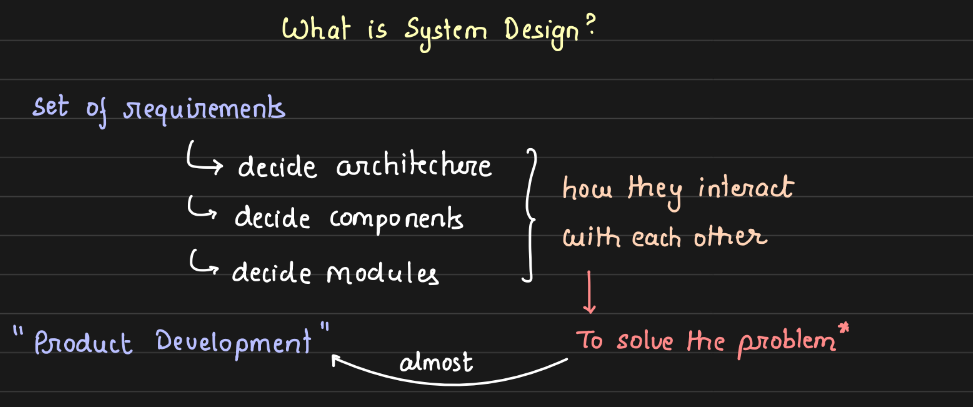

Every single "tech" product is a system that has been "designed".

Focus on how things talk to each other, and how to keep them talking when things go wrong (fault tolerance).

Break down problem statement, and think in a structured way, considering all possible cases to deliver a great user experience!

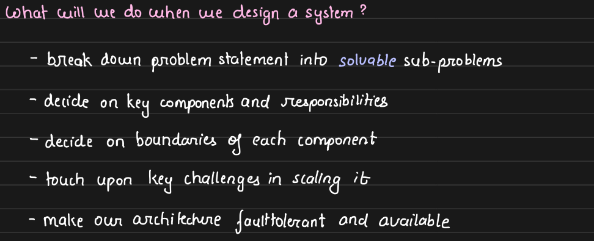

**How  to approach system design? **

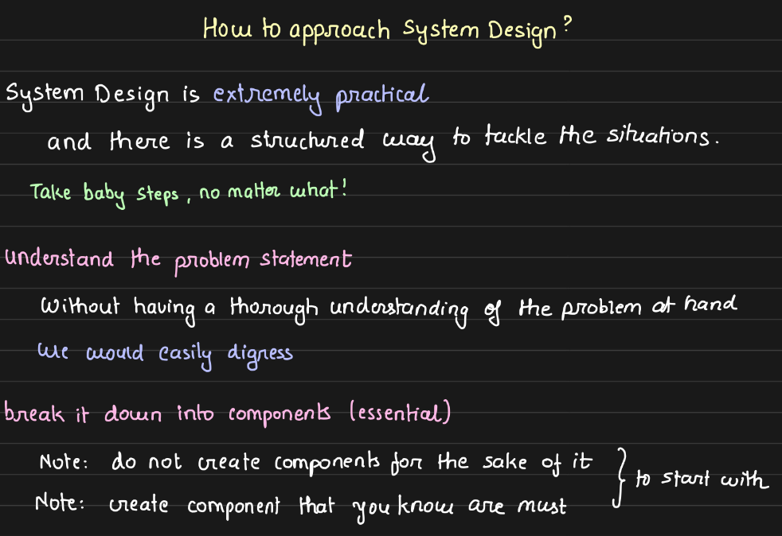

1. **Understand the problem statement**, and focus on solving the problem given to us, rather than digressing in a different direction. Understand the **constraints** that we need to adhere to, while designing a highly optimized system.

1. Break problem statement into components (features of Facebook) - almost** mutually exclusive components.**  Eg: Auth, Notification and Feed are three different features that are big enough to be its own microservices that can be tackled one at a time.

What are the features/components of facebook?

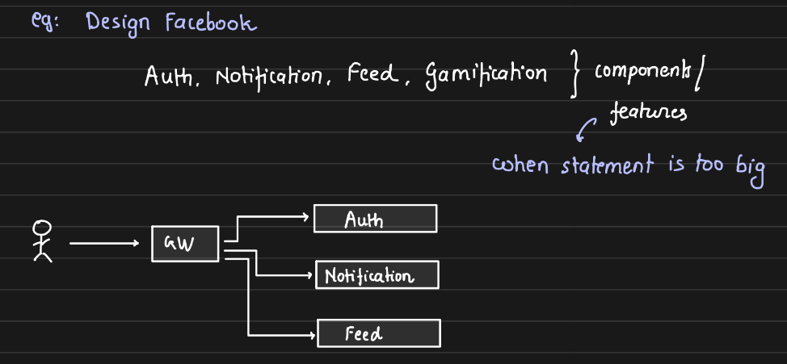

1. Go deep into one feature at a time. **Dissect each component** into sub-components (exclusive) - like webserver to serve the feed, database to store the feed contents, generator to pull data from services and generate a candidate feed, aggregator to collect and optimise the feed.

**If not sure of a component/feature, do not draw it. **

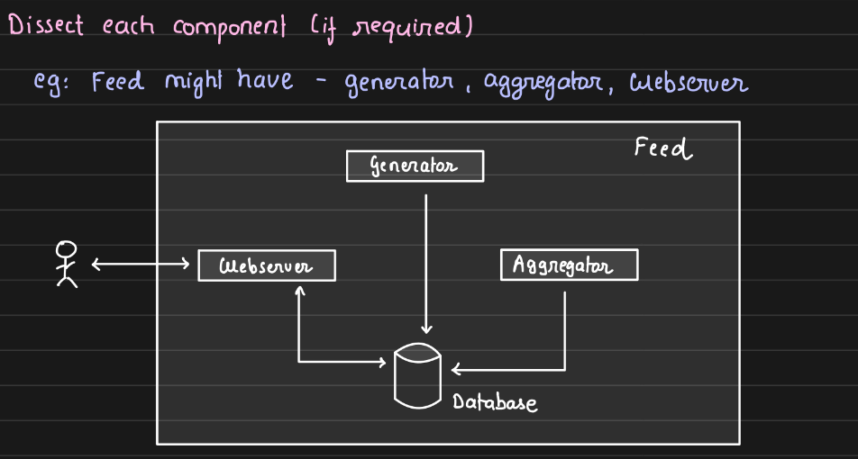

For each sub-component, dive deep into it. Eg: Tech Stack of WebServer, Which database would be use, how would generator generate the feed.

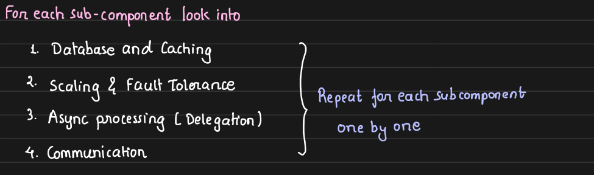

Dissect each component and for each-subcomponent once enough depth  into design, now it’s the time to take technical decisions and **dive in each sub-component**. Take 4 technical decisions for any sub-component:

1. **Storage (Database and Caching)** - caches to make things fast.

1. **Scaling and Fault Tolerance **

    - If my users > 1M then have to use more than 1 server and use load balancer.

    - If database fail, how will my system recover from that?

1. **Async processing (delegation)**

    - Asking your friend to do the task, handing him/her the task.

    - Pre-generated feed before the app is opened, and served as soon as request is made.

1. **Communication between sub-components**

    - HTTP, TCP, UDP, Websockets, gRPC

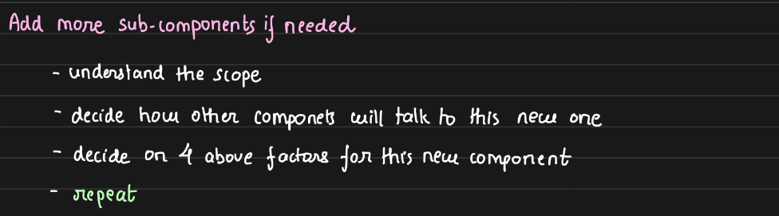

**If we find a need to split a component:** For example, generator can be split into further sub-sub-components like Post Service, Recommendation engine, Follow Service and they get merged to feed database (temporary)

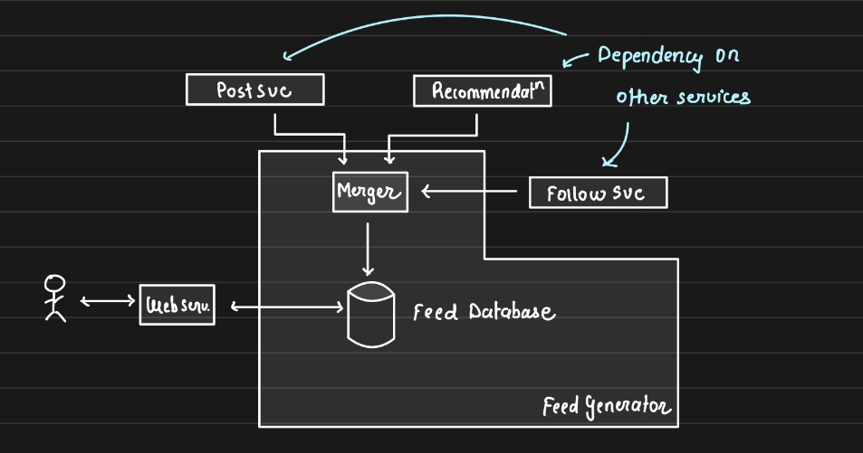

If given a very big (generic) problem, then go top-down, break into features and solve the problem. But if you're given a very specific (focussed) problem, start bottom-up.

**Interview Perspective**

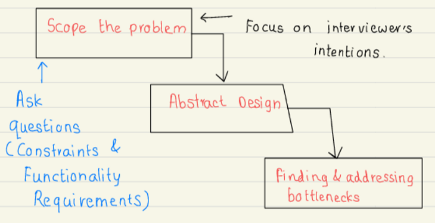

Discuss trade-offs as no solution is perfect. Discuss the impact on the system based on all the constraints/architectural resources and the end test cases.

**How to know if it is a good system? **

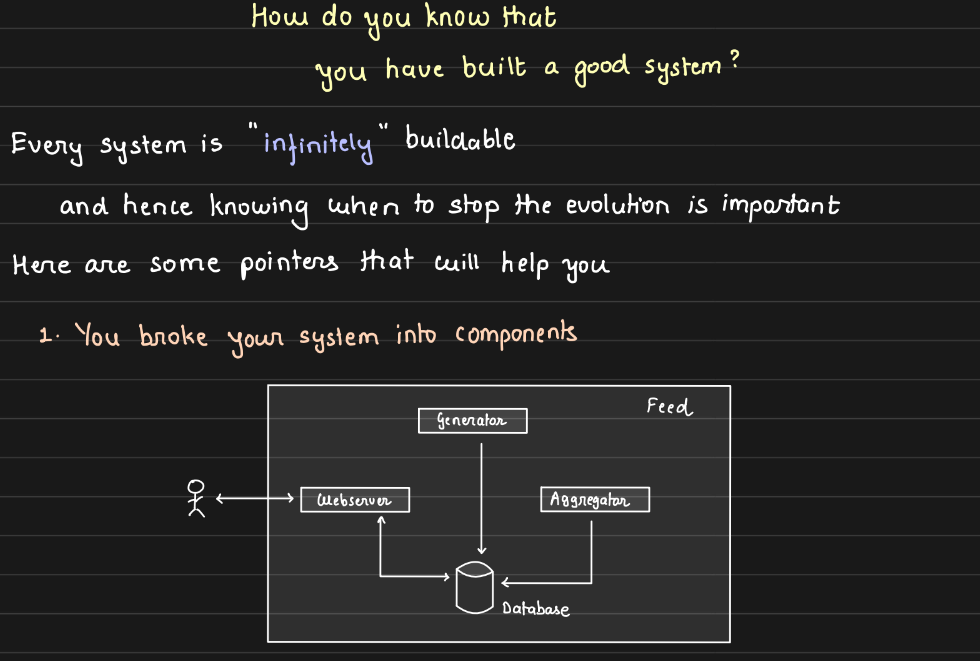

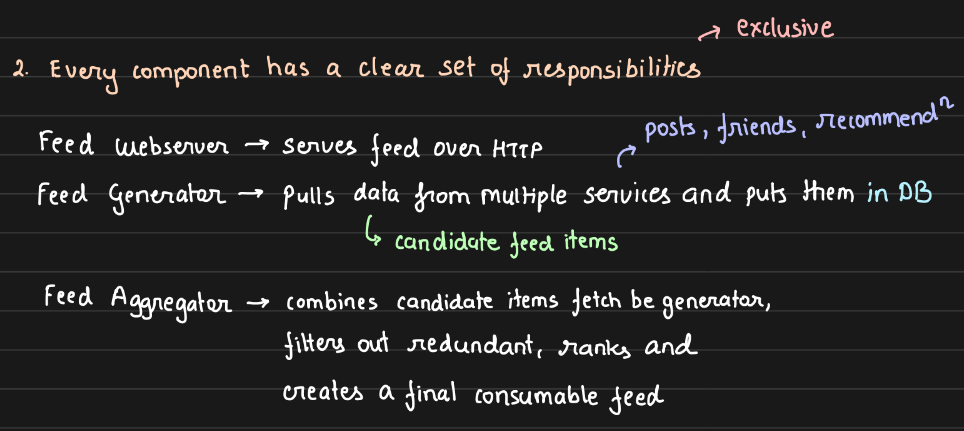

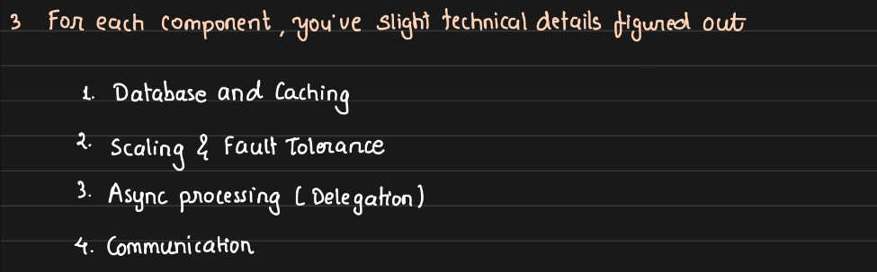

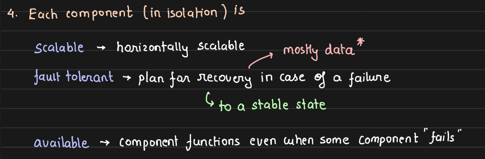

Scaling - how to handle large number of parallel requests/ operations?

Components should not be a** single point of failure.** If one component fails the system shouldn't chop down.

Decide the boundaries of each of the key components so that two components do not perform similar things.
