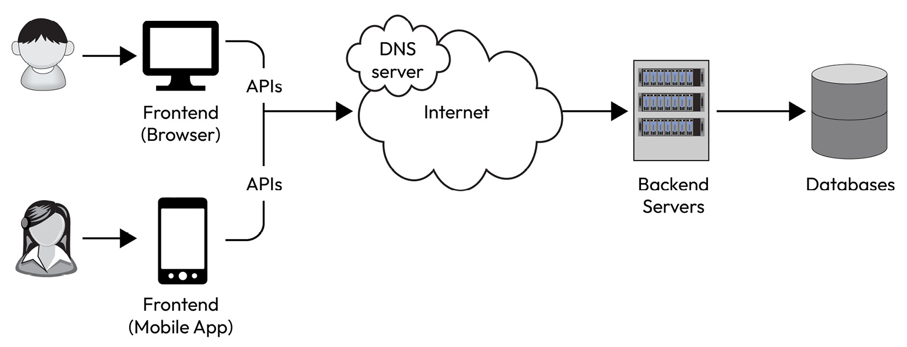

# 1.2.2 Interview Approach \*

https://www.youtube.com/watch?v=8Dkox1jGU6Q

[System Design - Real Life vs Interviews \| Tips and resources from Airbnb SDE2 \| Pratima Upadhyay](<https://www.youtube.com/watch?v=_pwcSWKoLFw>)

[Busting Software Engineering Myths with Staff Software Engineer \| Kaivalya Apte \| @TheGeekNarrator](<https://www.youtube.com/watch?v=gyiU3DHqROs>)

- 2 Alex Xu - Chapter 1,2,3

[EP2: High Level Systems Design: 6 Step Framework](<https://www.youtube.com/watch?v=PgR5sTCKWuk&list=PLoaQAd6R8JXyTpYZTOWT8JrVASNeyoBZu&index=10&pp=iAQB0gcJCU0KAYcqIYzv>)

[EP3: High Level Systems Design: Breaking Down Requirements](<https://www.youtube.com/watch?v=4E8gxwe8yas&list=PLoaQAd6R8JXyTpYZTOWT8JrVASNeyoBZu&index=9&pp=iAQB>)

The software system design process typically involves the following steps:

1. **Requirements analysis**: Understanding and defining the functional and non-functional requirements of the system. This step also calls for a deeper look into the read-and-write patterns and then designing the system to take advantage of these patterns.

1. **High-level architecture design**: Defining the overall structure of the system (see *Figure 1.2*), including its components, modules, and interfaces.

1. **Detailed design**: Defining the internal structure and behavior of each component and module. This also involves the core algorithms of each component and mechanisms of interactions between components.

1. **User interface design**: Designing the user interface of the system that would interact with the backend services via APIs. This is to be done at a very high level.

1. **API design**: Defining proper APIs, which would enable the user interface or the frontend to interact with the backend services.

1. **Database design**: Designing the data structures and storage mechanisms used by the system. The database could be simple file storage to a relational database such as MySQL or a NoSQL database such as HBase or Cassandra.

The output of the software system design process is a set of design documents, such as architectural diagrams and detailed design documents, enlisting and defining the APIs and user interface prototypes, which serve as a blueprint for implementing the software system.
