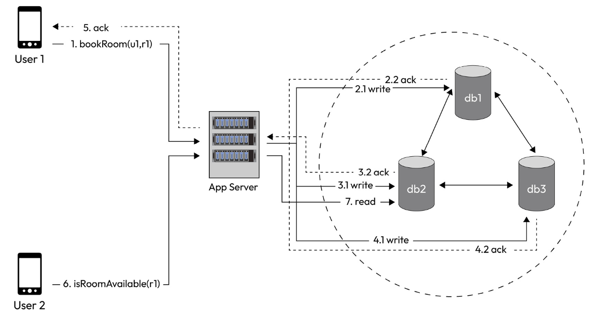

# 1.3 Terminology / Trade Offs

Let’s look at the write and the read flows:

**Write flow**:

User (u1) books a room (r1). The device/client makes an API call to book a room (u1,r1) to the app server. The server writes to one, a few, or all of the replicas.

**Read flow**:

User (u2) checks the availability of room (r1). The device/client makes an API call in RoomAvailable (r1) to the app server. The server reads from one, a few, or all of the replicas.

**Write options**:For write, we have the following options:

- **Serial sync writes**: The server writes to db1 and gets an ack, then writes to db2 and gets an ack, and then writes to db3 and gets an ack. Finally, it acks the client. In this case, the response latency back to the user (u1) would be very high.

- **Serial async writes**: The server writes to db1 and gets an ack. The server asks the client. Asynchronously, the server updates the other two replicas. Write latency is low.

- **Parallel async writes**: The server fires three updates simultaneously, but doesn’t wait for all the acks, gets one (or k) acks, and then returns an ack to the client. Latency is low, but thread resource usage is high.

- Write to a messaging service such as Kafka and return an ack to the client. A consumer then picks up the writes and follows any of the aforementioned options. Latency in this case is the lowest. It can support very high writes.

**Read options**:

For read, we have the following options:

- Read from only one replica

- Read from a quorum number of replicas

- Read from all replicas and then return to the client

Each of these read options comes with consistency trade-offs. For example, if we read from only one replica, the read may be stale in some situations, posing a correctness problem. On the other hand, reading from all replicas and comparing all the values to determine which one is the latest value addresses the correctness problem, but this would be slower. Reading from a quorum number of replicas may be a more balanced approach.
