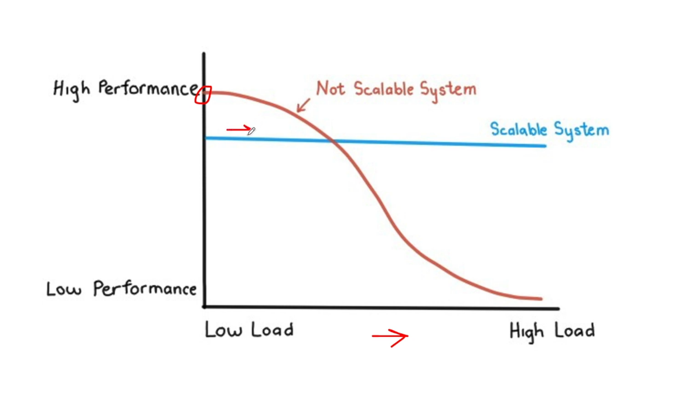

# 1.3.2 Scalability

SCALABILITY:

- Scalability refers to the ability of a system to handle large amounts of users, data, and traffic.

- A system is not scalable if the waiting time for consumers increases significantly as more consumers arrive at a faster rate.

- The goal is to have a highly scalable system where performance remains relatively constant, regardless of the number of users.

- Design for 1000 users vs design for 1M users

