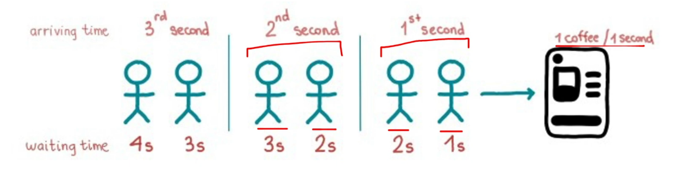

# 1.3.3 Performance

PERFORMANCE:

- Performance is defined as how quickly a system can serve an incoming request.

- Latency and Throughput are measures of performance.

- Performance Metrics:

    1. Latency (include p95, p99)

    1. Jitter

    1. Response Time

    1. Throughput

    1. Capacity

    1. Bandwidth

    1. Saturation

    1. Error Rate / Drop Rate

    1. MTTR

    1. MTBF, MTTA, MTTF

[Performance and Scaling in web architecture | High Level Design : 4 | Verical and Horizontal Scaling](<https://www.youtube.com/watch?v=8HZ4nNRvMZE>)

[HLD:Lecture 1: performance of a system | High Level Design | MAANGs](<https://www.youtube.com/watch?v=luTCwuEpGbA>)
