# 1.3.3.1 Latency

**LATENCY:**

- How much time it takes for data packet or signal to go from source system to destination system.

- This is the time it takes for your request to produce some result.

- **Machine Latency:** Time taken to read the data from machine/disc.

- **System Latency:** Time for Network Request from Client to Server and back.

- **Network Latency:** Time spent by the request on the network + waiting on the queues if any.

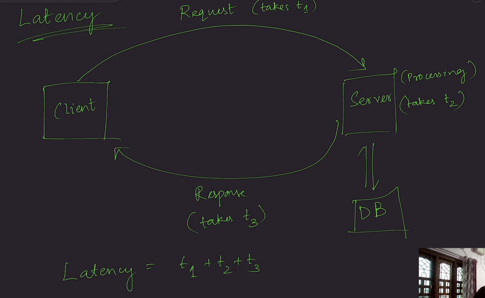

Latency = T1 (Client to Server travel time) + T2 (Server processing time) + T3 (Server to Client travel time)

In this formula:

    - T1 + T3 collectively represent network latency.

    - T2 represents system latency (server processing, including database and application logic).

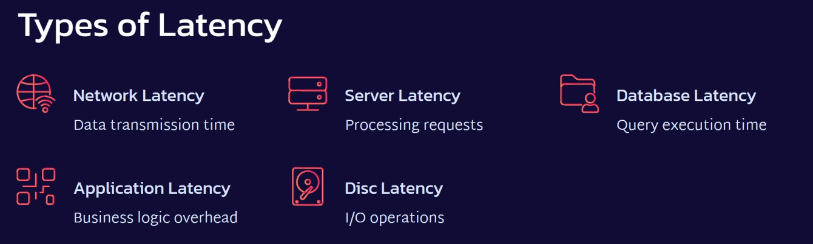

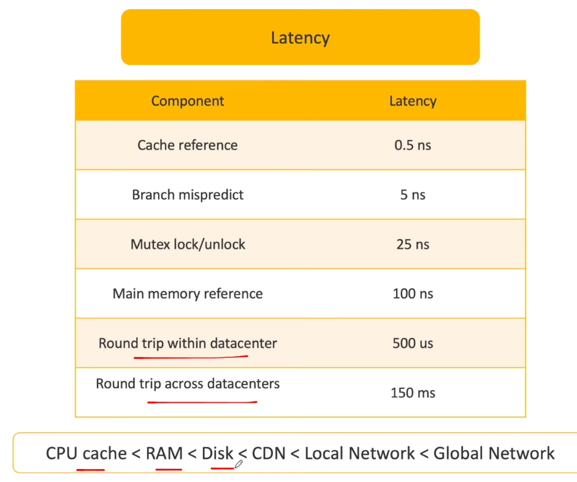

- Read 1MB of data from memory = 250 us

Read 1MB from SSD = 1000 us

Read 1MB from 1GBPS NETWORK = 10K us

Read 1MB from HDD = 20K us

**Reducing Latency:**

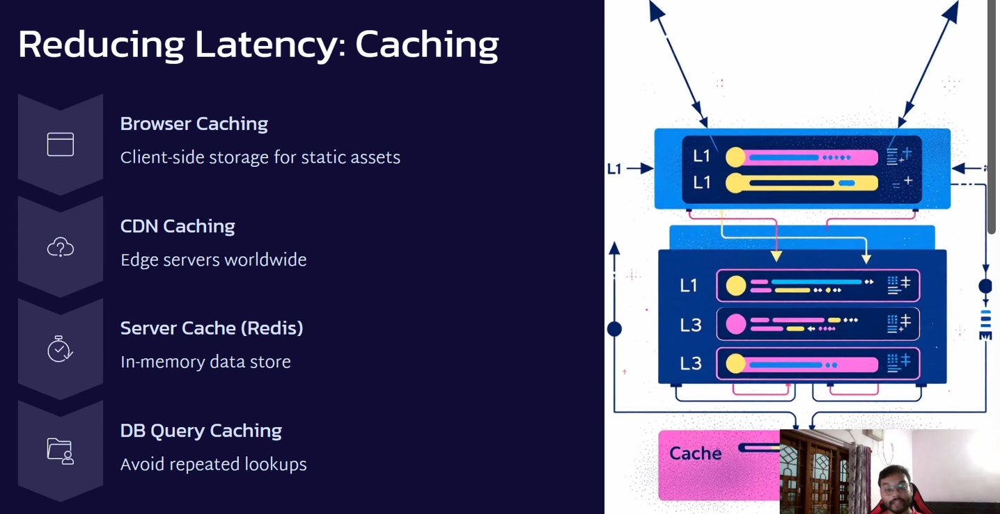

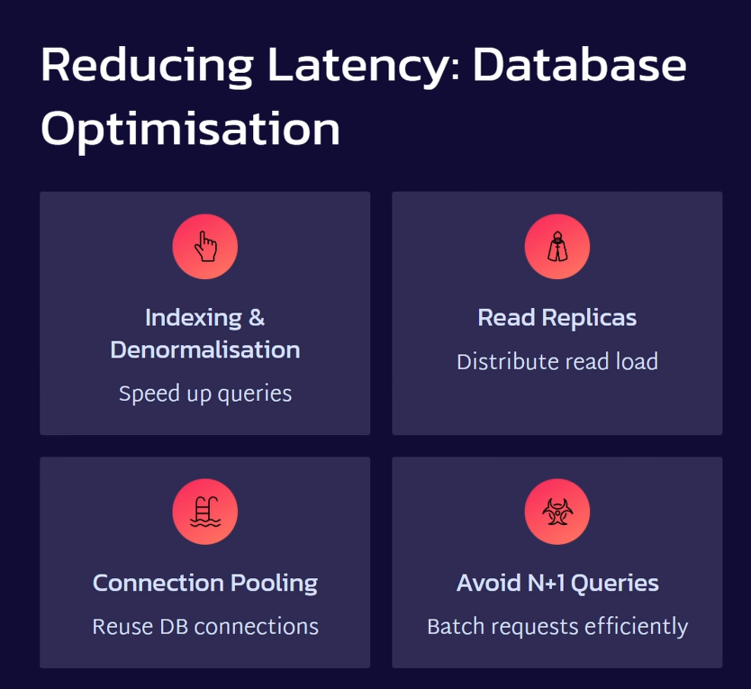

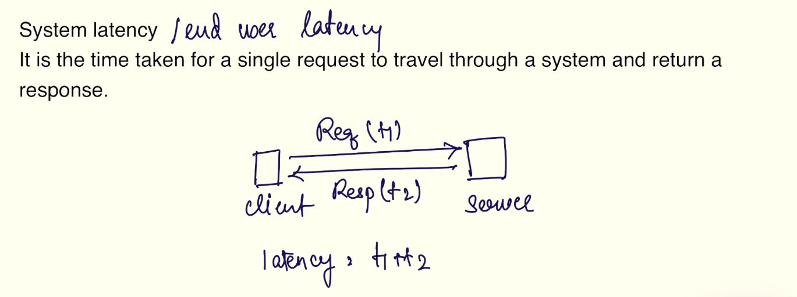

Latency Metrics

| ** Average Latency** | **Tail Latency** |
| --- | --- |
| - Cumulative Average:  cumulative average of all latencies over a given period. - Used in systems which are not time-critical - Log Aggregation, Batch Processing, Hadoop Servers 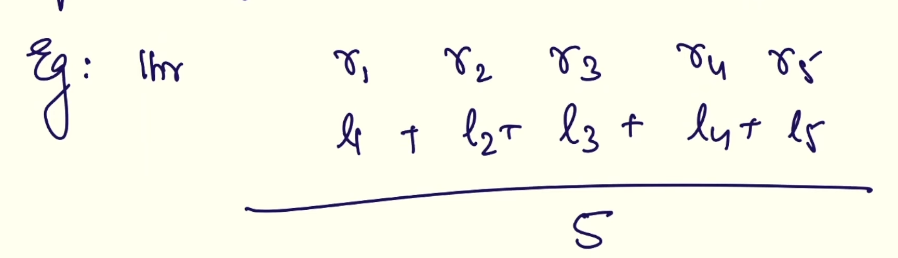 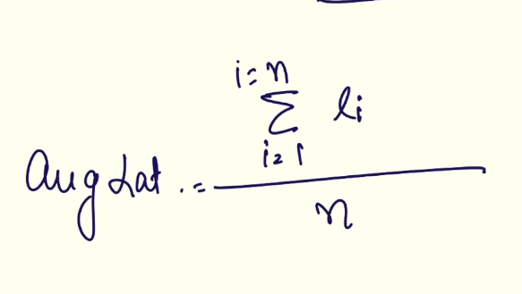 | - Tail latency refers to the l**ongest request-response times** in a system, highlighting the outliers. These are most observed by the user. Often expressed In percentiles. 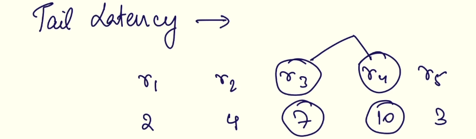 - Latency Percentile:   - p50, p90, p95   - p95 = 10ms means 95% of the requests would be completed within this tail latency barrier   - p50 = median latency - Time critical systems, financial systems, trading systems. **Tail Latency Amplification:** - This phenomenon occurs in distributed systems where a single request travels through multiple microservices. - **The**** probability of that request encountering a tail latency in one or more services increases ****as more microservices are involved in processing the request.** - Even if individual microservices have a low probability of high latency, the cumulative probability of a request hitting a tail latency across several services can significantly increase, leading to a worse overall user experience. **Single microservice:** 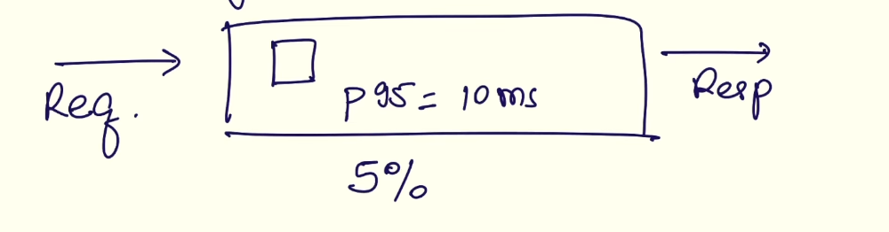 **Multiple Microservice: ** 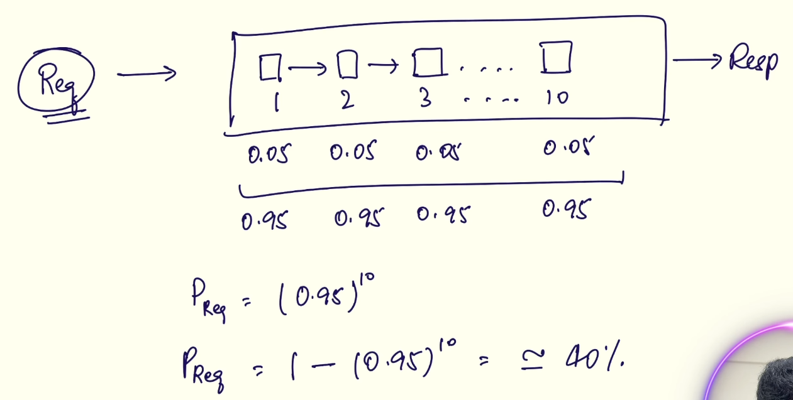 |

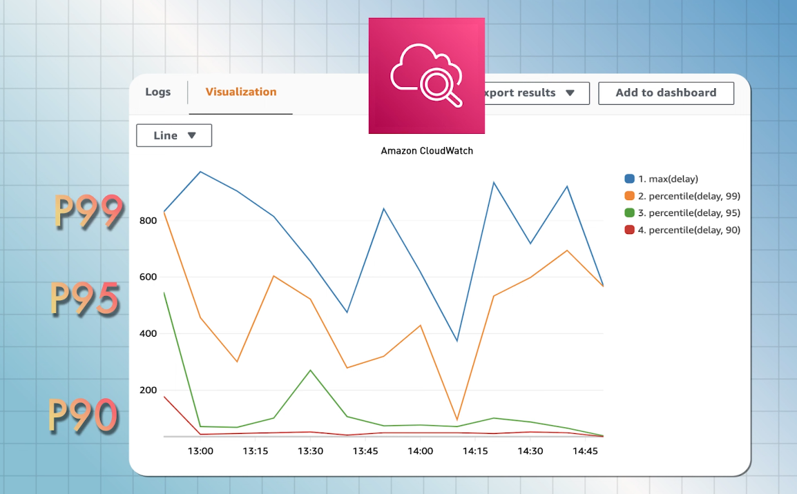
