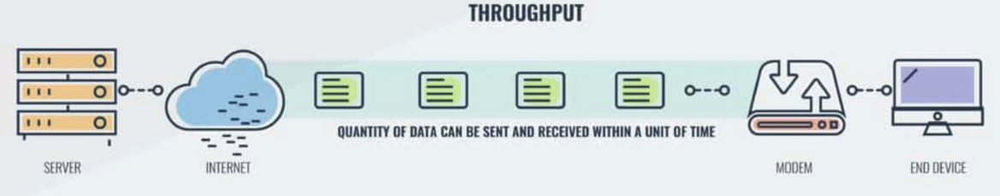
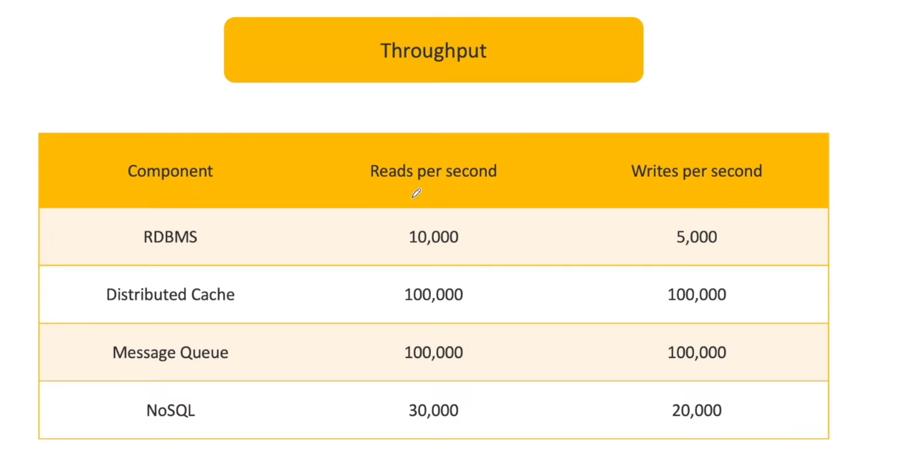

# 1.3.3.4 Throughput

**THROUGHPUT:**

- This is the number of units of work completed per unit of time.

- For web server, Number of requests a server can process per second (HTTP requests per second) (RPS)

- For database, number of queries processed per second (QPS)

- For network, it is amount fo data transmitted per second (mbps)

- For message queue, it is number of message consumed or produced per second (MPS)

- It is measure of how much work can a system perform in a given amount of time.

- For eg: ISP has 50Mbps throughput

- More throughput often means it will take more time for your request to produce individual results.

- In general in most systems we go for high throughput, with acceptable latency.

- Improving Throughput:

    - Vertical Scaling: Upgrading servers to process requests more quickly

    - Horizontal Scaling: Adding more servers to process requests simultaneously
