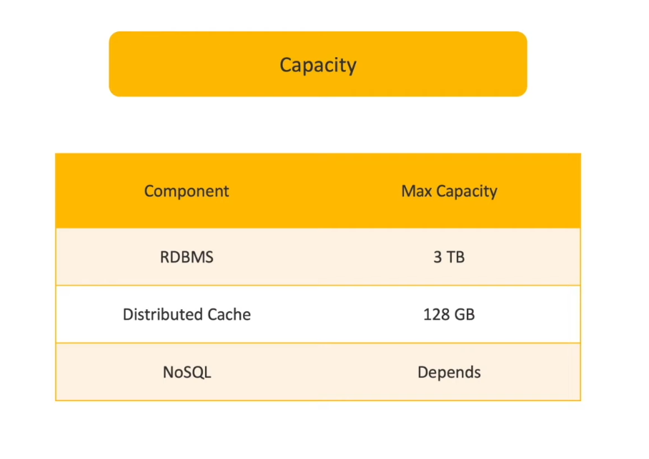
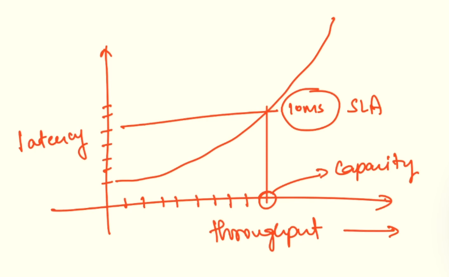
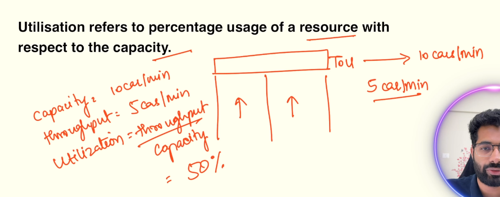
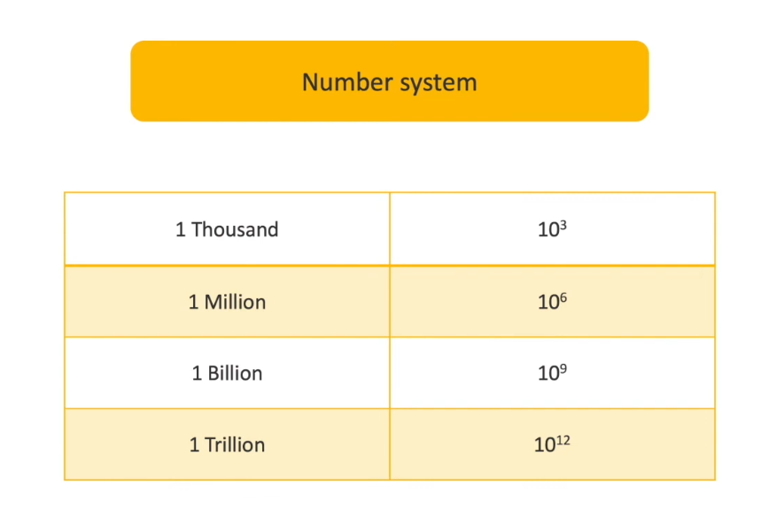
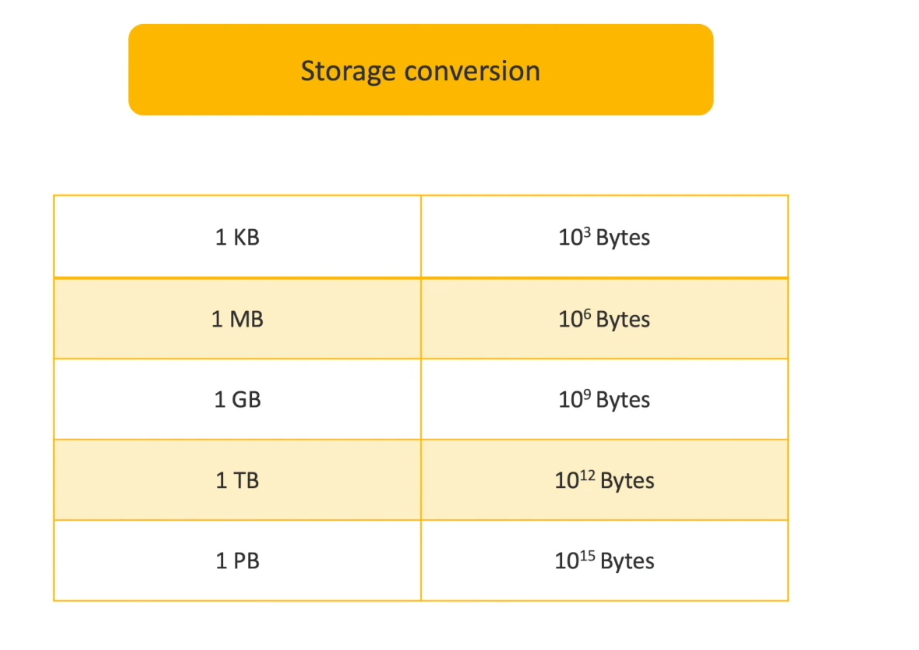
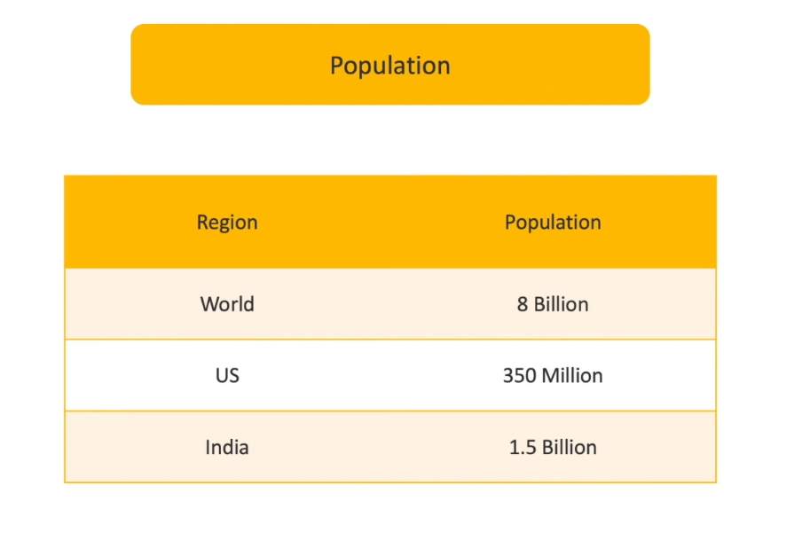
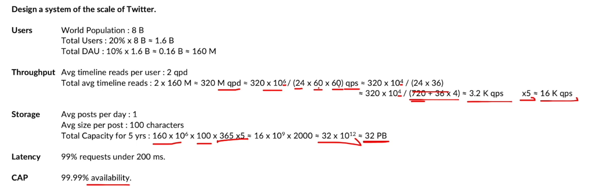

# 1.3.3.5 Capacity

CAPACITY:

- Maximum throughput a system can achieve under ideal conditions.

**BANDWIDTH:** Used in etworking. maximum data transfer rate (bits/sec). aka CAPACITY for a network

**UTILISATION**: Percentage usage of a resource with respect to capacity.

SATURATION: Degree of units of work pending to be performed beyond the full utilisation of the resource.

Saturation point refers to the point at which a system is fully utilised and cannot handle additional load without performance degradation.

**Measures to Prevent Capacity Breaches **

When a system's saturation level approaches its limit (e.g., 90%), several strategies can be employed:

1. Load Shedding:

    - This involves the server intelligently rejecting a portion of incoming requests when it's nearing its capacity.

    - For example, if a server can handle 100 requests per second but is at 90% saturation, it might deliberately reject 20-30 requests, sending a "429 Too Many Requests" HTTP status code back to the client.

    - The purpose is to prevent the server from reaching 100% saturation and crashing due to overload.

1. Autoscaling:

    - A common and effective method to handle increased load.

    - If a service's single instance (pod) reaches 90% saturation, autoscaling can automatically deploy more instances (e.g., scale out to two pods).

    - A load balancer is necessary to distribute incoming requests evenly among the scaled-out instances, ensuring each operates at a lower saturation level.

1. Backpressure:

    - This mechanism involves a downstream service (the server) informing an upstream service (like a gateway) that it is approaching its capacity limit.

    - The server communicates to the gateway that it has reached, for example, 90% saturation.

    - The gateway can then respond by slowing down the rate at which it sends requests to the server or temporarily stopping new requests based on configuration.

    - This reduces the number of requests reaching the saturated server, allowing its saturation level to decrease and prevent overload.

