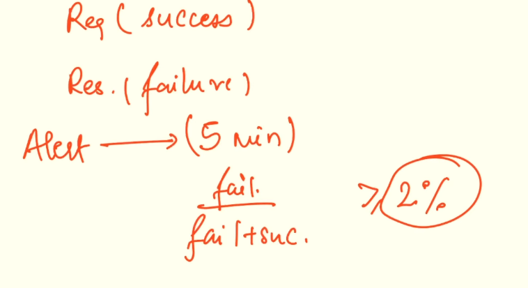

# 1.3.3.6 Error Rate / Drop Rate

**ERROR RATE:**

- Percentage of requests that failed in a system.

- Define your error:

    - Latency >= SLA

- Reasons for error:

    - Application Error

    - Data Error

    - System/Infra error

    - Environment/Operational errors

Monitoring of alerts - Observavility

| 1. metric.   1. Promethrus Servers   1. Data Dog  | 1. Logging Splunk etc. | 1. Traceability Which service is responsible for introducing error |
| --- | --- | --- |

**DROP RATE: **

- Percentage of data units or operations that are discarded by the system (intentional or unintentional)

- Network - Packet drop rate - packets lost due to congestion, buffer overflow or routing issues

- Database - timeout, queue is full etc.

**MTTR:**

**MTBF:**

**MTTA:**

**MTTF: **
