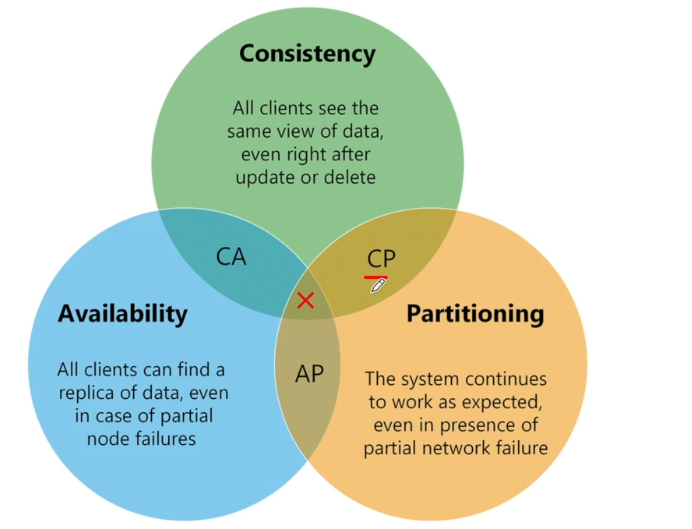
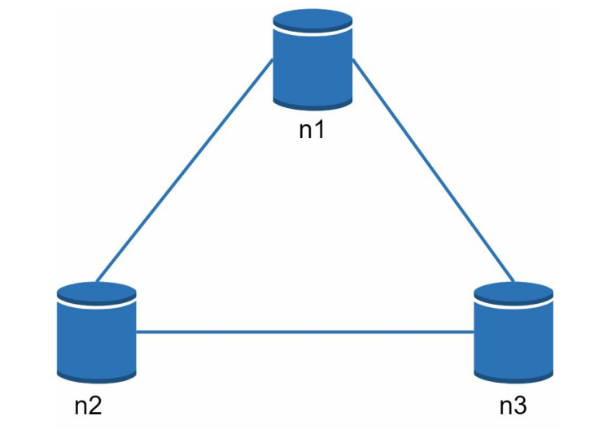
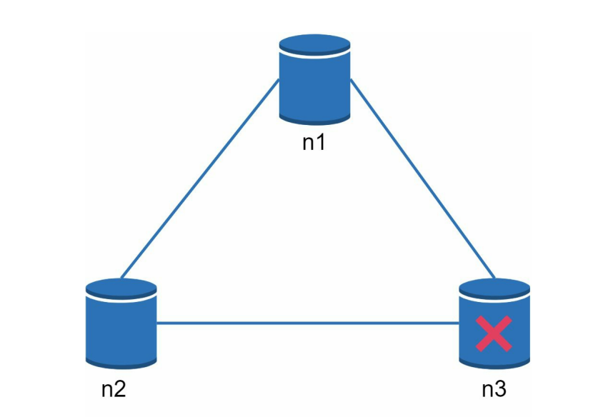

# 1.3.6 CAP Theorem

[System Design - Part 10 \| CAP Theorem and use cases \| Nikhil Lohia](<https://www.youtube.com/watch?v=G2RJEm9ZpQs&list=PLFdAYMIVJQHOWJgRrjv_RH-ng95B2h3ON&index=10&pp=iAQB>)

CAP theorem states it is impossible for a distributed system to simultaneously provide more than two of these three guarantees: consistency, availability, and partition tolerance:

- **Consistency**: Every data is strongly consistent with the first write, meaning all clients see the same data at the same time.

- **Availability**: The server is available at all times, correctly serving every request, prioritizing a response over strong consistency. Availability means any client which requests data gets a response even if some of the nodes are down.

- **Partition Tolerance**: a partition indicates a communication break between two nodes. Partition tolerance means the system continues to operate despite arbitrary failures of parts of the system, such as network outages.

Since networks are often unreliable and outages are common, **partition tolerance**** must be supported at all costs in distributed systems.** This necessitates a trade-off between consistency and availability. CA Model cannot exist in real world applications because network failure is unavoidable.

- **CP Model (Consistency and Partition Tolerance):**

    - Sacrificing availability

    - In this model, consistency is prioritized. Requests may time out if a server is unavailable, meaning availability is sacrificed.

    - This model is suitable for businesses that require atomic reads and writes, such as payment or banking applications.

- **AP Model (Availability and Partition Tolerance):**

    - Sacrificing Consistency

    - In this model, availability is prioritized. It's acceptable to return an older version of data if the system needs to continue working despite external failures.

    - This model is suitable for applications that can tolerate eventual consistency, like social media apps where seeing a friend's post a little later is not critical.

In distributed systems, data is usually replicated multiple times. Assume data are replicated on three replica nodes, n1, n2 and n3

| **Ideal Situation** In the ideal world, network partition never occurs. Data written to n1 is automatically replicated to n2 and n3. Both consistency and availability are achieved. |  |
| --- | --- |
| **Real World Systems** If n3 goes down, then data written to n1 and n2 can't be propagated to n3. |  |
