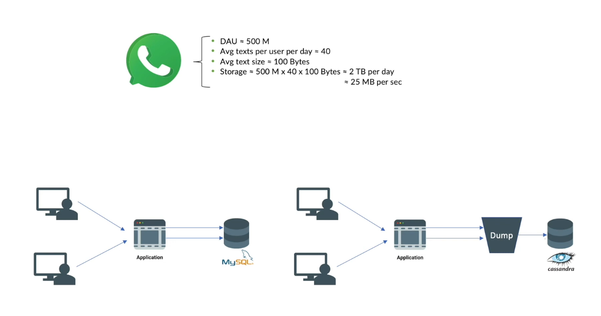

# 1.4.2 Capacity Estimation / Back of envelope

Back of the Envelope Calculation

Building a chat application like WhatsApp to illustrate the process:

- Assume 500 million daily active users, each sending 40 messages daily.

- Each message is about 100 bytes.

- This translates to storing 2 TB of data per day, or 25 MB/s of data consumed by the database.

Traditional databases like MySQL or MongoDB, which read and write a row for every message sent or received, would become very slow and overloaded under such a heavy load.

Instead, a database like Cassandra DB would be more suitable for scaling such an application, even for future growth over five years.

[How to solve capacity estimation problems faster? | Thumb rules and quick tips | System Design ](<https://www.youtube.com/watch?v=VBw703pjC3E&list=PLTCrU9sGyburBw9wNOHebv9SjlE4Elv5a&index=28&pp=iAQB>)

From < https://www.youtube.com/watch?v=VBw703pjC3E&list=PLTCrU9sGyburBw9wNOHebv9SjlE4Elv5a&index=28&pp=iAQB>

[Capacity Planning and Estimation: How much data does YouTube store daily? ](<https://www.youtube.com/watch?v=0myM0k1mjZw&list=PLMCXHnjXnTnvo6alSjVkgxV-VH6EPyvoX&index=13&pp=iAQB>)

[Capacity Estimation for System Design Interviews | DAU, MAU, Bandwidth, Cache Hits Explained](<https://www.youtube.com/watch?v=ckqPuJJ7qaY&list=PL0zBvCLNlDwFrYw-WgM7LCZW5JVNQoEdT&index=10&pp=iAQB0gcJCU0KAYcqIYzv>)

From < https://www.youtube.com/watch?v=0myM0k1mjZw&list=PLMCXHnjXnTnvo6alSjVkgxV-VH6EPyvoX&index=13&pp=iAQB>

[Capacity Estimation & Planning | System Design Interview | Back of Envelope Estimation](<https://www.youtube.com/watch?v=i6gQtBvasSQ>)

[E10: HLD : Engineering Estimations | The Back-of-the-Envelope Method](<https://www.youtube.com/watch?v=Jy9zywpnT2Q&list=PLoaQAd6R8JXyTpYZTOWT8JrVASNeyoBZu&index=2&pp=iAQB>)
