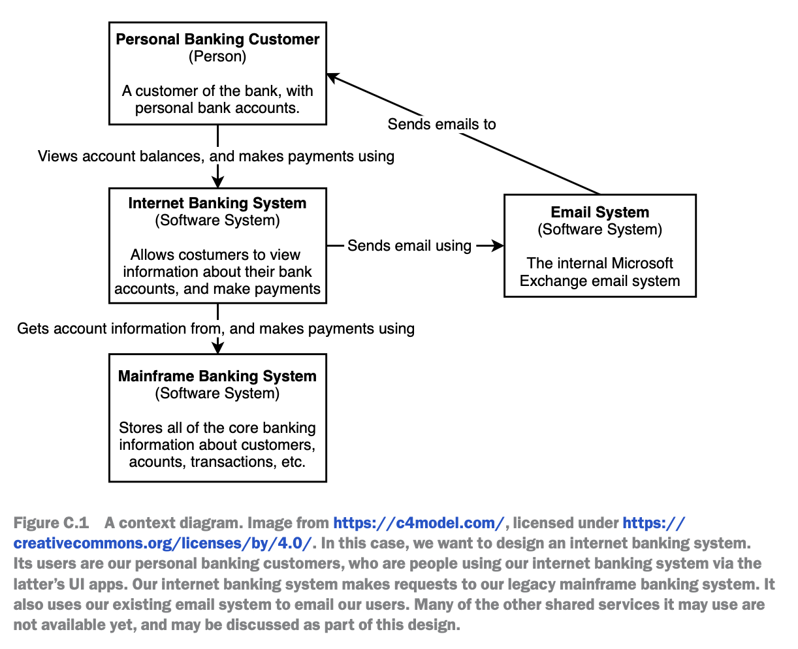
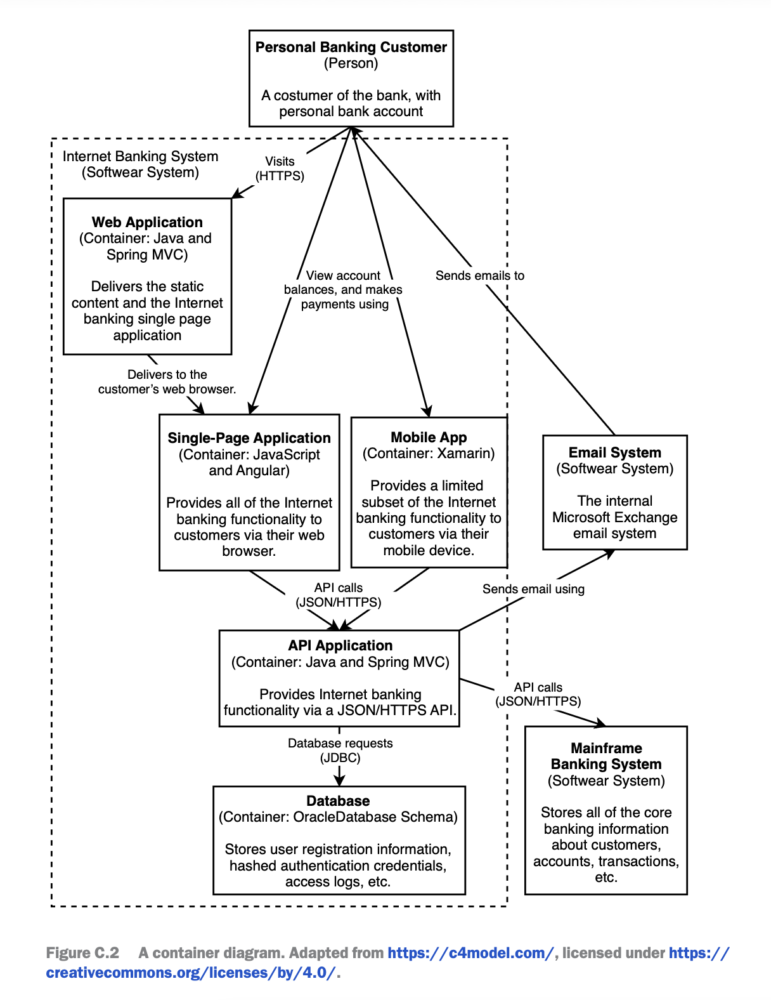
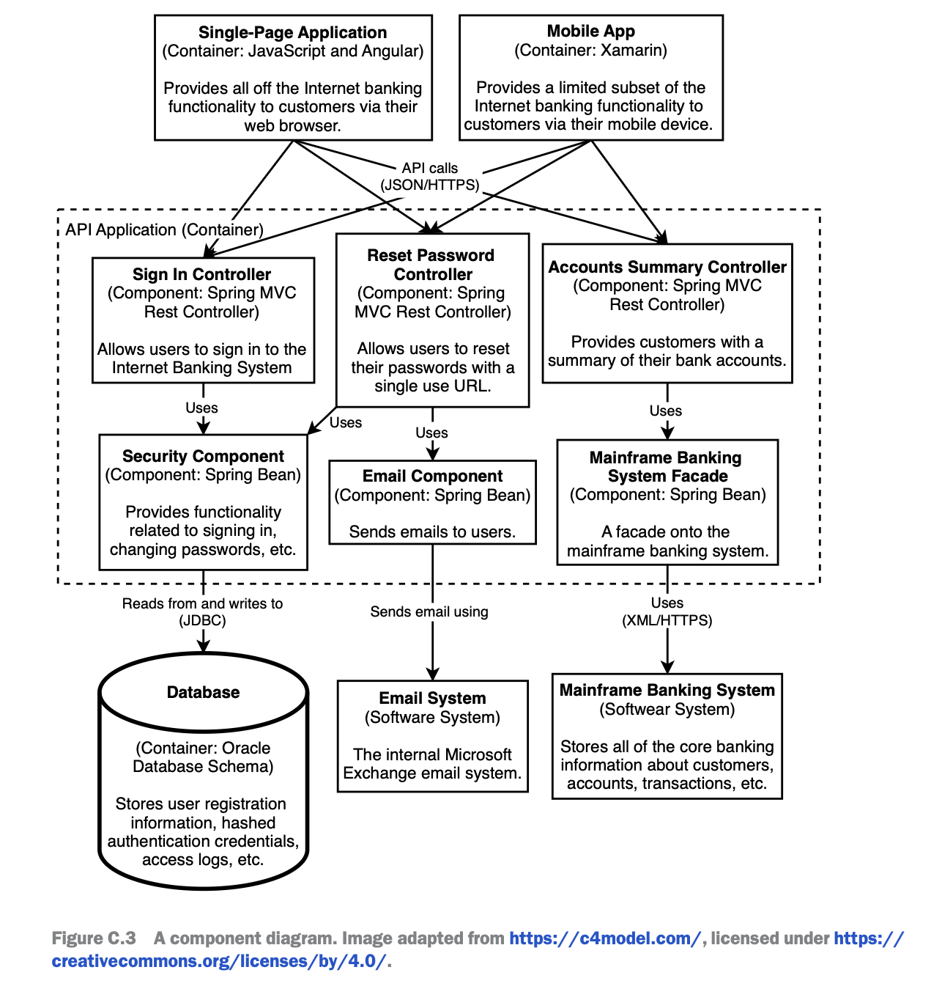
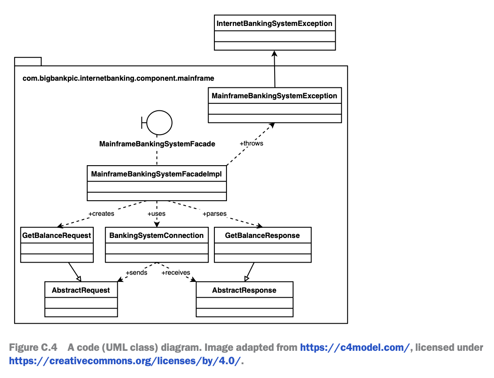

# 1.5.11 C4 Model/Architecture | LLD

[What is Low Level Design (LLD)? |  Let's learn using C4 architecture](<https://www.youtube.com/watch?v=Ia1B-vsg21w&list=PLpVAqPqryuRuiGSz7U7rbYvouCDoM5z_4&index=2&pp=iAQB>)

The C4 model (https://c4model.com/) is a system architecture diagram technique

created by Simon Brown to decompose a system into various levels of abstraction.

This section is a brief introduction to the C4 model. The website has good intro-

ductions and in-depth coverage of the C4 model, so we will only briefly go over the

C4 model here; readers should refer to the website for more details. The C4 model

defines four levels of abstraction.

A context diagram represents the system as a single box, surrounded by its users

and other systems that it interacts with. Figure C.1 is an example context diagram

of a new internet banking system that we wish to design on top of our existing main-

frame banking system. Its users will be our personal banking customers, who will use

our internet banking system via UI apps we develop for them. Our internet banking

system will also use our existing email system. In figure C.1, we draw our users and

systems as boxes and connect them with arrows to represent the requests between

them.

A container diagram is defined on c4model.com as “a separately runnable/deployable

unit that executes code or stores data.” We can also understand containers as the ser-

vices that make up our system. Figure C.2 is an example container diagram. We break

up our internet banking system that we represented as a single box in figure C.1.

A web/browser user can download our single-page (browser) app from our web

application service and then make further requests through this single-page app. A

mobile user can download our mobile app from an app store and make all requests

through this app.

Our browser and mobile apps make requests to our (backend) API application/ser-

vice. Our backend service makes requests to its Oracle SQL database, mainframe bank-

ing system, and our email system.

A component diagram is a collection of classes behind an interface to implement a

functionality. Components are not separately deployable units. Figure 6.3 is an example

component diagram of our (backend) API application/service from figure 6.2, illus-

trating its interfaces and classes, and their requests with other services.

Our browser and mobile apps make requests to our backend, which are routed to the

appropriate interfaces:

Our sign-in controller receives sign in requests. Our reset password controller receives

password reset requests. Our security component has functions to process these secu-

rity-related functionalities from the sign-in controller and reset password controller. It

persists data to an Oracle SQL database.

Our email component is a client that makes requests to our email system. Our reset

password controller uses our email component to send password reset emails to our

users.

Our account summary controller provides users with their bank account balance

summaries. To obtain this information, it calls functions in our mainframe banking sys-

tem façade, which in turn makes requests to our mainframe banking system. There may

also be other components in our backend service, not illustrated in figure C.3, which

use our mainframe banking system façade to make requests to our mainframe banking

system.

A code diagram is a UML class diagram. (Refer to other sources such as https://www.uml

.org/ if you are unfamiliar with UML.) You may use object-oriented programming

(OOP) design patterns in designing an interface.

Figure C.4 is an example code diagram of our mainframe banking system façade

from figure C.3. Employing the façade pattern, our MainframeBankingSystem

Facade interface is implemented in our MainframeBankingSystemFacadeImpl class.

We employ the factory pattern, where a MainframeBankingSystemFacadeImpl object

creates a GetBalanceRequest object. We may use the template method pattern to define

an AbstractRequest interface and GetBalanceRequest class, define an Internet

BankingSystemException interface and a MainframeBankingSystemException

class, and define an AbstractResponse interface and GetBalanceResponse class. A

MainframeBankingSystemFacadeImpl object may use a BankingSystemConnection

connection pool to connect and make requests to our mainframe banking system and

throw a MainframeBankingSystemException object when it encounters an error. (We

didn’t illustrate dependency injection in figure C.4.)

Diagrams drawn during an interview or in a system’s documentation tend not to con-

tain only components of a specific level, but rather usually mix components of levels

1–3.

The value of the C4 model is not about following this framework to the letter, but

rather about recognizing its levels of abstraction and fluently zooming in and out of a

system design.
