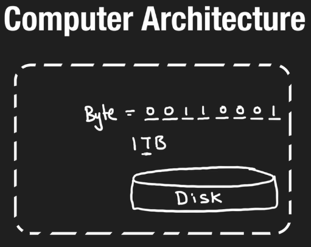
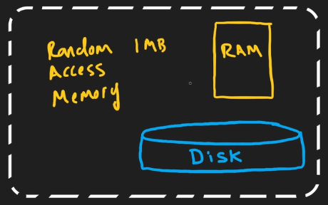
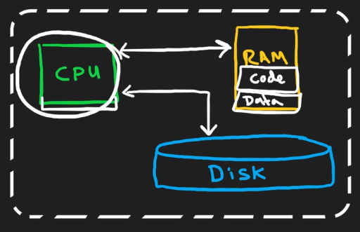
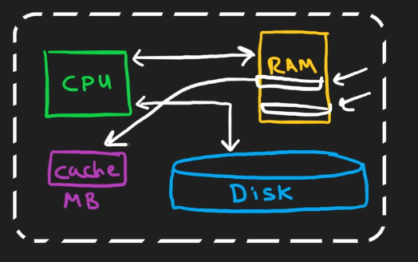
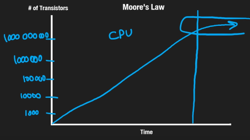

# 1.5.2 Computer Architecture

Components of computer architecture:

1. Storage/Disk:

1. aka HDD/SSD, persistent storage (restart, crash)

2. Typically ~500GB or more.

3. Slow. Reads are $10^{-3}$ seconds.

2. Random Access Memory (RAM):

1. Cheaper in terms of time, but expensive in money.

2. Typically ~8-10GB.

3. 1 operation (read/write) is $10^{-9}$ s

4. Data in RAM and Cache is \*\*not persistent.\*\*

3. Central Processing Unit (CPU):

1.   Reads and write to RAM and disk.

2.  Also capable of executing codes and manipulating data from RAM.

4. Cache: (belongs to CPU)

1. Speeds up read and write operations from RAM.

2. Typically in MBs.

3. Put frequently required data/operation in cache for faster execution of reads and writes.

4. Before reading from RAM, check if data is in cache. This might save us expensive operation.

5. Data in RAM and Cache is \*\*not persistent.\*\*

Distributed systems combine several building blocks (computers) with architecture like above, because individual computers have a lot of hardware limitations. We can't infinitely scale a CPU.

[Process vs Thread | Simply Explained](<https://www.youtube.com/watch?v=1myWEH8IGt4>)

[Volatile vs Non-Volatile Memory | Simply Explained](<https://www.youtube.com/watch?v=1DgJmnJ8D2Y>)

[CPU vs GPU | Simply Explained](<https://www.youtube.com/watch?v=Axd50ew4pco>)

[Deadlock - Operating Systems | Simply Explained](<https://www.youtube.com/watch?v=y7DOHyBTWps>)

[Concurrency vs Parallelism | Simply Explained](<https://www.youtube.com/watch?v=U48g5izggiE>)

[Virtual Machines vs Containers - Simply Explained](<https://www.youtube.com/watch?v=Bo-5DkXzBLc>)

[Compile Time vs Run Time | Simply Explained](<https://www.youtube.com/watch?v=-EhLq8-GlX8&pp=0gcJCX4JAYcqIYzv>)

[Interpreter vs Compiler vs JIT Compiler | Simply Explained](<https://www.youtube.com/watch?v=mQ-vQ2BlKrw&pp=0gcJCX4JAYcqIYzv>)
