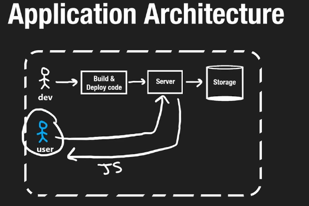
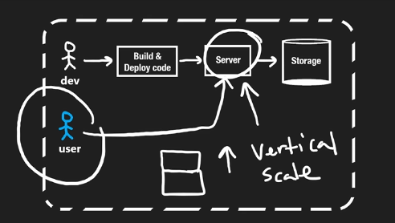
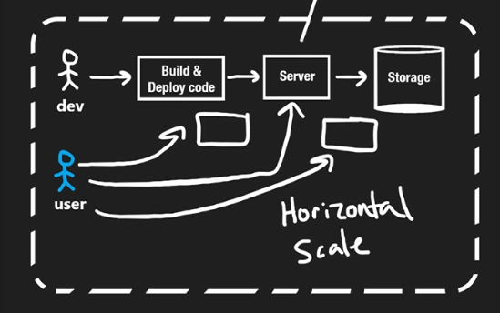
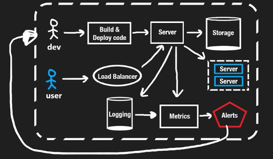

# 1.5.3 Application Architecture

[Anatomy of applications and services \| System Design Tutorials \| Part 7 \| 2020 ](<https://www.youtube.com/watch?v=iuR7rzNvbxs&list=PLTCrU9sGyburBw9wNOHebv9SjlE4Elv5a&index=7&pp=iAQB>)

From < https://www.youtube.com/watch?v=iuR7rzNvbxs&list=PLTCrU9sGyburBw9wNOHebv9SjlE4Elv5a&index=7&pp=iAQB>

[Web App Architecture \| DNS \| CDN \| Loadbalancer \| Gateway \| Cloudfront \| Redis \| TCP/TLS Handshake](<https://www.youtube.com/watch?v=brMPFHzVAbs>)

High level application architecture for a production app:

\* If we upgrade the CPU, RAM of a single resource (server) then this is called Vertical Scaling.

\*  If multiple servers run the same code, that is if we have multiple resources then also we might be able to serve more number of users.

### OTHER COMPONENTS:

### Load Balancers:

Load Balancer: Balances the amount of request each server is getting.

### Logging:

This is used by developers, logging about the server's availability and functions.

### Metrics:

Metrics services shows the amount of resources that are busy in the server.   These are application metrics or resource metrics. Logs can also be used to generate metrics. Metrics are usually displayed as time series charts.

### Alerts:

Alters services pushes notification to us if a certain metric crosses the threshold. Say is the OK response rate %age drops below 95% then the developer should get an alert.
