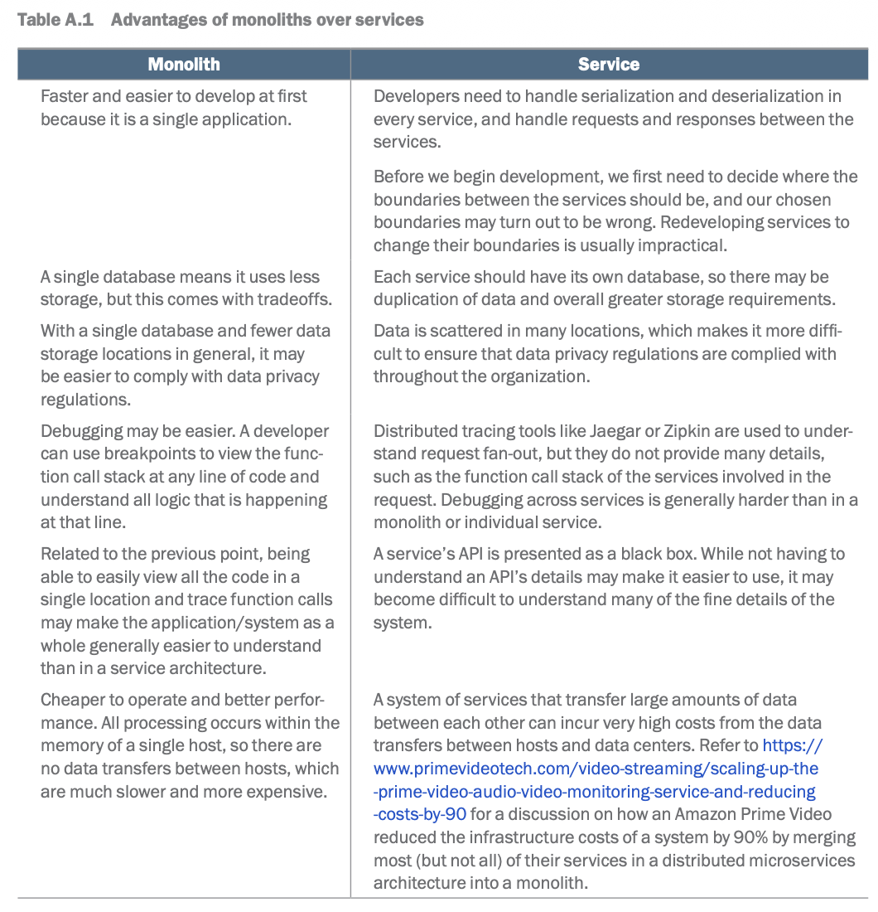
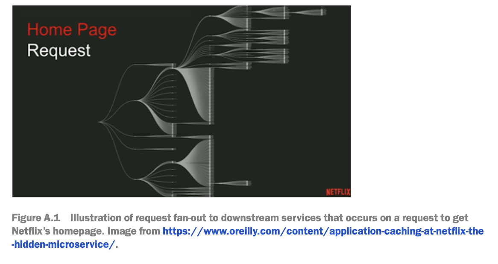

# 1.5.5 Monolithic vs Microservice

[Monolithic Architecture In Hindi  ( Complete Explanation )](<https://www.youtube.com/watch?v=z4AUhxIWKSM&list=PLA3GkZPtsafZdyC5iucNM_uhqGJ5yFNUM&index=2&pp=iAQB>)

[How to migrate Monolithic code to Micro services for scaling \| High Level Design : Lecture-7](<https://www.youtube.com/watch?v=ysoyCyo_60o>)

[System Design - Monolithic vs MicroServices Architecture](<https://www.youtube.com/watch?v=srXdCa89H04&list=PLt4nG7RVVk1g_LutiJ8_LvE914rIE5z4u&index=8&pp=iAQB>)

[Difference between monolithic and microservices architecture in Hindi](<https://www.youtube.com/watch?v=MPxr1q8ORuA&list=PLA3GkZPtsafZdyC5iucNM_uhqGJ5yFNUM&index=3&pp=iAQB>)

[Monolith Vs. Microservices + Docker + Kubernetes \| Systems Design Interview with Ex-Google SWE](<https://www.youtube.com/watch?v=kDHb99gTByU&list=PLjTveVh7FakLdTmm42TMxbN8PvVn5g4KJ&index=60&pp=iAQB>)

[Google SWE teaches systems design \| EP37: Monoliths vs. Microservices](<https://www.youtube.com/watch?v=YSA9BcrAehA&list=PLjTveVh7FakKjb4UYzUazqBNNF-WGurXp&index=37&pp=iAQB>)

[What is a MICROSERVICE ARCHITECTURE and what are its advantages? ](<https://www.youtube.com/watch?v=qYhRvH9tJKw&list=PLMCXHnjXnTnvo6alSjVkgxV-VH6EPyvoX&index=6&pp=iAQB>)

From < https://www.youtube.com/watch?v=qYhRvH9tJKw&list=PLMCXHnjXnTnvo6alSjVkgxV-VH6EPyvoX&index=6&pp=iAQB>

[Monoliths vs Microservices \| Explained in 5 Minutes](<https://www.youtube.com/watch?v=3fwRmW8pgWU>)

[Stateless vs Stateful services \| High Level Design Interview \| Scaling of stateless services](<https://www.youtube.com/watch?v=0qfNfsfz-ag>)

- 1 Zhiyong Tan - Appendix A

[how to transition monolithic to microservices \| High Level Design : Lecture 6](<https://www.youtube.com/watch?v=HoNS4_-o2uE>)

[How to migrate Monolithic code to Micro services for scaling \| High Level Design : Lecture-7](<https://www.youtube.com/watch?v=ysoyCyo_60o>)

We use the terms “service” and “microservice” interchangeably.

Microservice architecture is about building a software system as a collection of loose-

ly-coupled and independently developed, deployed, and scaled services. Monoliths

are designed, developed, and deployed as a single unit.

Advantages of monoliths

Disadvantages of monoliths

Monoliths have the following disadvantages compared to microservices:

¡ Most capabilities cannot have their own lifecycles, so it is hard to practice Agile

methodologies.

¡ Need to redeploy the entire application to apply any changes.

¡ Large bundle size. High resource requirements. Long startup time.

¡ Must be scaled as a single application.

¡ A bug or instability in any part of a monolith can cause failures in production

¡ Must be developed with a single language, so it cannot take advantage of the

capabilities offered by other languages and their frameworks in addressing

requirements of various use cases.

Advantages of services

The advantages of services over monoliths include the following:

1 Agile and rapid development and scaling of product requirements/business

functionalities.

2 Modularity and replaceability.

3 Failure isolation and fault-tolerance.

4 More well-defined ownership and organizational structure.

A.3.1 Agile and rapid development and scaling of product requirements and business

functionalities

Designing, implementing, and deploying software to satisfy product requirements is

slower with a monolith than a service because the monolith has a much bigger code-

base and more tightly coupled dependencies.

When we develop a service, we can focus on a small set of related functionalities and

the service’s interface to its users. Services communicate via network calls through the

service interfaces. In other words, services communicate via their defined APIs over

industry-standard protocols such as HTTP, gRPC, and GraphQL. Services have obvious

boundaries in the form of their APIs, while monoliths do not. In a monolith, it is far

more common for any particular piece of code to have numerous dependencies scat-

tered throughout the codebase, and we may have to consider the entire system when

developing in a monolith.

With cloud-based container native-infrastructure, a service can be developed and

deployed much quicker than comparable features in a monolith. A service that pro-

vides a well-defined and related set of capabilities may be CPU-intensive or memory-in-

tensive, and we can select the optimal hardware for it, cost-efficiently scaling it up or

down as required. A monolith that provides many capabilities cannot be scaled in a

manner to optimize for any individual capability.

Changes to individual services are deployed independently of other services. Com-

pared to a monolith, a service has a smaller bundle size, lower resource requirements,

and faster startup time.

Modularity and replaceability

The independent nature of services makes them modular and easier to replace. We

can implement another service with the same interface and swap out the existing ser-

vice with the new one. In a monolith, other developers may be changing code and

interfaces at the sam

We can choose technologies that best suit the service’s requirements (e.g., a specific

programming language for a frontend, backend, mobile, or analytics service).

Failure isolation and fault-tolerance

Unlike a monolith, a microservices architecture does not have a single point of fail-

ure. Each service can be separately monitored, so any failure can be immediately

narrowed down to a specific service. In a monolith, a single runtime error may crash

the host, affecting all other functionalities. A service that adopts good practices for

fault-tolerance can adapt to high latency and unavailability of the other services that

it is dependent on. Such best practices are discussed in section 3.3, including caching

other services’ responses or exponential backoff and retry. The service may also return

a sensible error response instead of crashing.

Certain services are more important than others. For example, they may have a more

direct effect on revenue or are more visible to users. Having separate services allows us

to categorize them by importance and allocate development and operations resources

accordingly.

Ownership and organizational structure

With their well-defined boundaries, mapping the ownership of services to teams is

straightforward compared to monoliths. This allows concentration of expertise and

domain knowledge; that is, a team that owns a particular service can develop a strong

understanding of it and expertise in developing it. The flip side is that developers are

less likely to understand other services and possess less understanding and ownership

of the overall system, while a monolith may force developers to understand more of

the system beyond the specific components that they are responsible to develop and

maintain. For example, if a developer requires some changes in another service, they

may request the relevant team to implement those changes rather than doing so them-

selves, so development time and communication overhead are higher. Having those

changes done by developers familiar with the service may take less time and have a

lower risk of bugs or technical debt.

The nature of services with their well-defined boundaries also allows various service

architectural styles to provide API definition techniques, including OpenAPI for REST,

protocol buffers for gRPC, and Schema Definition Language (SDL) for GraphQL.

A.4 Disadvantages of services

The disadvantages of services compared to monoliths include duplicate components

and the development and maintenance costs of additional components.

Duplicate components

Each service must implement inter-service communication and security, which is

mostly duplicate effort across services. A system is as strong as its weakest point, and the

large number of services exposes a large surface area that must be secured, compared

to a monolith.

Developers in different teams who are developing duplicate components may also

duplicate mistakes and the efforts needed to discover and fix these mistakes, which is

development and maintenance waste. This duplication of effort and waste of time also

extends to users and operations staff of the duplicate services who run into the bugs

caused by these mistakes, and expend duplicate effort into troubleshooting and com-

municating with developers.

Services should not share databases, or they will no longer be independent. For

example, a change to a database schema to suit one service will break other services.

Not sharing databases may cause duplicate data and lead to an overall higher amount

and cost of storage in the system. This may also make it more complex and costly to

comply with data privacy regulations.

Development and maintenance costs of additional components

To navigate and understand the large variety of services in our organization, we will

need a service registry and possibly additional services for service discovery.

A monolithic application has a single deployment lifecycle. A microservice appli-

cation has numerous deployments to manage, so CI/CD is a necessity. This includes

infrastructure like containers (Docker), container registry, container orchestration

(Kubernetes, Docker Swarm, Mesos), CI tools such as Jenkins, and CD tools, which may

support deployment patterns like blue/green deployment, canary, and A/B testing.

When a service receives a request, it may make requests to downstream services in

the process of handling this request, which in turn may make requests to further down-

stream services. This is illustrated in figure A.1. A single request to Netflix’s homepage

causes a request to fan out to numerous downstream services. Each such request adds

networking latency. A service’s endpoint may have a one-second P99 SLA, but if multi-

ple endpoints are dependencies of each other (e.g., service A calls service B, which calls

service C, and so on), the original requester may experience high latency.

Caching is one way to mitigate this, but it introduces complexity, such as having to con-

sider cache expiry and cache refresh policies to avoid stale data, and the overhead of

developing and maintaining a distributed cache service.

A service may need the additional complexity and development and maintenance

costs of implementing exponential backoff and retry (discussed in section 3.3.4) to

handle outages of other services that it makes requests to.

Another complex additional component required by microservices architec-

ture is distributed tracing, which is used for monitoring and troubleshooting micro-

services-based distributed systems. Jaeger and Zipkin are popular distributed tracing

solutions.

Installing/updating a library on a monolith involves updating a single instance of

that library on the monolith. With services, installing/updating a library that is used

in multiple services will involve installing/updating it across all these services. If an

update has breaking changes, each service’s developers manually update their libraries

and update broken code or configurations caused by backward incompatibility. Next,

they must deploy these updates using their CI/CD (continuous integration/continu-

ous deployment) tools, possibly to several environments one at a time before finally

deploying to the production environment. They must monitor these deployments.

Along the way in development and deployment, they must troubleshoot any unfore-

seen problems. This may come down to copying and pasting error messages to search

for solutions on Google or the company’s internal chat application like Slack or Micro-

soft Teams. If a deployment fails, the developer must troubleshoot and then retry the

deployment and wait for it again to succeed or fail. Developers must handle complex

scenarios (e.g., persistent failures on a particular host) All of this is considerable devel-

oper overhead. Moreover, this duplication of logic and libraries may also add up to a

non-trivial amount of additional storage.

Distributed transactions

Services have separate databases, so we may need distributed transactions for consis-

tency across these databases, unlike a monolith with a single relational database that

can make transactions against that database. Having to implement distributed transac-

tions is yet another source of cost, complexity, latency, and possible errors and failures.

Chapter 5 discussed distributed transactions.

A.4.4 Referential integrity

Referential integrity refers to the accuracy and consistency of data within a relationship.

If a value of one attribute in a relation references a value of another attribute and then

the referenced value must exist.

Referential integrity in a monolith’s single database can be easily implemented using

foreign keys. Values in a foreign key column must either be present in the primary

key that is referenced by the foreign key, or they must be null (https://www.interfacett

.com/blogs/referential-integrity-options-cascade-set-null-and-set-default). Referential

integrity is more complicated if the databases are distributed across services. For

referential integrity in a distributed system, a write request that involves multiple ser-

vices must succeed in every service or fail/abort/rollback in every service. The write

process must include steps such as retries or rollbacks/compensating transactions.

Refer to chapter 5 for more discussion of distributed transactions. We may also need a

periodic audit across the services to verify referential integrity.

Coordinating feature development and deployments that span multiple services

If a new feature spans multiple services, development and deployment need to be

coordinated between them. For example, one API service may be dependent on oth-

ers. In another example, the developer team of a Rust Rocket (https://rocket.rs/)

RESTful API service may need to develop new API endpoints to be used by a React UI

service, which is developed by a separate team of UI developers. Let’s discuss the latter

example.

In theory, feature development can proceed in parallel on both services. The API

team need only provide the specification of the new API endpoints. The UI team can

develop the new React components and associated node.js or Express server code. Since

the API team has not yet provided a test environment that returns actual data, the server

code or mock or stub responses from the new API endpoints and use them for develop-

ment. This approach is also useful for authoring unit tests in the UI code, including spy

tests (refer to https://jestjs.io/docs/mock-function-api for more information).

Teams can also use feature flags to selectively expose incomplete features to develop-

ment and staging environments, while hiding them from the production environment.

This allows other developers and stakeholders who rely on these new features to view

and discuss the work in progress.

In practice, the situation can be much more complicated. It can be difficult to under-

stand the intricacies of a new set of API endpoints, even by developers and UX design-

ers with considerable experience in working with that API. Subtle problems can be

discovered by both the API developers and UI developers during the development of

their respective services, the API may need to change, and both teams must discuss a

solution and possibly waste some work that was already done:

¡ The data model may be unsuitable for the UX. For example, if we develop a

version control feature for templates of a notifications system (refer to section

9.5), the UX designer may design the version control UX to consider individual

templates. However, a template may actually consist of subcomponents that are

versioned separately. This confusion may not be discovered until both UI and

API development are in progress.

¡ During development, the API team may discover that the new API endpoints

require inefficient database queries, such as overly large SELECT queries or

JOIN operations between large tables.

¡ For REST or RPC APIs (i.e., not GraphQL), users may need to make multiple

API requests and then do complex post-processing operations on the responses

before the data can be returned to the requester or displayed on the UI. Or the

provided API may fetch much more data than required by the UI, which causes

unnecessary latency. For APIs that are developed internally, the UI team may

wish to request some API redesign and rework for less complex and more effi-

cient API requests.

A.4.6 Interfaces

Services can be written in different languages and communicate with each other via a

text or binary protocol. In the case of text protocols like JSON or XML, these strings

need to be translated to and from objects. There is additional code required for vali-

dation and error and exception handling for missing fields. To allow graceful degrada-

tion, our service may need to process objects with missing fields. To handle the case of

our dependent services returning such data, we may need to implement backup steps

such as caching data from dependent services and returning this old data, or perhaps

also return data with missing fields ourselves. This may cause implementation to differ

from documentation.

A.5 References

This appendix uses material from the book Microservices for the Enterprise: Designing,

Developing, and Deploying by Kasun Indrasiri and Prabath Siriwardena (2018, Apress).
