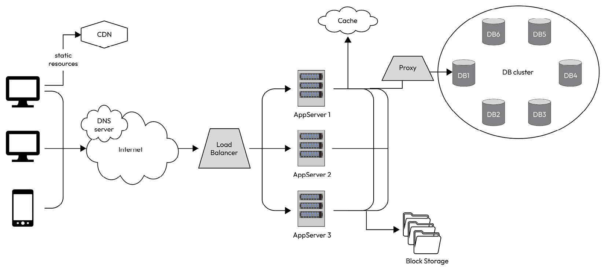

# 1.5.6 Distributed vs Single Node

A distributed software system consists of multiple independent components, processes, or nodes that communicate and coordinate with each other to achieve a common goal. Unlike a centralized software system, where all the components are located on a single machine, a distributed software system is spread across multiple machines, networks, and geographical locations (see *Figure 1.1*).

Each component in a distributed software system is responsible for a specific task or set of tasks, and they work together to achieve a common goal. The components communicate with each other using a variety of communication protocols, such as **remote procedure calls** (**RPCs**), message passing, or publish-subscribe mechanisms.

Distributed software systems are often used in large-scale applications where scalability, availability, and fault tolerance are critical requirements. Examples of distributed software systems include cloud computing platforms, peer-to-peer networks, distributed databases, and **content delivery networks** (**CDNs**).
