# 1.6 Deployment

Production Deployment

Dev Environment

Staging Environment

Production Environment

| - Ship all the code together - Has little bit of downtime If things don't go as planned: 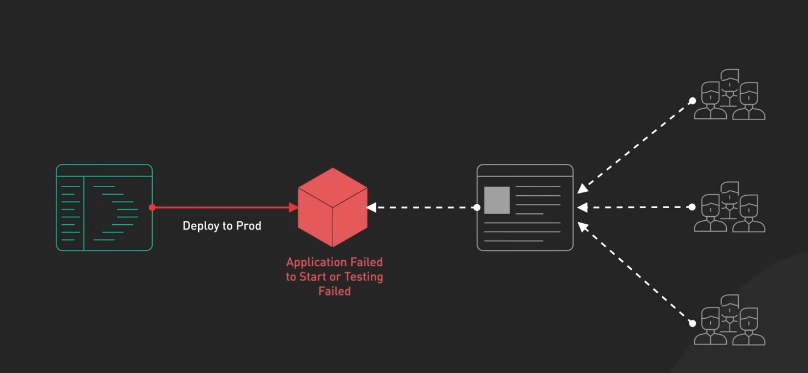 Then rollback should be done. 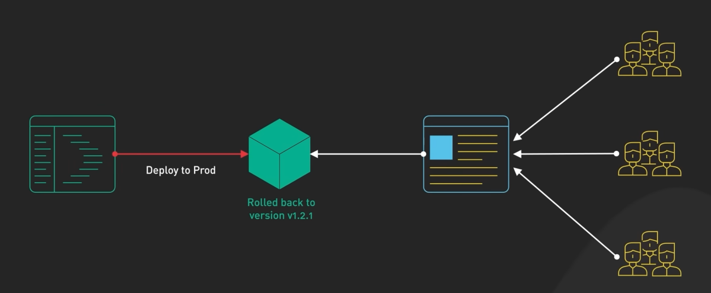 Eg: Database updates | 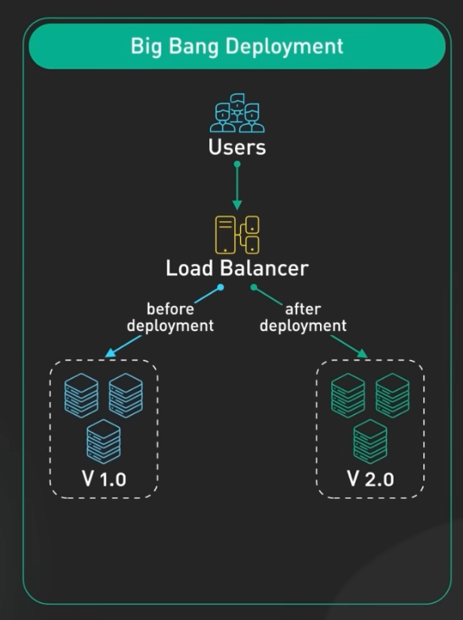 |
| --- | --- |

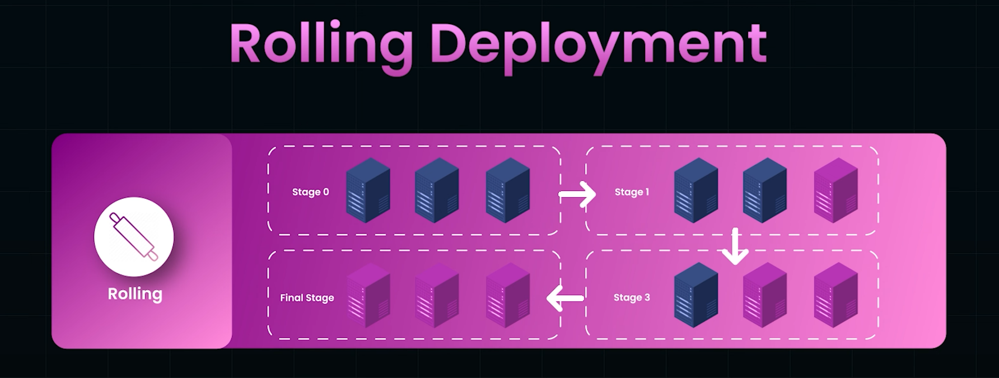

| - Release parts of the product over time. Slower Process. - Phased roll-out, each server downtime and upgrade and back up, then move to next server. - Usually prevents downtime, as other N-1 servers are running all the time. Zero downtime. 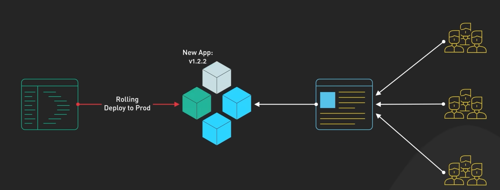 - Loadbalance dynamically routes the traffic to available servers. | 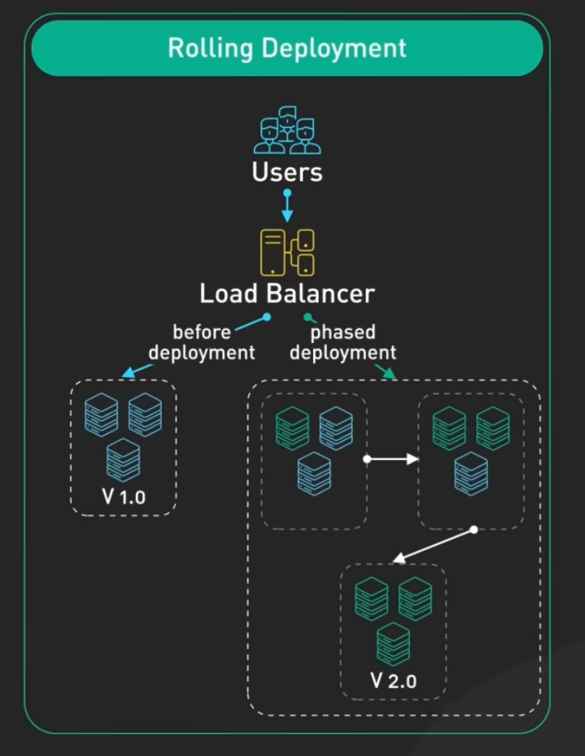 |
| --- | --- |

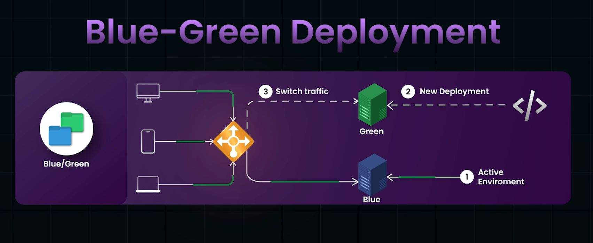

| - Two copies of production systems - At any given time, one system is live/active and visible to users, while other is idle 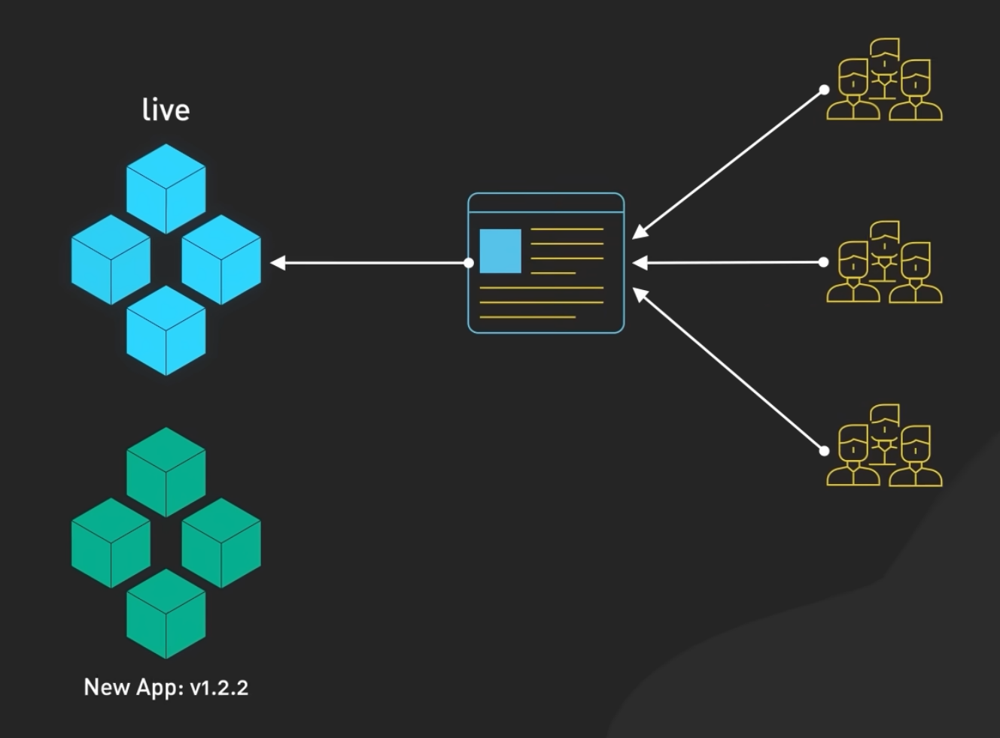 - One green is ready, switch the load balance to switch to green system to serve user request. Blue becomes idle now. - Zero Downtime. If issues with green version, switch to blue version. - Resource intensive. Double infrastructure. Synchronization between production environments is complex. - Quick rollback. | 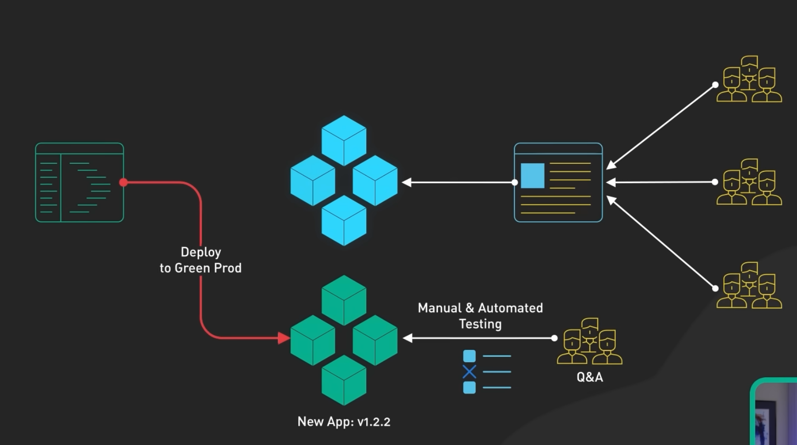 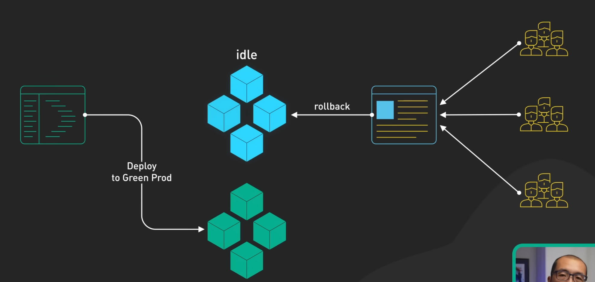 |
| --- | --- |

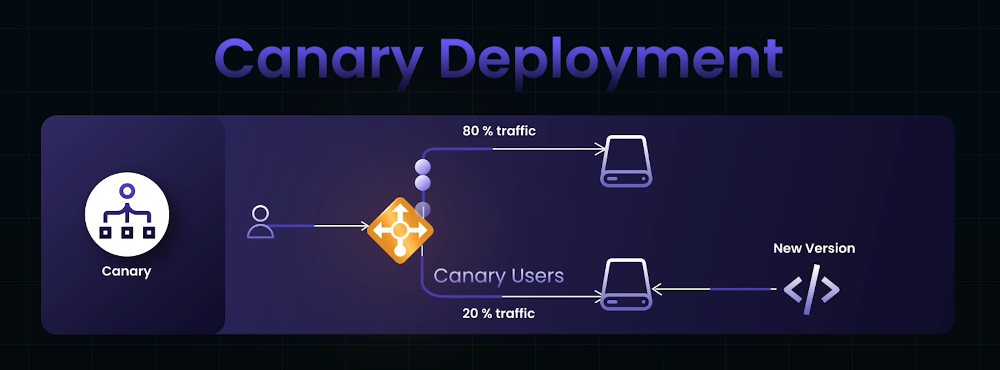

| - Rather than deploying the new servers to all users, we deploy to 1% servers called canaries (from old coal mining example, where canary distress represented its danger) - Example: deploy to Asia region only. If successful, then gradually roll out to other servers. 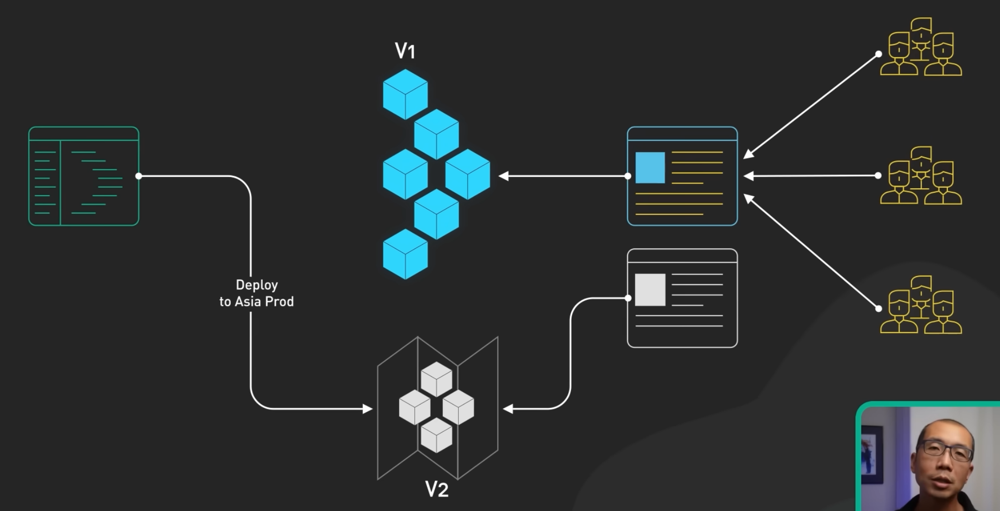 - If failed, then rollback / fix on the small number of affected servers. And redirect users to global prod. 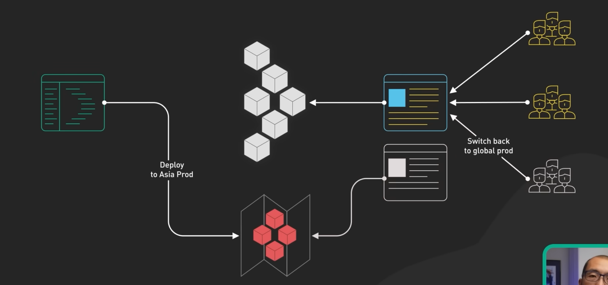 | 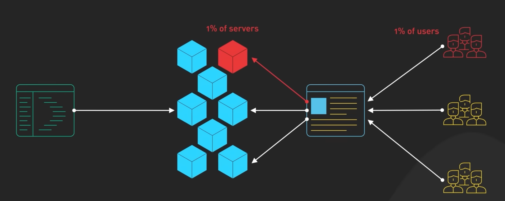 How it is done? 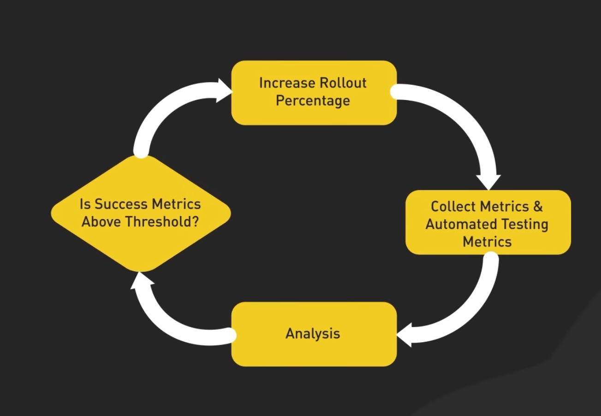 |
| --- | --- |

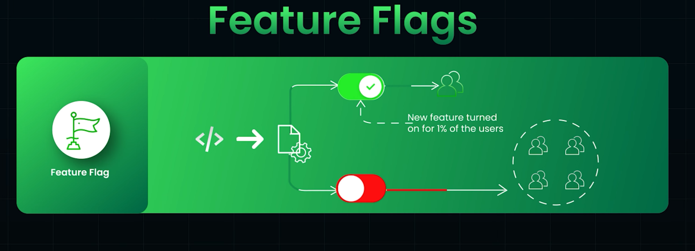

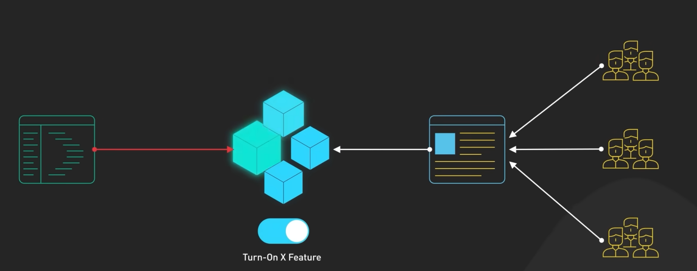

Useful for A/B testing: paired with canary deployment

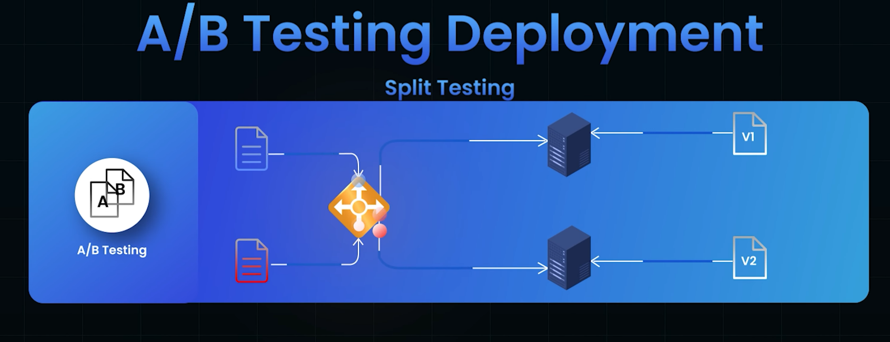

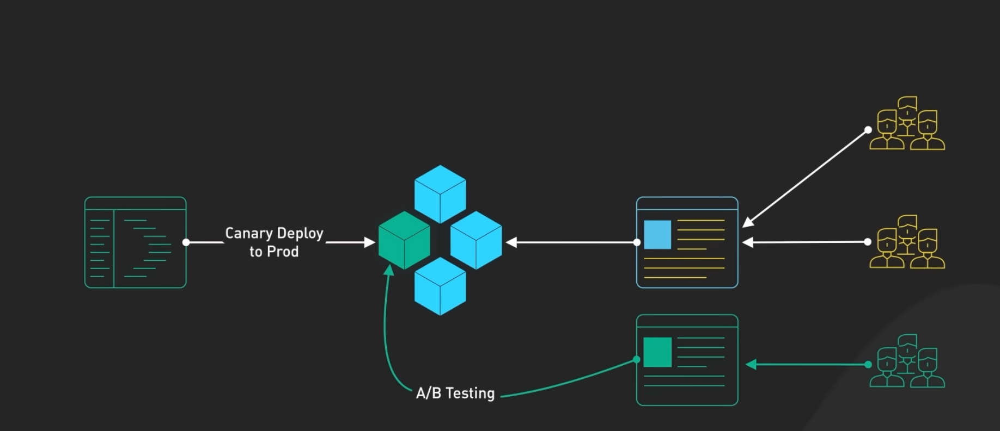

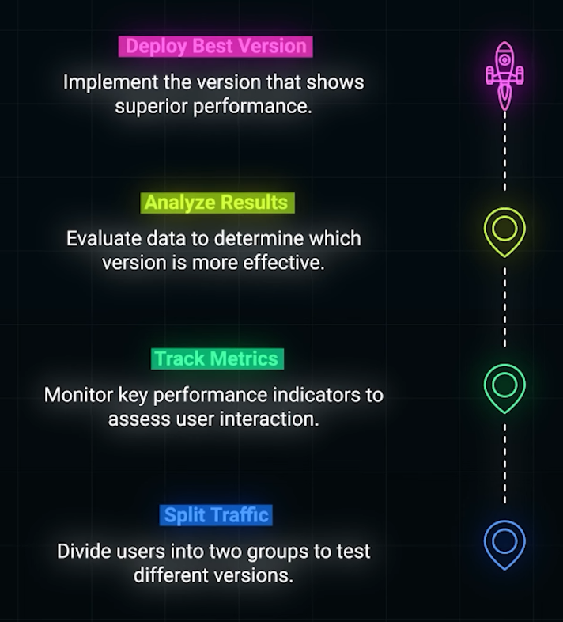
