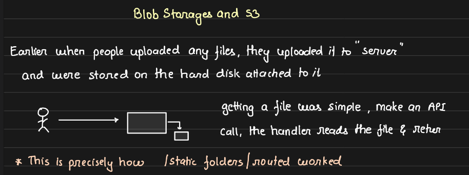
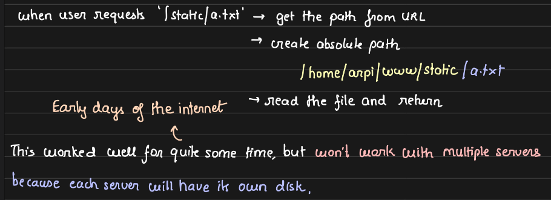
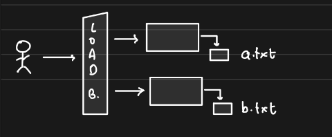
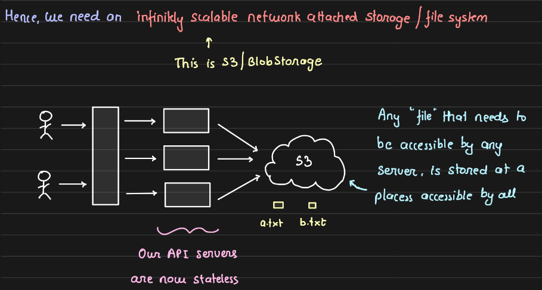
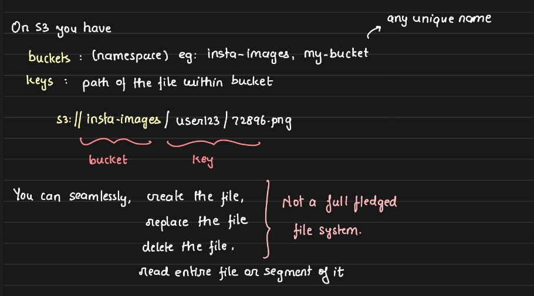
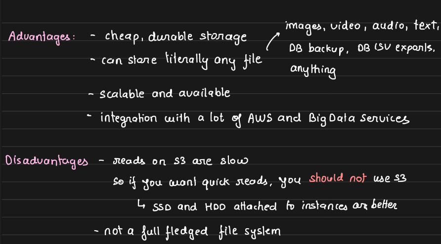
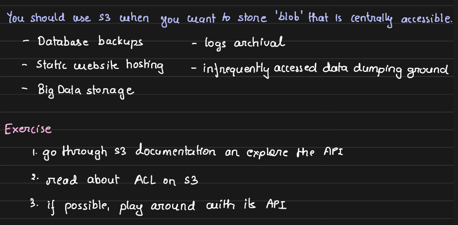

# 2.12.3 Blob Storage and S3

BINARY LARGE OBJECT - BLOB

NO ONE WOULD PEEK INTO THE FILE, STORE ANY FILE/SCHEMA/FORMAT IN ANY SET OF BYTES

AWS S3  IS THE MOST POPULAR BLOB STORAGE

TAKE THE DATA, CREATE A PATH ON S3, AND STORE THE DATA FILE ON THE PATH USING API CALL THROUGH AWS SDK

