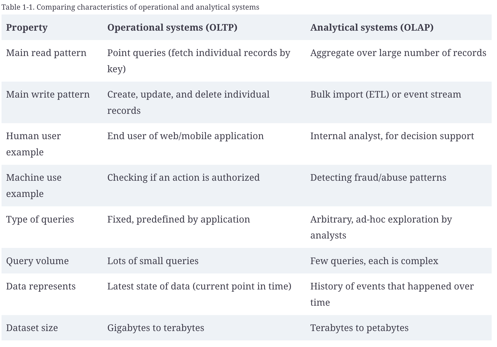
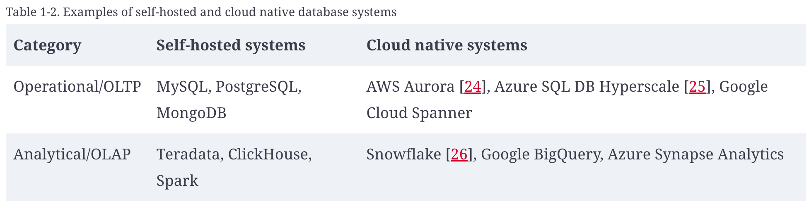

# 2.18 Tradeoffs in Data Systems Architecture

in data-intensive applications we usually worry more about things like storing and processing large data volumes, managing changes to data, ensuring consistency in the face of failures and concurrency, and making sure services are highly available.

- for web applications, the client-side code (which runs in a web browser) is called the frontend,

- the server-side code that handles user requests is known as the backend

- A backend service is often reachable via HTTP (or sometimes WebSocket); it usually consists of application code that reads and writes data in one or more databases and sometimes interfaces with additional data systems, such as caches or message queues (which we might collectively call data infrastructure).

- The application code is often stateless (i.e., when it finishes handling one HTTP request, it forgets everything about that request), and any information that needs to persist from one request to another needs to be stored either on the client or in the server-side data infrastructure.

[Distributed vs Single Node](<onenote:Background.one#Distributed%20vs%20Single%20Node&section-id={D5992A2B-77FF-1445-B4DD-9A2D4CA01CE4}&page-id={706B9E71-55FC-0C4E-88D1-F088D6E347E4}&end&base-path=https://d.docs.live.net/1B496228341EAA92/NOTES/System%20Design%20-%20HLD>)

Elasticity

If your application is busy at some times and idle at others, a cloud deployment can scale up or down to meet the demand so that you pay only for resources you are actively using.

Scalability

If your data volume or computing requirements grow bigger than a single machine can handle, you can potentially spread the load across multiple machines.

Latency

If you have users around the world, you might want to have servers in various regions worldwide so that each user can be served from a server that is geographically close to them. That avoids the users having to wait for network packets to travel halfway around the world to answer their requests.

Observability

Techniques for diagnosing problems in distributed systems are developed under the heading of observability, which involves collecting data about the execution of a system and allowing that data to be queried in ways that allow both high-level metrics and individual events to be analyzed. Tracing tools such as OpenTelemetry, Zipkin, and Jaeger allow you to track which client called which server for which operation and how long each call took

| **Microservices ** | **Serverless, or function as a service (FaaS)** |
| --- | --- |
| The most common way of distributing a system across multiple machines is to divide them into clients and servers and let the clients make requests to the servers. Most commonly, HTTP is used for this communication n a microservices architecture, a service has one well-defined purpose (e.g., in the case of S3, this is file storage); each service exposes an API that can be called by clients via the network, and each service has one team that is responsible for its maintenance. A complex application can thus be decomposed into multiple interacting services, each managed by a separate team. Cloud native systems make heavy use of decomposition into services, but on-premises systems can use a service-oriented approach too. Dividing a complex piece of software into multiple services has several advantages: each service can be updated independently, reducing coordination effort among teams; each service can be assigned the hardware resources it needs; and hiding the implementation details behind an API means the service owners are free to change the implementation without affecting clients. In terms of data storage, it is common for each service to have its own databases and not to share databases between services. API description standards such as OpenAPI and gRPC help manage the relationship between client and server APIs; | Serverless, or function as a service (FaaS), is another approach to deploying services, in which the management of the infrastructure is outsourced to a cloud vendor \[32\]. When using VMs, you have to explicitly choose when to start up or shut down an instance; in contrast, with the serverless model, the cloud provider automatically allocates and frees hardware resources as needed, based on the incoming requests to your service \[53\]. Just as cloud storage replaced capacity planning (deciding in advance how many disks to buy) with a metered billing model, the serverless approach is bringing metered billing to code execution: you pay only for the time that your application code is running rather than having to provision resources in advance. To offer such benefits, many serverless infrastructure providers impose a time limit on function execution and limit runtime environments, and services might suffer from slow start times when a function is first invoked. The term “serverless” can also be misleading; each serverless function execution still runs on a server, but subsequent executions might run on a different one. What’s more, infrastructure services such as BigQuery and various Kafka offerings have adopted “serverless” terminology to signal that their services autoscale and that they bill by usage rather than machine instances. |
