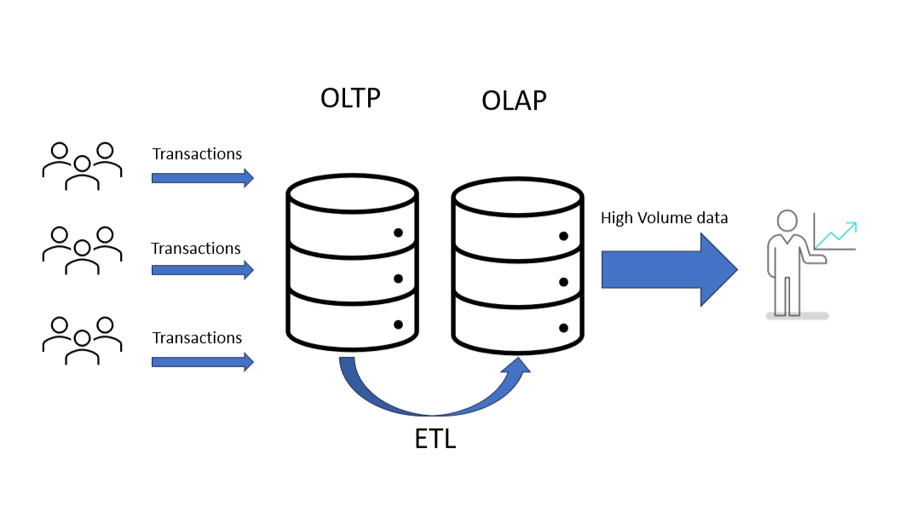
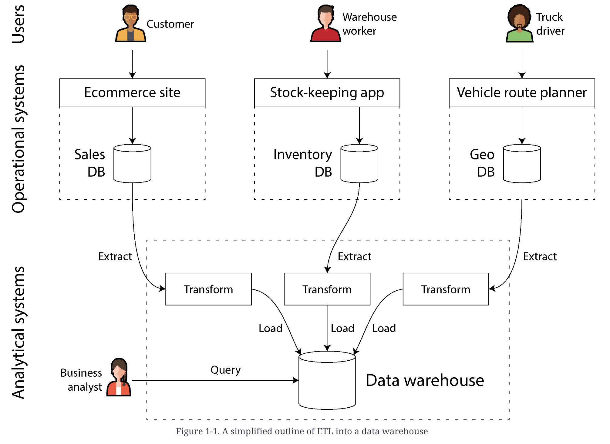
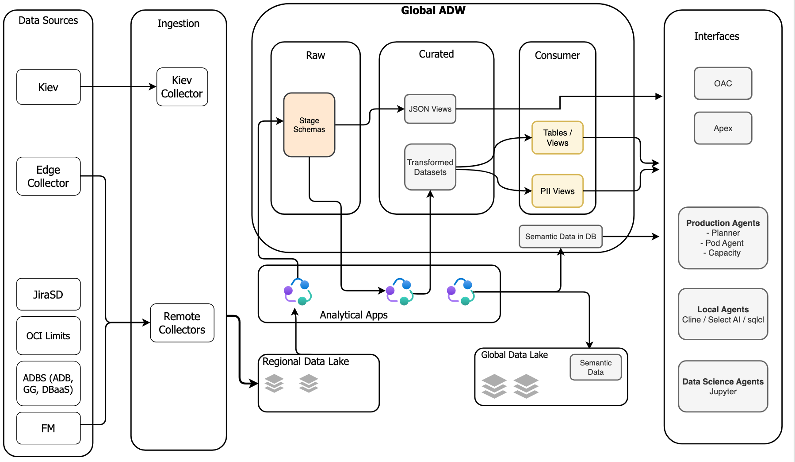

# 2.19 Data Warehouse & Data Lake

Data is extracted from OLTP databases (using either a periodic data dump or a continuous stream of updates), transformed into an analysis-friendly schema, cleaned up, and then loaded into the data warehouse. This process of getting data into the data warehouse is known as extract–transform–load (ETL). Sometimes the order of the transform and load steps is swapped (i.e., the transformation is done in the data warehouse, after loading), resulting in ELT.

Fivetran, Singer or Airbyte

Data Lake: primarily raw data from operational systems.

Data Warehouse: primarily transformed, curated and modeled data from upstream systems

In some cases the outputs of analytical systems are made available to operational systems (a process sometimes known as **reverse ETL**). For example, an ML model that was trained on data in an analytical system may be deployed to production so that it can generate recommendations for end users, such as “people who bought X also bought Y.” Machine learning models can be deployed to operational systems by using specialized tools such as **TFX, Kubeflow, or MLflow.**
