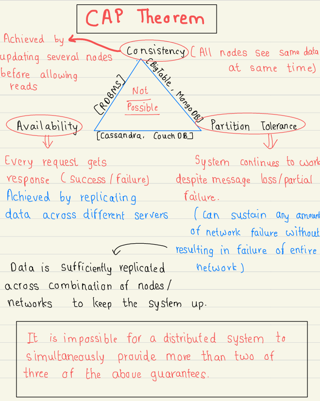
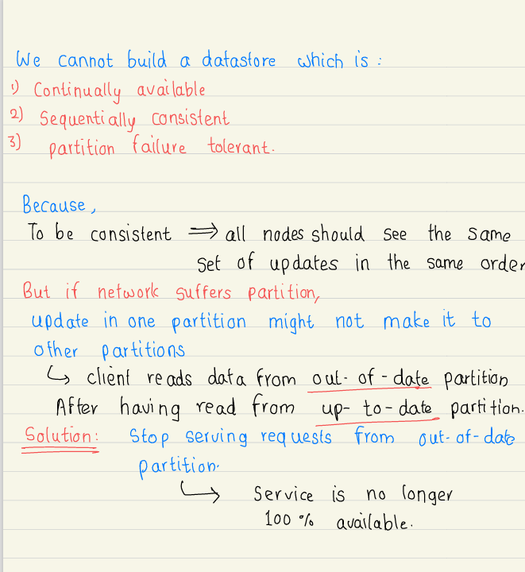

# 2.2 CAP Theorem

[What is availability ? ( replication vs redundancy)](<https://www.youtube.com/watch?v=Cdh9qAwFNNk&list=PLA3GkZPtsafZdyC5iucNM_uhqGJ5yFNUM&index=6&pp=iAQB>)

[2. CAP Theorem (Hindi) | High Level Design for Beginners | CAP Partition Tolerance explained](<https://www.youtube.com/watch?v=3qRBeZsUa18&list=PL6W8uoQQ2c63W58rpNFDwdrBnq5G3EfT7&index=4&pp=iAQB>)

[CAP Theorem in System Design Interviews](<https://www.youtube.com/watch?v=VdrEq0cODu4>)

[CAP Theorem | Explained](<https://www.youtube.com/watch?v=Ryx26qijkSo>)

[CAP Theorem in plain HINDI | System Design Fundamentals | Distributed Systems](<https://www.youtube.com/watch?v=fHXptJRjv6o>)

[Design 100% Available & Strong Consistent System | CAP Theorem | Distributed Systems in Hindi](<https://www.youtube.com/watch?v=CD1Zs0hXoUA&pp=0gcJCX4JAYcqIYzv>)

[What is Consistency in System Design in Hindi ( Strong vs Eventual Consistency )](<https://www.youtube.com/watch?v=2GKay0Mwk4U&list=PLA3GkZPtsafZdyC5iucNM_uhqGJ5yFNUM&index=7&pp=iAQB>)

[What is Polyglot Persistence in Hindi ?](<https://www.youtube.com/watch?v=z7wB95TXB8M&list=PLA3GkZPtsafZdyC5iucNM_uhqGJ5yFNUM&index=18&pp=iAQB>)

[CAP Theorem - System design](<https://www.youtube.com/watch?v=prUs7I-TIMw&list=PLt4nG7RVVk1g_LutiJ8_LvE914rIE5z4u&index=25&pp=iAQB>)

[What is throughput in Hindi  ? ( How to improve throughput ? )](<https://www.youtube.com/watch?v=IhemzDuCwgU&list=PLA3GkZPtsafZdyC5iucNM_uhqGJ5yFNUM&index=5&pp=iAQB>)

[What is CAP theorem in Hindi ?](<https://www.youtube.com/watch?v=rb2R5I9S5d8&list=PLA3GkZPtsafZdyC5iucNM_uhqGJ5yFNUM&index=8&pp=iAQB>)

[CAP | Consistency, Availability and Partitioning | System Design Tutorials | Lecture 19 | 2020 ](<https://www.youtube.com/watch?v=pSoKUfLTe8Y&list=PLTCrU9sGyburBw9wNOHebv9SjlE4Elv5a&index=19&pp=iAQB>)

From < https://www.youtube.com/watch?v=pSoKUfLTe8Y&list=PLTCrU9sGyburBw9wNOHebv9SjlE4Elv5a&index=19&pp=iAQB>

[What is CAP Theorem? Degrees of CAP theorem, use cases | System Design Tutorials | Lecture 20 | 2020 ](<https://www.youtube.com/watch?v=kwCFHLbIhak&list=PLTCrU9sGyburBw9wNOHebv9SjlE4Elv5a&index=20&pp=iAQB>)

From < https://www.youtube.com/watch?v=kwCFHLbIhak&list=PLTCrU9sGyburBw9wNOHebv9SjlE4Elv5a&index=20&pp=iAQB>

