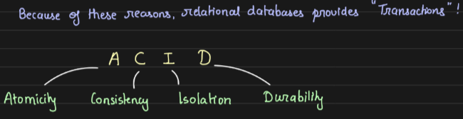

# 2.3.1 ACID Transactions

**TRANSACTIONS:**

Transactions are atomic unit of work. Transactions help us build systems that are "correct"

[Google SWE teaches systems design \| EP6: ACID Transactions ](<https://www.youtube.com/watch?v=NpQ-S89jVzE&list=PLjTveVh7FakKjb4UYzUazqBNNF-WGurXp&index=6&pp=iAQB>)

[Google SWE teaches systems design \| EP7: Weak forms of isolation ](<https://www.youtube.com/watch?v=5f7AliHXQ08&list=PLjTveVh7FakKjb4UYzUazqBNNF-WGurXp&index=7&pp=iAQB>)

[Intro to ACID Database Transactions \| Systems Design Interview: 0 to 1 with Google Software Engineer](<https://www.youtube.com/watch?v=oGmxzUBCYtY&list=PLjTveVh7FakLdTmm42TMxbN8PvVn5g4KJ&index=7&pp=iAQB>)

[Read Committed Isolation \| Systems Design Interview: 0 to 1 with Google Software Engineer](<https://www.youtube.com/watch?v=oS60pr8H1e0&list=PLjTveVh7FakLdTmm42TMxbN8PvVn5g4KJ&index=8&pp=iAQB>)

[Snapshot Isolation \| Systems Design Interview: 0 to 1 with Google Software Engineer](<https://www.youtube.com/watch?v=Tgpa9TrxsfU&list=PLjTveVh7FakLdTmm42TMxbN8PvVn5g4KJ&index=9&pp=iAQB>)

[Write Skew and Phantom Writes \| Systems Design Interview: 0 to 1 with Google Software Engineer](<https://www.youtube.com/watch?v=eym48yrObhY&list=PLjTveVh7FakLdTmm42TMxbN8PvVn5g4KJ&index=10&pp=iAQB0gcJCU0KAYcqIYzv>)

[Achieving ACID: Serial Execution \| Systems Design Interview: 0 to 1 with Google Software Engineer](<https://www.youtube.com/watch?v=kN_rOaNZBng&list=PLjTveVh7FakLdTmm42TMxbN8PvVn5g4KJ&index=11&pp=iAQB>)

[Database Internals: Two Phase Locking \| Systems Design Interview: 0 to 1 with Ex-Google SWE](<https://www.youtube.com/watch?v=gB7qazeSD3k&list=PLjTveVh7FakLdTmm42TMxbN8PvVn5g4KJ&index=12&pp=iAQB>)

[Serializable Snapshot Isolation \| Systems Design Interview: 0 to 1 with Ex-Google SWE](<https://www.youtube.com/watch?v=4TAKYRzm_dA&list=PLjTveVh7FakLdTmm42TMxbN8PvVn5g4KJ&index=13&pp=iAQB>)

[Column Oriented Storage (with Parquet!) \| Systems Design Interview: 0 to 1 with Ex-Google SWE](<https://www.youtube.com/watch?v=Zt7rqtJ3uWA&list=PLjTveVh7FakLdTmm42TMxbN8PvVn5g4KJ&index=14&pp=iAQB0gcJCU0KAYcqIYzv>)
