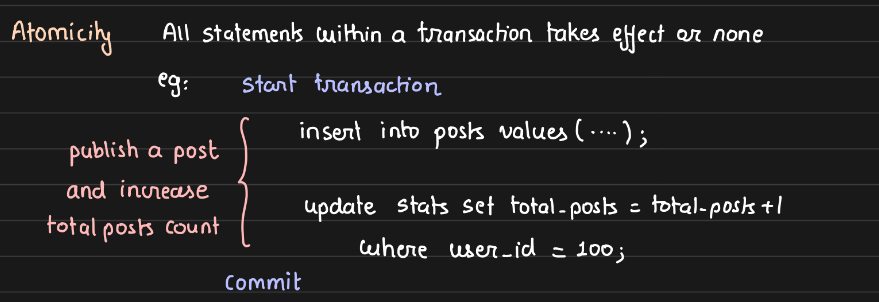
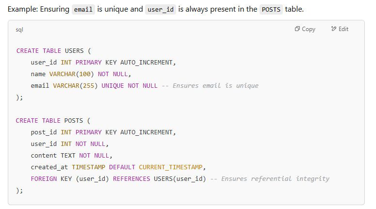
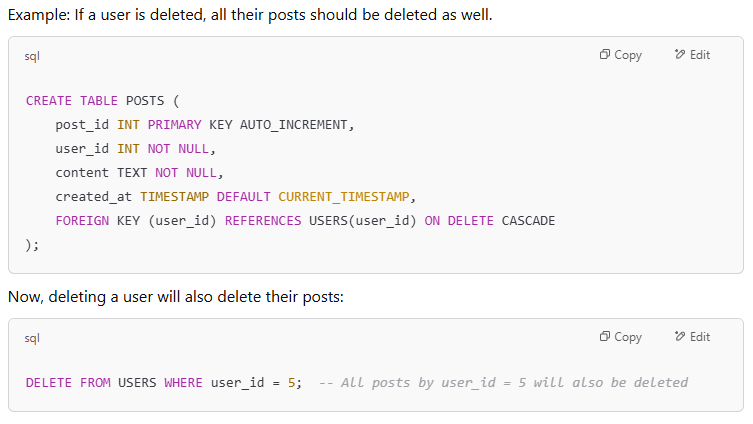
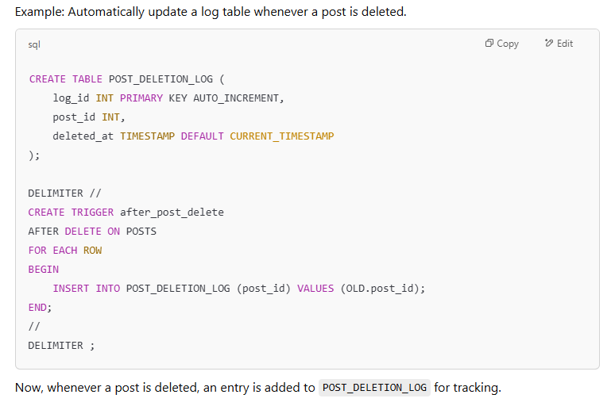
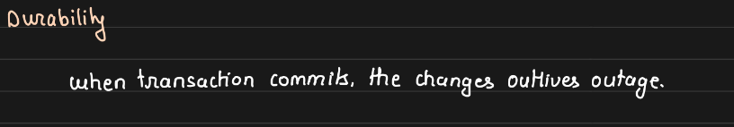
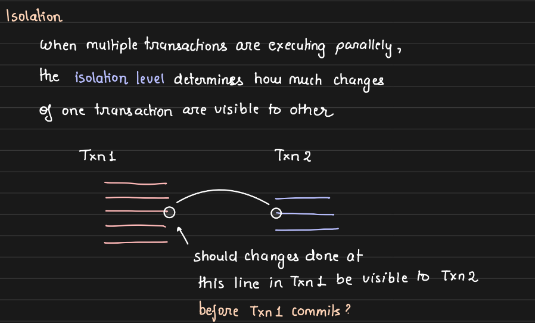
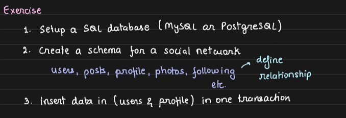

# 2.3.2 ACID properties

**ACID PROPERTIES:**

[ACID Properties](<onenote:https://d.docs.live.net/1B496228341EAA92/NOTES/DBMS/ACID%20Properties.one#section-id={E8FD1DD8-F704-4CE6-A2AF-E98E4AC925F9}&end>)** (DBMS Notes)**

______________________________________________________________________________

    1. ATOMICITY:

    - Either all the statements wrapped inside of a transaction happen, or none of them happen. It will never happen that system breaks in between two statements written in a transaction, leading to an inconsistent state.

    - A transaction enforces atomicity, ensuring that a sequence of database operations is treated as a single, indivisible unit. Either all operations within the transaction are successfully committed, or the entire transaction is rolled back, leaving the database state unchanged. This prevents partial execution and maintains data consistency by eliminating the possibility of an inconsistent state arising from mid-transaction failures.

    - When we say **commit** then both statements would take effect, otherwise none would.

    - **Cascades:** Cascades help automatically maintain referential integrity, ensuring dependent data is deleted or updated accordingly.

If you delete a row, you need to delete everything associated with it. Eg: Foreign Key relationship between two tables.

Parent : Users Table, Child: Posts Table

If delete entry corresponding to User Table, then cascades ensure that all Posts entries corresponding to that User is deleted.  **"on cascade delete"**

    - Triggers: Triggers are used to execute a function automatically before or after certain operations (INSERT, UPDATE, DELETE).

On update, trigger something, invoke a function etc.

3. DURABILITY:

The changes should persist in the disk, even when outage is there. Data should not just vanish. Commit is written on the disk.

    1. ISOLATION:

When multiple parallel transactions happen, then how much transparency/details of one transaction should be visible to other is call isolation level.

    - Four type of isolation levels, different in strictness.

    - One transaction running, then no other transaction should be running. => Serializable Isolation Level

    - In most cases, we don't tune isolation level. We proceed with **Repeatable Read (default) **- don't change it.

Model relationships, constraints, insert data using transactions. Kill the transaction in between and check how and what happens. Start transaction, insert disk and kill database.

[Database Transaction ACID Properties | System Design Fundamentals | Distributed Systems](<https://www.youtube.com/watch?v=5Y62RtDxaLk>)
