# 2.3.3 DB Isolation Levels

**DATABASE ISOLATION LEVELS:**

[Isolation Levels and Types](<onenote:https://d.docs.live.net/1B496228341EAA92/NOTES/DBMS/ACID%20Properties.one#Isolation%20Levels%20and%20Types&section-id={E8FD1DD8-F704-4CE6-A2AF-E98E4AC925F9}&page-id={42D3DB4A-7F57-47EA-9E58-4B3854E4E61E}&end>)

______________________________________________________________________________

- Relational Databases provide ACID guarantees

- I in ACID stands for Isolation (between Transactions)

- Isolation Levels helps us tune them

- Isolation levels dictate how much one transaction knows about the other transaction which is running parallely

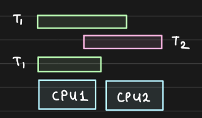

## **Types of Isolation Levels**

4 SQL 1992 Standard Isolation Levels

HANDS-ON

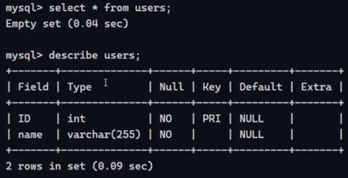

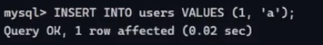

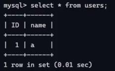

Two Sessions logged in.

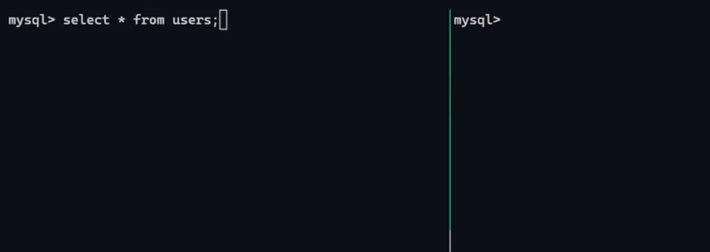

Left is for transaction 1. and Right for transaction 2

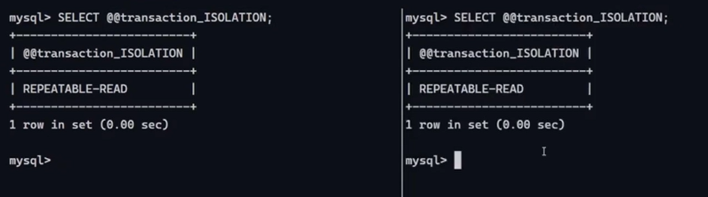

Setting autocommit to 0. Autocommits commits each line as it happens.

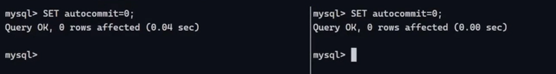

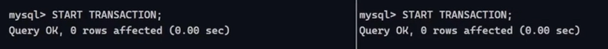

Start transactions in both the sessions.

Reading the row in each transaction.

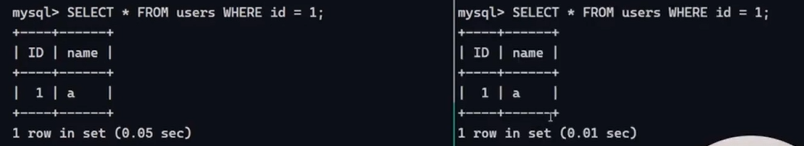

Fire an update in transaction 1, yet to be commited:

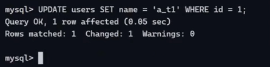

| Reading the row in transaction 1 (uncommited, and unaborted): \[ROW GOT UPDATED\] | Reading the row in transaction 2 \[READS THE OLD ROW\] |
| --- | --- |
| 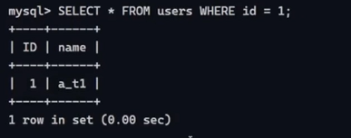 | 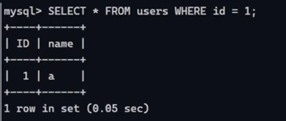 Changes made by transaction 1 does not matter to transaction 2 unless they're committed. |

Transaction 1 commits

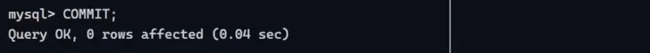

| Reading the row in Session 1 | Reading the row in session 2 |
| --- | --- |
| 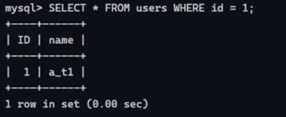 Updated | 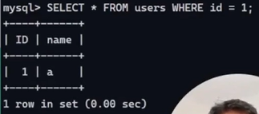 Still not updated You can repeat your reads within a transaction and it will give you a consistent view of it. The first read you see, you will keep seeing the same reads no matter what the other transactions make changes. Opaque to what has been done in the system by other transactions. |
|  | Transaction 2 commits 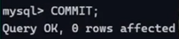 |
|  | Now start another transaction in session 2 and read then we see fresh  value 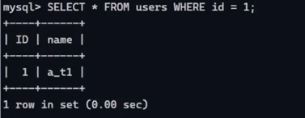 Reads are repeatable and consistent within a transaction. |

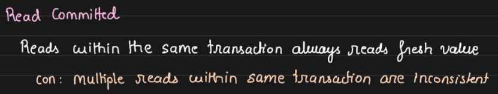

When a transaction is reading a value it will always read the latest committed value. It is possible for a transaction T1 to read two different values while it is running, given that another transaction T2 commits changes in the middle of two reads in T1.

HANDS ON

Set Session Transaction Isolation Level to READ COMMITTED

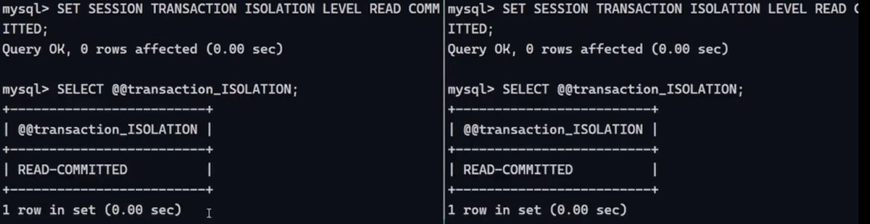

Start transactions

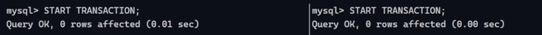

READ IN Transaction T1,  UPDATE IN Transaction T2  and COMMIT

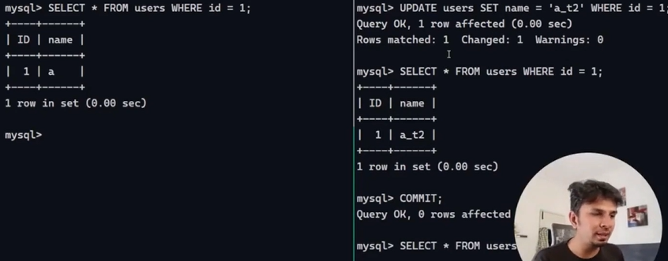

But now after committing if we read in transaction 1 that was already running, then we'll get updated/committed value. It reads the committed value even if any other transaction wrote that.

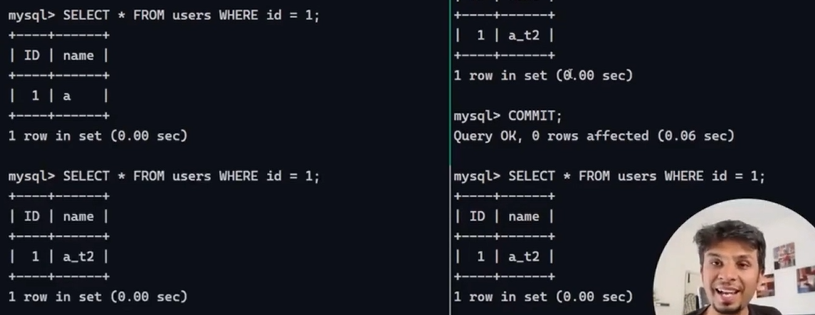

"Under the 'read committed' isolation level, a transaction may experience non-repeatable reads. Specifically, subsequent read operations within the same transaction can return different results if concurrent transactions commit modifications to the data between those reads. This phenomenon compromises read consistency within the transaction, though it typically provides higher concurrency and throughput compared to stronger isolation levels."

Reads even uncommitted updates made in other transactions --> DIRTY READ

HANDS-ON

Set Session Transaction Isolation Level to READ UNCOMMITTED

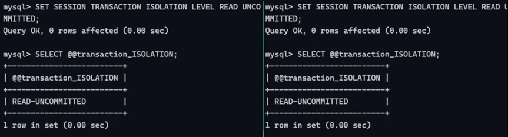

Transaction 1 reads a row, Transaction T2 updates it (but not comitted yet):

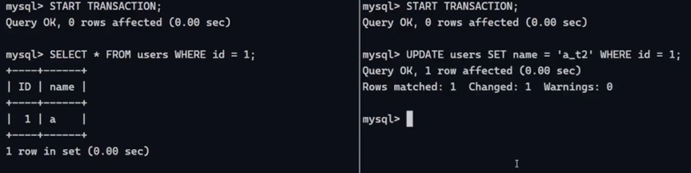

Read again in T1:

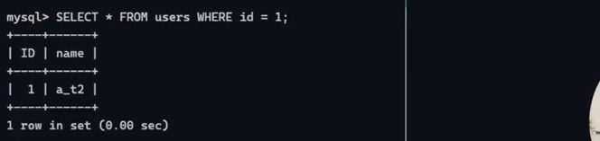

Getting uncommitted value. Now if transaction T2 rolls back, so we have done processing on the data which is updated and then rolled back by some other transaction. -- DIRTY READS

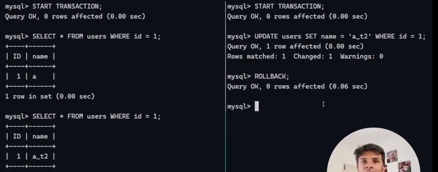

[Everything you need to know about Read Uncommitted Isolation Level](<https://www.youtube.com/watch?v=AiPGbVjl3JY&ab_channel=ArpitBhayani>)

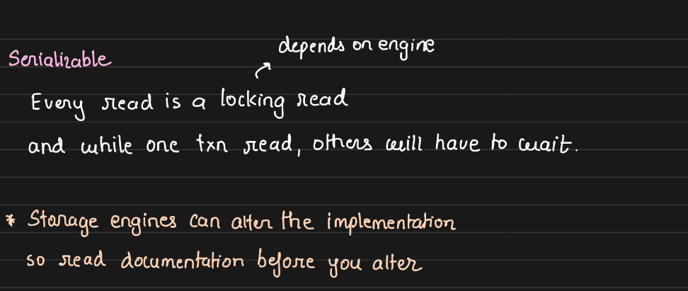

Strictest form of isolation and slowest. Enforces serilizability. Every read is a locking read. If one transaction reads a row, and then is finished processing on that row, then only other transactions can read that row and move forward.

Set Isolation to Serializable

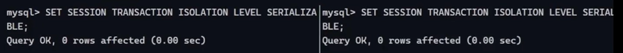

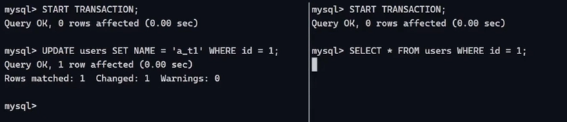

UPDATED ROW in T1, and now trying to read that row in T2, we see that transaction T2 waits.

Waits until T1 either commits or rollbacks. SELECT Statement won't even move forward.

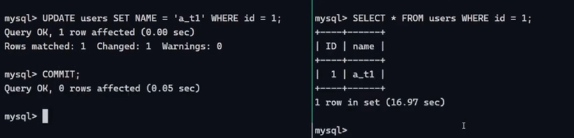

See T2 showing 16.97 seconds, because it had been waiting until we write commit in T1.

[Read Committed Isolation | Systems Design Interview: 0 to 1 with Google Software Engineer](<https://www.youtube.com/watch?v=oS60pr8H1e0&ab_channel=Jordanhasnolife>)

[Serializable Snapshot Isolation | Systems Design Interview: 0 to 1 with Ex-Google SWE](<https://www.youtube.com/watch?v=4TAKYRzm_dA&ab_channel=Jordanhasnolife>)

[Snapshot Isolation | Systems Design Interview: 0 to 1 with Google Software Engineer](<https://www.youtube.com/watch?v=Tgpa9TrxsfU&ab_channel=Jordanhasnolife>)
