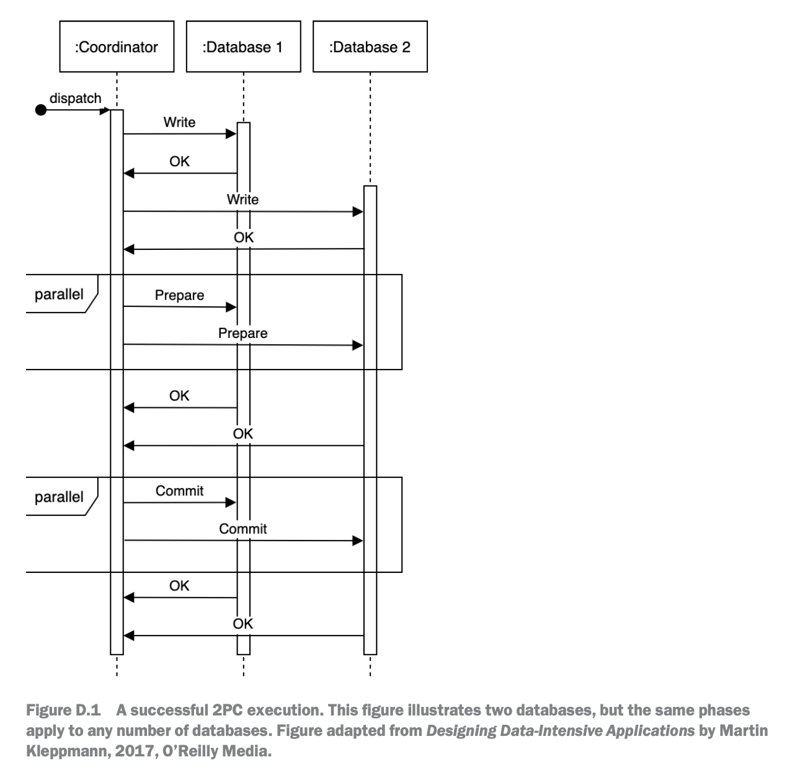
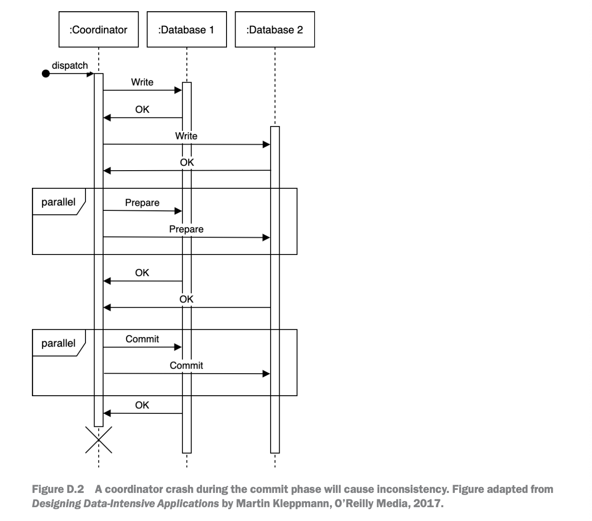
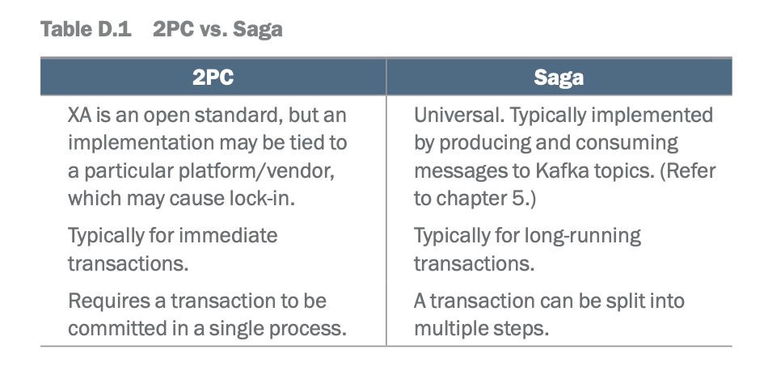

# 2.3.4 2 Phase Commit

[Two Phase Commit - Distributed Transactions | Systems Design Interview 0 to 1 with Ex-Google SWE](<https://www.youtube.com/watch?v=7DoT2sTGulc&list=PLjTveVh7FakLdTmm42TMxbN8PvVn5g4KJ&index=26&pp=iAQB>)

We discuss two-phase commit (2PC) here as a possible distributed transactions tech-

nique, but emphasize that it is unsuitable for distributed services. If we discuss dis-

tributed transactions during an interview, we can briefly discuss 2PC as a possibility

and also discuss why it should not be used for services. This section will cover this

material.

Figure D.1 illustrates a successful 2PC execution. 2PC consists of two phases

(hence its name), the prepare phase and the commit phase. The coordinator first

sends a prepare request to every database. (We refer to the recipients as databases,

but they may also be services or other types of systems.) If every database responds

successfully, the coordinator then sends a commit request to every database. If any

database does not respond or responds with an error, the coordinator sends an abort

request to every database.

2PC achieves consistency with a performance tradeoff from the blocking require-

ments. A weakness of 2PC is that the coordinator must be available throughout the

process, or inconsistency may result. Figure D.2 illustrates that a coordinator crash

during the commit phase may cause inconsistency, as certain databases will commit,

but the rest will abort. Moreover, coordinator unavailability completely prevents any

database writes from occurring.

Inconsistency can be avoided by participating databases neither committing nor abort-

ing transactions until their outcome is explicitly decided. This has the downside that

those transactions may hold locks and block other transactions for a long time until

the coordinator comes back.

2PC requires all databases to implement a common API to interact with the coordi-

nator. The standard is called X/Open XA (eXtended Architecture), which is a C API

that has bindings in other languages too.

2PC is generally unsuitable for services, for reasons including the following:

¡ The coordinator must log all transactions, so during a crash recovery it can com-

pare its log to the databases to decide on synchronization. This imposes addi-

tional storage requirements.

¡ Moreover, this is unsuitable for stateless services, which may interact via HTTP,

which is a stateless protocol.

All databases must respond for a commit to occur (i.e., the commit does not

occur if any database is unavailable). There is no graceful degradation. Overall,

there is lower scalability, performance, and fault-tolerance.

¡ Crash recovery and synchronization must be done manually because the write is

committed to certain databases but not others.

¡ The cost of development and maintenance of 2PC in every service/database

involved. The protocol details, development, configuration, and deployment

must be coordinated across all the teams involved in this effort.

¡ Many modern technologies do not support 2PC. Examples include NoSQL

databases, like Cassandra and MongoDB, and message brokers, like Kafka and

RabbitMQ.

¡ 2PC reduces availability, as all participating services must be available for com-

mits. Other distributed transaction techniques, such as Saga, do not have this

requirement.

Table D.1 briefly compares 2PC with Saga. We should avoid 2PC and prefer other tech-

niques like Saga, Transaction Supervisor, Change Data Capture, or checkpointing for

distributed transactions involving services.

