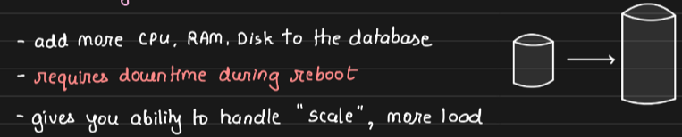
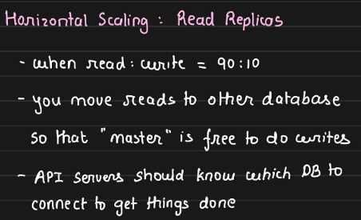
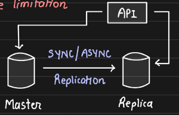
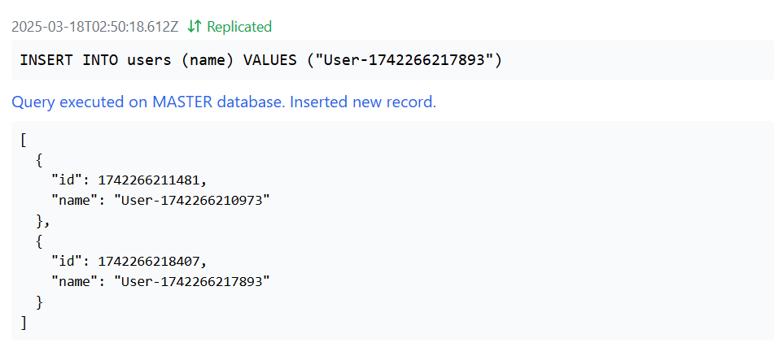
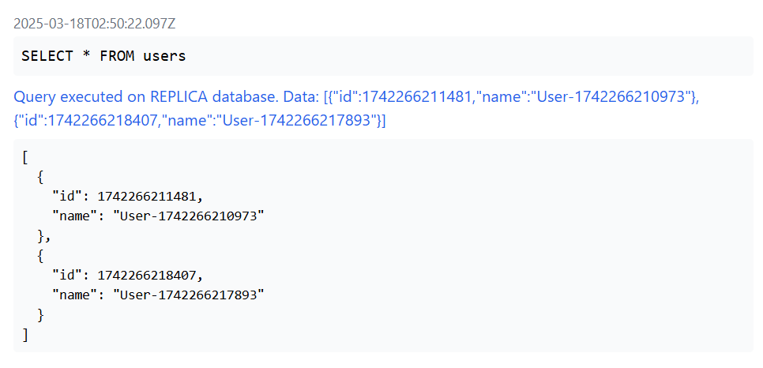
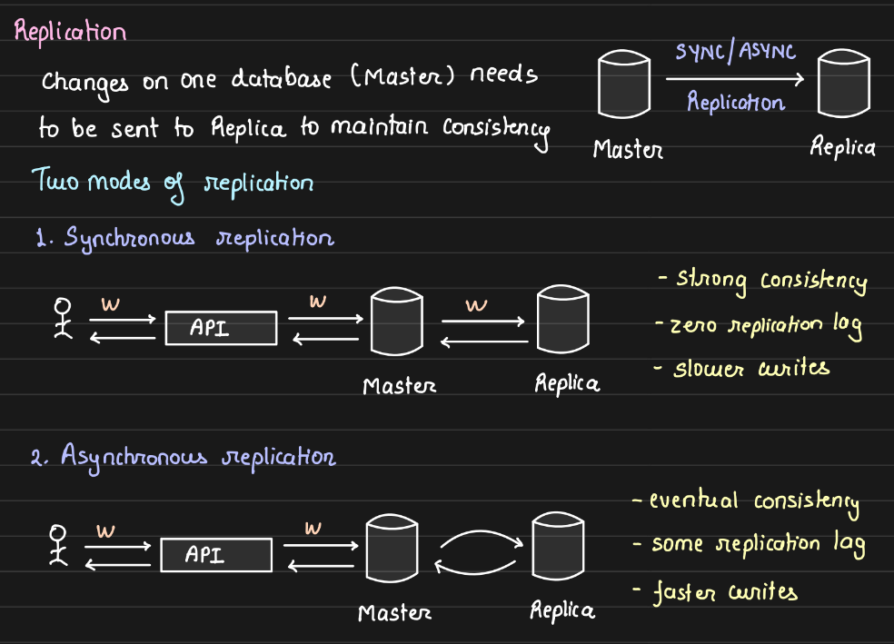
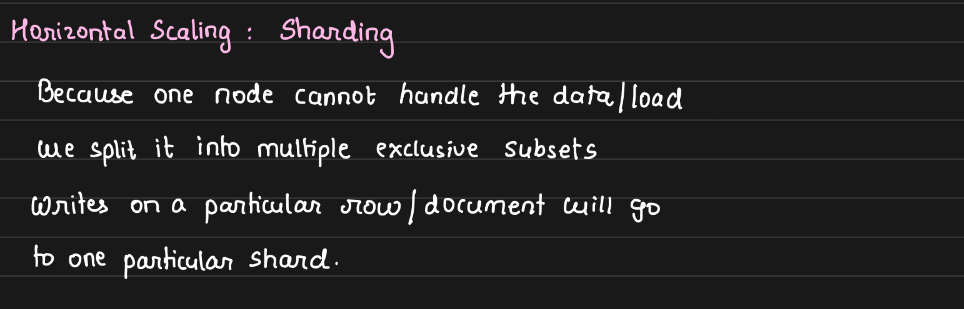
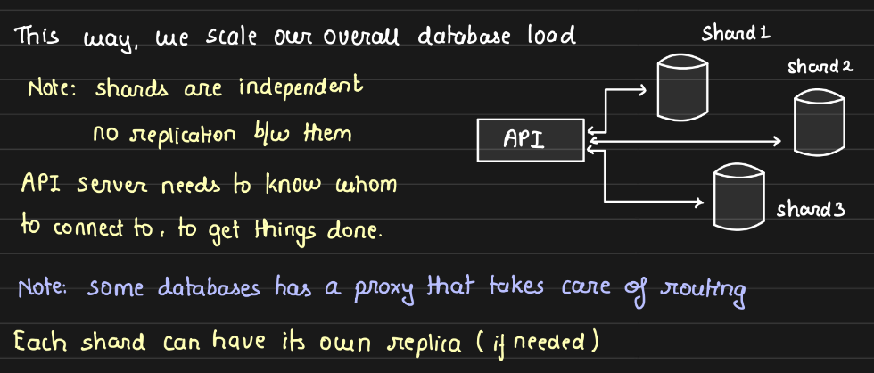
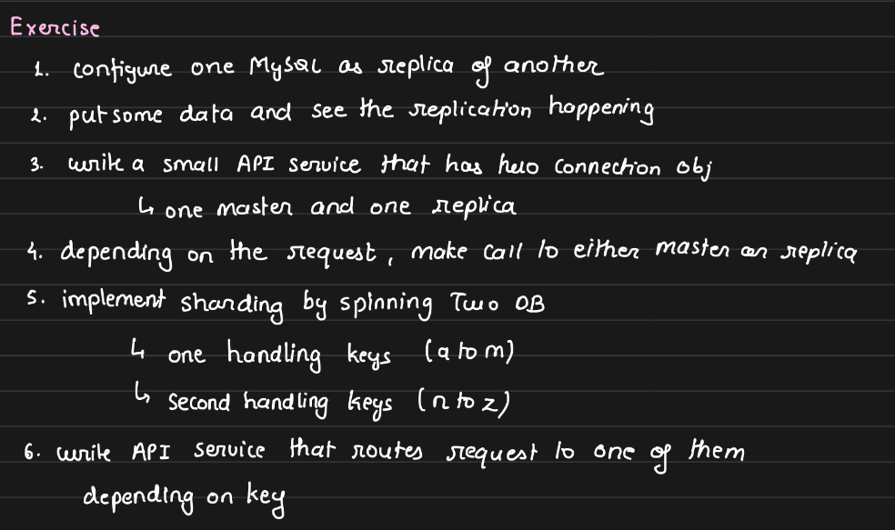

# 2.4 Scaling Databases

**SCALING DATABASES**

[Lecture 19: Database Scaling Patterns](<onenote:https://d.docs.live.net/1B496228341EAA92/NOTES/DBMS/Scaling.one#Lecture%2019%20Database%20Scaling%20Patterns&section-id={29970DCC-EE28-45A3-ABDA-CA73723173E6}&page-id={30DD881D-9A87-4FD9-822E-6202E3B6344D}&end>)

______________________________________________________________________________

These scaling strategies can be used for relational as well as non-relational DBs. These are very common and general method to scale any stateful thing like DB.

Nowadays, all our databases are in the cloud and cloud providers such as GCP, Azure, AWS provide 2 click solutions to scale our databases vertically. They abstract out all the ugly implementations and copying of data and gives us option of just buying the better plan in order to scale our DB vertically.

As we're scaling vertically, we have to suffer downtime due to rebooting of DB after enlarging. DB would be unavailable for some time.

Vertical Scaling has a physical hardware limitation. Even on cloud providers, there is a physical limit till which you can scale vertically. (Cache line, Bus Limit etc. actual physical limit on IC board)

**2.1 READ REPLICAS**

Most common way to scale the reads, in most workloads, as mostly read operations as compared to writes. So, keep one separate replica of the master database for reads operations only and scale the reads independently.

MASTER DB takes us all the writes operations

REPLICA DB follows the writes happening on master DB

HOW TO KNOW WHICH DB TO SEND READ AND WRITE REQUESTS TO?

Write that logic at Database API server level. In your API, create  DB connection object. We can create one connection object for master and another for replica. Depending on READ/WRITE, we pick the corresponding object on which we need to fire the query.

Eg: READ QUERY = Use the connection object of the read replica to query it.

**HANDS-ON**

// Database connection manager

class DatabaseManager {

private masterDb: DatabaseConnection;

private replicaDb: DatabaseConnection;

constructor() {

this.masterDb = new DatabaseConnection('MASTER');

this.replicaDb = new DatabaseConnection('REPLICA');

// Set up replication from master to replica

this.masterDb.setReplicationCallback(async (sql, params) => {

// Simulate replication delay

await new Promise(resolve => setTimeout(resolve, 200));

// Sync replica storage with master

**      this.replicaDb.setStorage(this.masterDb.getStorage());**

console.log('Replicated data from master to replica');

});

}

async executeQuery(sql: string, params?: any\[\]): Promise<any> {

const isReadQuery = sql.trim().toUpperCase().startsWith('SELECT');

const connection = isReadQuery ? this.replicaDb : this.masterDb;

const result = await connection.query(sql, params);

return result;

}

}

**REPLICATION:**

In synchronous replication, the API server doesn't respond to the client unless the write happens on both the MASTER and the REPLICA. If WRITE happens on both, then only we return that WRITE is successful. MASTER and REPLICA in strong sync, as we aren't terminating WRITE until done on both. Zero Replication Lag (trade-off with slower writes)

In **asynchronous replication, very common**, MASTER doesn't have to write to REPLICA immediately. WRITE goes to MASTER and response is sent to user, however WRITE is not propagated to REPLICA instantly.

Configuration in DB that whether it is replica or master and replica periodically pulls from MASTER. MASTER sends all the queries that have been fired up until last check, and the replica applies those queries.

No strong consistency, but eventual consistency. Some replication lag between MASTER and REPLICA.

**2.2 SHARDING**

What if one node can't handle all the write requests coming towards it. We split it into exclusive subsets of data. Instead of one node holding all the data, we have three nodes holding mututally exclusive data.

Eg: Keys A-Z ---> A-J, K-M, N-Z three shards

Each shard is responsible for its own things. API server has the required **routing logic/**knowledge that which query is corresponding to which shard. Use corresponding connection objects for each shard for querying.

Each shard is responsible for 1/3rd of the load/keys.

[Scalability \| Horizontal vs Vertical Scaling \| System Design Fundamentals \| Distributed Systems](<https://www.youtube.com/watch?v=dRGA9cX096U>)

[Horizontal vs Vertical Scaling \| Simply Explained](<https://www.youtube.com/watch?v=uuxCNj8a5fE>)
