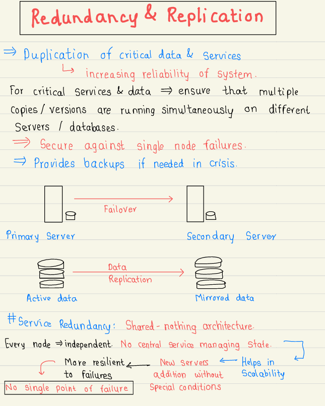

# 2.4.2 Replication

[Difference between Redundancy and Replication in Hindi ( Master - Slave Replication )](<https://www.youtube.com/watch?v=d9kA8CW8Cns&list=PLA3GkZPtsafZdyC5iucNM_uhqGJ5yFNUM&index=11&pp=iAQB>)

[What is Lamport Logical Clock ?](<https://www.youtube.com/watch?v=27wYlcIYAO8&list=PLA3GkZPtsafZdyC5iucNM_uhqGJ5yFNUM&index=9&pp=iAQB>)

[Google SWE teaches systems design | EP2: single leader replication ](<https://www.youtube.com/watch?v=X687PvgOWzQ&list=PLjTveVh7FakKjb4UYzUazqBNNF-WGurXp&index=2&pp=iAQB>)

[Google SWE teaches systems design | EP3: Multileader replication ](<https://www.youtube.com/watch?v=1BXCxpcsmzc&list=PLjTveVh7FakKjb4UYzUazqBNNF-WGurXp&index=3&pp=iAQB>)

[Google SWE teaches systems design | EP4: Leaderless Replication ](<https://www.youtube.com/watch?v=atDe7qka6q8&list=PLjTveVh7FakKjb4UYzUazqBNNF-WGurXp&index=4&pp=iAQB>)

[Database Replication | Synchronous vs Asynchronous | System Design Tutorials | Lecture 18 | 2020 ](<https://www.youtube.com/watch?v=RIcNswROzCc&list=PLTCrU9sGyburBw9wNOHebv9SjlE4Elv5a&index=18&pp=iAQB>)

From < https://www.youtube.com/watch?v=RIcNswROzCc&list=PLTCrU9sGyburBw9wNOHebv9SjlE4Elv5a&index=18&pp=iAQB>

[Intro to Replication - Systems Design "Need to Knows" | Systems Design 0 to 1 with Ex-Google SWE](<https://www.youtube.com/watch?v=FIPCDRRBGz4&list=PLjTveVh7FakLdTmm42TMxbN8PvVn5g4KJ&index=16&pp=iAQB>)

[Dealing with Stale Reads - Make Your App Better | Systems Design 0 to 1 with Ex-Google SWE](<https://www.youtube.com/watch?v=Y29yuEoBmjM&list=PLjTveVh7FakLdTmm42TMxbN8PvVn5g4KJ&index=17&pp=iAQB>)

[Single Leader Replication - how it works | Systems Design 0 to 1 with Ex-Google SWE](<https://www.youtube.com/watch?v=8h-a7TsXw28&list=PLjTveVh7FakLdTmm42TMxbN8PvVn5g4KJ&index=18&pp=iAQB>)

[Multi Leader Replication - chaos | Systems Design 0 to 1 with Ex-Google SWE](<https://www.youtube.com/watch?v=tffuvQtiTwY&list=PLjTveVh7FakLdTmm42TMxbN8PvVn5g4KJ&index=19&pp=iAQB>)

[Dealing with Write Conflicts - What do you do? | Systems Design 0 to 1 with Ex-Google SWE](<https://www.youtube.com/watch?v=sa4BJAFT8sU&list=PLjTveVh7FakLdTmm42TMxbN8PvVn5g4KJ&index=20&pp=iAQB>)

[CRDTs - Stop Worrying About Write Conflicts | Systems Design 0 to 1 with Ex-Google SWE](<https://www.youtube.com/watch?v=FG5Varj1Ows&list=PLjTveVh7FakLdTmm42TMxbN8PvVn5g4KJ&index=21&pp=iAQB>)

[Leaderless Replication Introduction | Systems Design 0 to 1 with Ex-Google SWE](<https://www.youtube.com/watch?v=Jy4Cm2WEZVg&list=PLjTveVh7FakLdTmm42TMxbN8PvVn5g4KJ&index=22&pp=iAQB>)

[Quorums - Leaderless Replication Continued | Systems Design Interview 0 to 1 with Ex-Google SWE](<https://www.youtube.com/watch?v=DAONthD50g0&list=PLjTveVh7FakLdTmm42TMxbN8PvVn5g4KJ&index=23&pp=iAQB>)

[Replication Summarized in 9 Minutes | Systems Design Interview 0 to 1 with Ex-Google SWE](<https://www.youtube.com/watch?v=uvRcYQ8fdMs&list=PLjTveVh7FakLdTmm42TMxbN8PvVn5g4KJ&index=24&pp=iAQB>)

[Database Replication | System Design Fundamentals | Distributed Systems](<https://www.youtube.com/watch?v=4jn5A5mkeGs&pp=0gcJCX4JAYcqIYzv>)

[Replication vs Redundancy | System Design Fundamentals | Distributed Systems](<https://www.youtube.com/watch?v=KvX3FThRvkI>)

[(Hindi) Master-Slave Database Replication | High Level Design :10 | System Design | Database Scaling](<https://www.youtube.com/watch?v=wcyoY5VzIco&pp=0gcJCfYJAYcqIYzv>)

[(Hindi)Master-slave vs  Master-Master Database Replication | High Level Design: 10 | Latency Impact](<https://www.youtube.com/watch?v=R5X7Ne-DsXE>)

[Master-Master Database Scaling | High Level Design : Lecture-11 | System-design theory concepts](<https://www.youtube.com/watch?v=Iah5E7dFpdM>)
