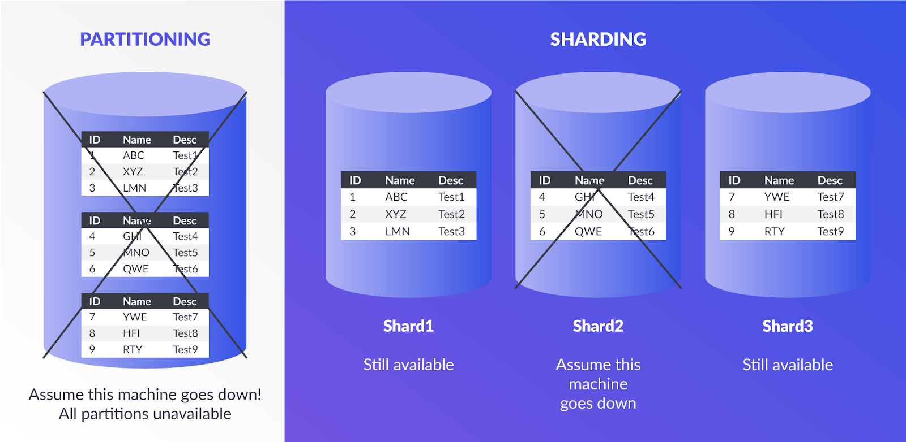
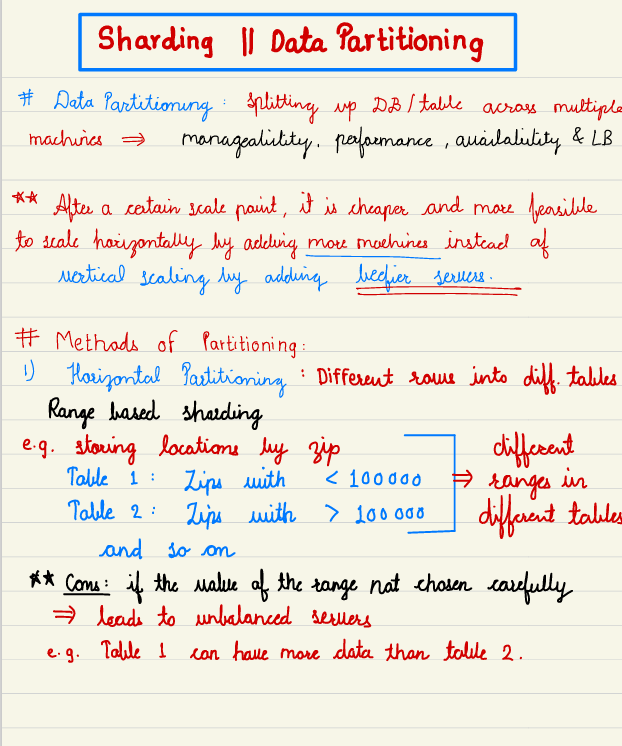
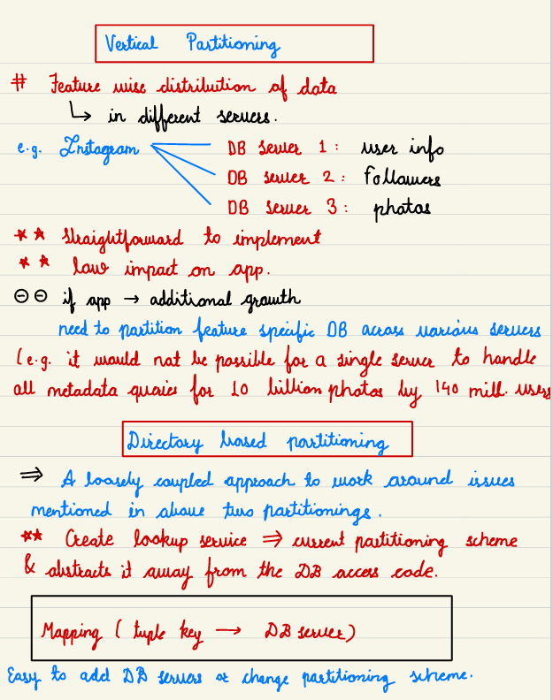
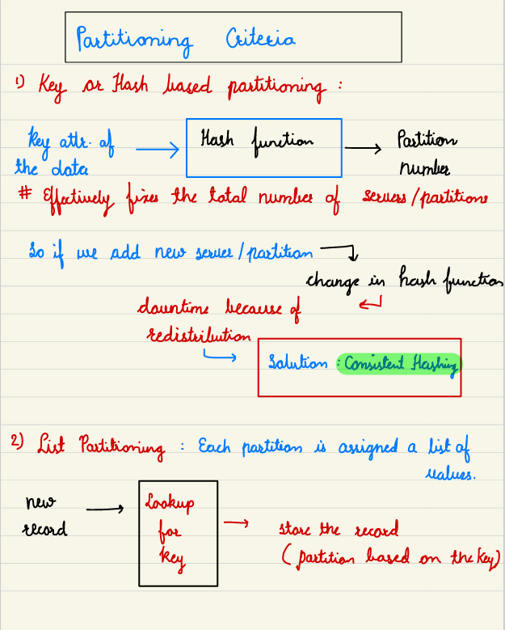
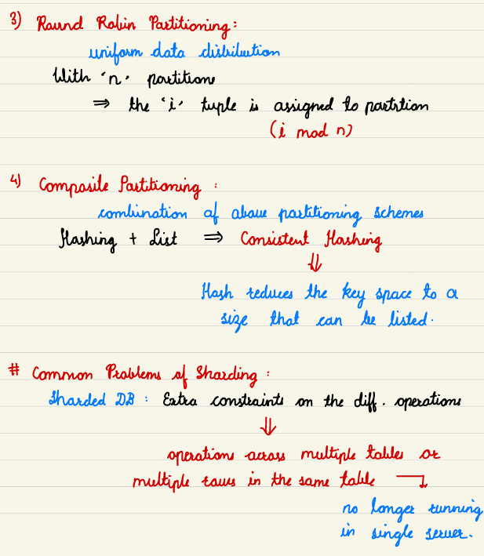
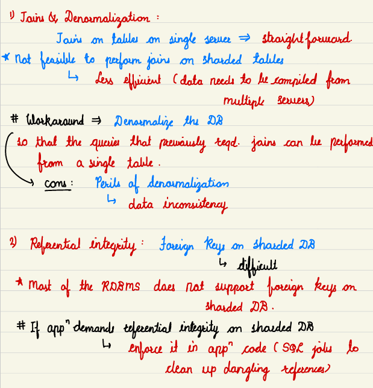
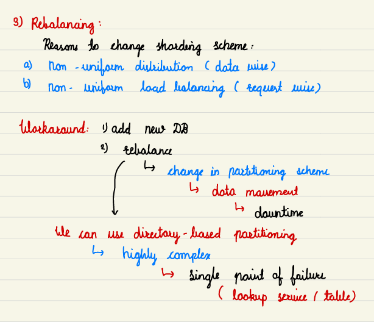

# 2.4.3 Sharding/Partitioning

[EP11: HLD: Database Partitioning & Sharding Explained Concisely | TechSimplified by Rajdeep](<https://www.youtube.com/watch?v=wl2GcrRq0FY&list=PLoaQAd6R8JXyTpYZTOWT8JrVASNeyoBZu&index=1&pp=iAQB>)

[System Design - Sharding | Data Partitioning](<https://youtu.be/yNrVexoEnFM?si=o-5WjQ3NqcXQwXnE>)

[Google SWE teaches systems design | EP5: Database sharding/partitioning ](<https://www.youtube.com/watch?v=IM6urSjtMrQ&list=PLjTveVh7FakKjb4UYzUazqBNNF-WGurXp&index=5&pp=iAQB>)

[What is DATABASE SHARDING? ](<https://www.youtube.com/watch?v=5faMjKuB9bc&list=PLMCXHnjXnTnvo6alSjVkgxV-VH6EPyvoX&index=7&pp=iAQB>)

From < https://www.youtube.com/watch?v=5faMjKuB9bc&list=PLMCXHnjXnTnvo6alSjVkgxV-VH6EPyvoX&index=7&pp=iAQB>

[What is Database Sharding, Logical and Physical Shards, Dynamic vs Algorithmic Sharding | 2021 ](<https://www.youtube.com/watch?v=YCb-tDQWrXk&list=PLTCrU9sGyburBw9wNOHebv9SjlE4Elv5a&index=21&pp=iAQB>)

From < https://www.youtube.com/watch?v=YCb-tDQWrXk&list=PLTCrU9sGyburBw9wNOHebv9SjlE4Elv5a&index=21&pp=iAQB>

[Key based Sharding | Shard Key | Hash function | Advantages and disadvantages | 2021 ](<https://www.youtube.com/watch?v=arUpleGFdt4&list=PLTCrU9sGyburBw9wNOHebv9SjlE4Elv5a&index=22&pp=iAQB>)

From < https://www.youtube.com/watch?v=arUpleGFdt4&list=PLTCrU9sGyburBw9wNOHebv9SjlE4Elv5a&index=22&pp=iAQB>

[Range based sharding | Advantages and disadvantages | Hotspots | Use Cases ](<https://www.youtube.com/watch?v=avepna2q9w0&list=PLTCrU9sGyburBw9wNOHebv9SjlE4Elv5a&index=23&pp=iAQB>)

From < https://www.youtube.com/watch?v=avepna2q9w0&list=PLTCrU9sGyburBw9wNOHebv9SjlE4Elv5a&index=23&pp=iAQB>

[Directory based sharding ](<https://www.youtube.com/watch?v=62adurZ_Muw&list=PLTCrU9sGyburBw9wNOHebv9SjlE4Elv5a&index=24&pp=iAQB>)

From < https://www.youtube.com/watch?v=62adurZ_Muw&list=PLTCrU9sGyburBw9wNOHebv9SjlE4Elv5a&index=24&pp=iAQB>

[Database Partitioning | Database Sharding | Partitioning Techniques | System Design Fundamentals](<https://www.youtube.com/watch?v=iAv-2jFVUsU>)

[Why you should avoid Database Partitioning? | System Design Fundamentals | Distributed Systems](<https://www.youtube.com/watch?v=t3s2ginV7KI&pp=0gcJCX4JAYcqIYzv>)

[Introduction to Partitioning | Systems Design Interview 0 to 1 with Ex-Google SWE](<https://www.youtube.com/watch?v=Bt8ZMC_Yuys&list=PLjTveVh7FakLdTmm42TMxbN8PvVn5g4KJ&index=25&pp=iAQB>)
