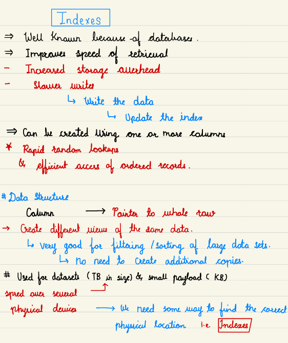

# 2.5 Indexing

[Boost DATABASE PERFORMANCE Overnight with These Pro Tips](<https://www.youtube.com/watch?v=-OrY8nio6eA&t=32s>)

[Database Indexes: What do they do? | Systems Design Interview: 0 to 1 with Google Software Engineer](<https://www.youtube.com/watch?v=LzNdvuj3a5M&list=PLjTveVh7FakLdTmm42TMxbN8PvVn5g4KJ&index=2&pp=iAQB>)

[How do Hash Indexes work? | Systems Design Interview: 0 to 1 with Google Software Engineer](<https://www.youtube.com/watch?v=I1wQsY-Nh_k&list=PLjTveVh7FakLdTmm42TMxbN8PvVn5g4KJ&index=3&pp=iAQB>)

[How do B-Tree Indexes work? | Systems Design Interview: 0 to 1 with Google Software Engineer](<https://www.youtube.com/watch?v=Z2OaqmxiH20&list=PLjTveVh7FakLdTmm42TMxbN8PvVn5g4KJ&index=4&pp=iAQB>)

[LSM Tree + SSTable Database Indexes | Systems Design Interview: 0 to 1 with Google Software Engineer](<https://www.youtube.com/watch?v=ciGAVER_erw&list=PLjTveVh7FakLdTmm42TMxbN8PvVn5g4KJ&index=5&pp=iAQB>)

[Indexes Concluded | Systems Design Interview: 0 to 1 with Google Software Engineer](<https://www.youtube.com/watch?v=QO7KTO-8RWM&list=PLjTveVh7FakLdTmm42TMxbN8PvVn5g4KJ&index=6&pp=iAQB>)

[21. Database Indexing: How DBMS Indexing done to improve search query performance? Explained](<https://www.youtube.com/watch?v=6ZquiVH8AGU&list=PL6W8uoQQ2c63W58rpNFDwdrBnq5G3EfT7&index=25&pp=iAQB>)

[DB Indexing in System Design Interviews - B-tree, Geospatial, Inverted Index, and more!](<https://www.youtube.com/watch?v=BHCSL_ZifI0>)

[System Design - Indexes | Indexing | Index benefits](<https://www.youtube.com/watch?v=p36JPdxpmXg&list=PLt4nG7RVVk1g_LutiJ8_LvE914rIE5z4u&index=4&pp=iAQB>)

[How does indexing work in Databases in Hindi ( How to optimize SQL Queries in Hindi )](<https://www.youtube.com/watch?v=xXtig5uLQS4&list=PLA3GkZPtsafZdyC5iucNM_uhqGJ5yFNUM&index=20&pp=iAQB>)

[Google SWE teaches systems design | EP27: Search Indexes ](<https://www.youtube.com/watch?v=DTUSFVfjRQA&list=PLjTveVh7FakKjb4UYzUazqBNNF-WGurXp&index=27&pp=iAQB>)

From < https://www.youtube.com/watch?v=DTUSFVfjRQA&list=PLjTveVh7FakKjb4UYzUazqBNNF-WGurXp&index=27&pp=iAQB>

[Google SWE teaches systems design | EP29: Geospatial Indexes ](<https://www.youtube.com/watch?v=VXWcNGxKMq4&list=PLjTveVh7FakKjb4UYzUazqBNNF-WGurXp&index=29&pp=iAQB>)

From < https://www.youtube.com/watch?v=VXWcNGxKMq4&list=PLjTveVh7FakKjb4UYzUazqBNNF-WGurXp&index=29&pp=iAQB>

[Absolutely Everything That I Know About Database Indexes](<https://www.youtube.com/watch?v=Qhc8gFF2qS8>)

[Database Indexes | System Design Fundamentals | Distributed Systems](<https://www.youtube.com/watch?v=8xTfhXu7ZMg>)

