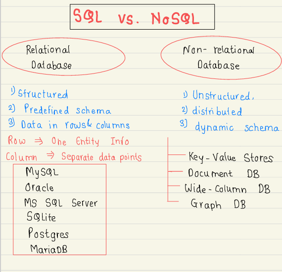
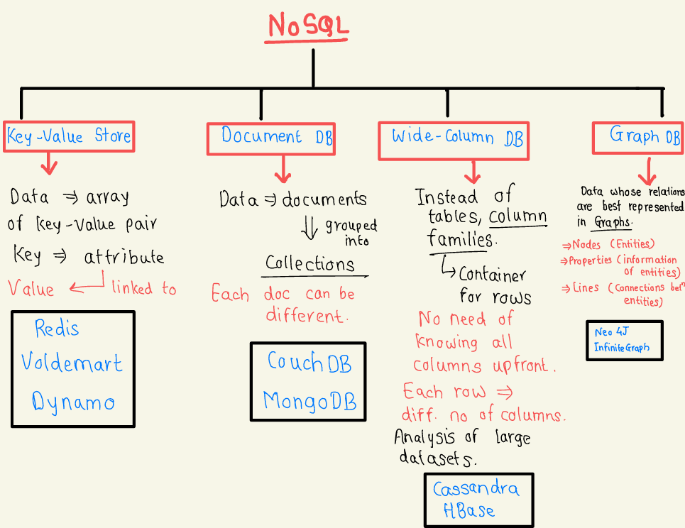
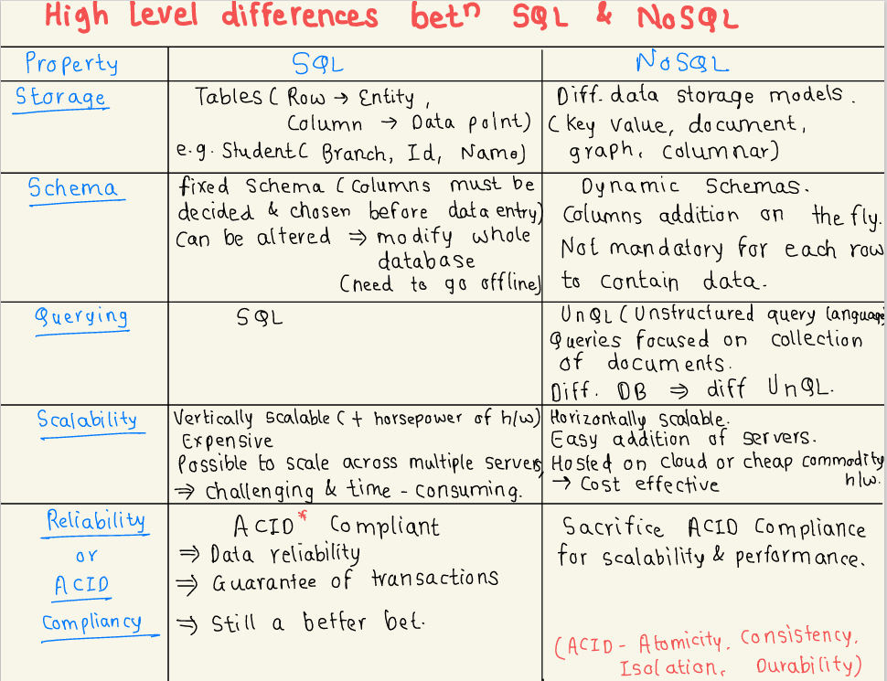
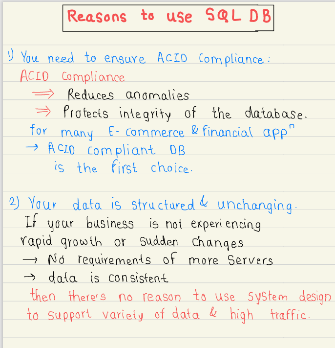
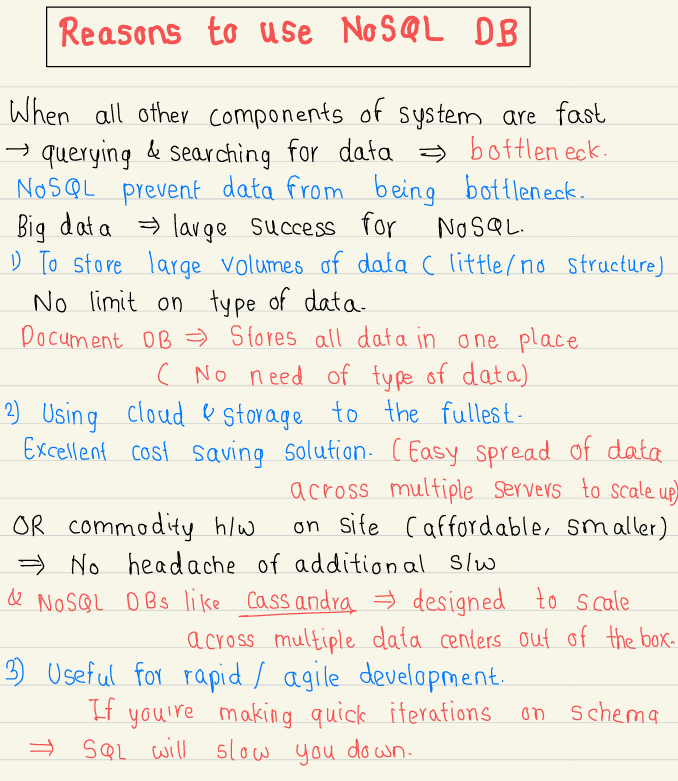

# 2.7 SQL vs NoSQL

[Google SWE teaches systems design \| EP8: SQL and its Pitfalls ](<https://www.youtube.com/watch?v=coJNGQFJ5kM&list=PLjTveVh7FakKjb4UYzUazqBNNF-WGurXp&index=8&pp=iAQB>)

[System Design: Choosing Database b/w SQL vs NoSQL](<https://www.youtube.com/watch?v=R5adYE8s0Zs&list=PLt4nG7RVVk1g_LutiJ8_LvE914rIE5z4u&index=7&pp=iAQB>)

[Types of NoSQL Databases in Hindi ( Which one to use  and where ? )](<https://www.youtube.com/watch?v=qxFj8X8n6CE&list=PLA3GkZPtsafZdyC5iucNM_uhqGJ5yFNUM&index=17&pp=iAQB>)

[SQL vs NoSQL - Who Wins? \| Systems Design Interview 0 to 1 with Ex-Google SWE](<https://www.youtube.com/watch?v=YgTLqO54UOA&list=PLjTveVh7FakLdTmm42TMxbN8PvVn5g4KJ&index=32&pp=iAQB>)

[EP9: HLD : SQL vs NoSQL Explained \| Choosing the Right Database Design](<https://www.youtube.com/watch?v=L78rwGegxz0&list=PLoaQAd6R8JXyTpYZTOWT8JrVASNeyoBZu&index=3&pp=iAQB0gcJCU0KAYcqIYzv>)

[Google SWE teaches systems design \| EP35: MongoDB ](<https://www.youtube.com/watch?v=ZEh0A6O72Kw&list=PLjTveVh7FakKjb4UYzUazqBNNF-WGurXp&index=35&pp=iAQB>)

[Google SWE teaches systems design \| EP36: VoltDB ](<https://www.youtube.com/watch?v=hoEhM9s3FNQ&list=PLjTveVh7FakKjb4UYzUazqBNNF-WGurXp&index=36&pp=iAQB>)

[Introduction to NoSQL databases ](<https://www.youtube.com/watch?v=xQnIN9bW0og&list=PLMCXHnjXnTnvo6alSjVkgxV-VH6EPyvoX&index=19&pp=iAQB>)

From < https://www.youtube.com/watch?v=xQnIN9bW0og&list=PLMCXHnjXnTnvo6alSjVkgxV-VH6EPyvoX&index=19&pp=iAQB>

[SQL vs NoSQL in 4 Minutes](<https://www.youtube.com/watch?v=eVApl3kzTB0>)

[Do I need NoSQL database? \| SQL vs NoSQL \| System Design Fundamentals \| Distributed Systems](<https://www.youtube.com/watch?v=DXaiTCmkpAU>)

[MySQL vs PostgreSQL - Who Wins? \| Systems Design Interview 0 to 1 with Ex-Google SWE](<https://www.youtube.com/watch?v=x6-RN-_i5Xs&list=PLjTveVh7FakLdTmm42TMxbN8PvVn5g4KJ&index=33&pp=iAQB>)

[What's VoltDb and Why Do We Care About It? \| \| Systems Design Interview 0 to 1 with Ex-Google SWE](<https://www.youtube.com/watch?v=K-UXF8Y72X8&list=PLjTveVh7FakLdTmm42TMxbN8PvVn5g4KJ&index=34&pp=iAQB>)

[Is Google Spanner the BEST Database? \| \| Systems Design Interview 0 to 1 with Ex-Google SWE](<https://www.youtube.com/watch?v=YIaYoxqpE7E&list=PLjTveVh7FakLdTmm42TMxbN8PvVn5g4KJ&index=35&pp=iAQB>)

[MongoDB vs. Apache Cassandra - Who Wins? \| Systems Design Interview 0 to 1 with Ex-Google SWE](<https://www.youtube.com/watch?v=6bxin9cZL_w&list=PLjTveVh7FakLdTmm42TMxbN8PvVn5g4KJ&index=36&pp=iAQB>)

