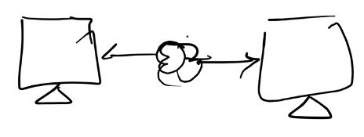
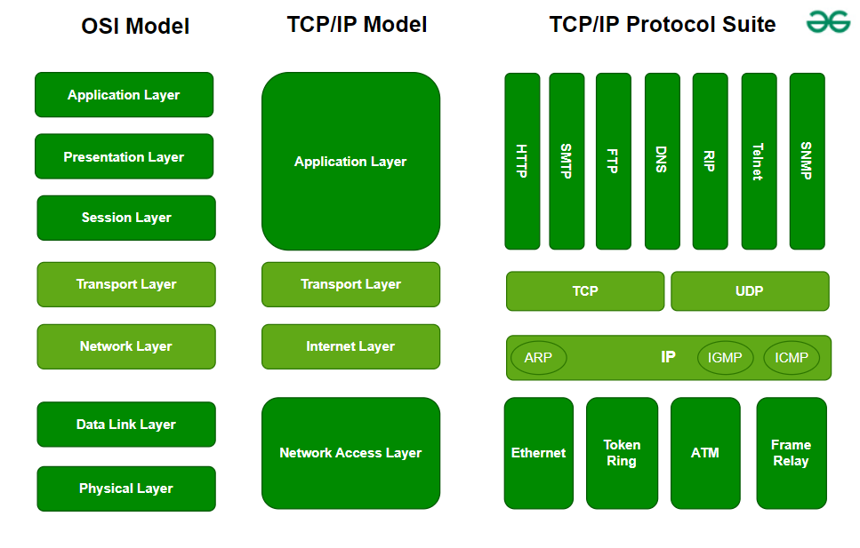
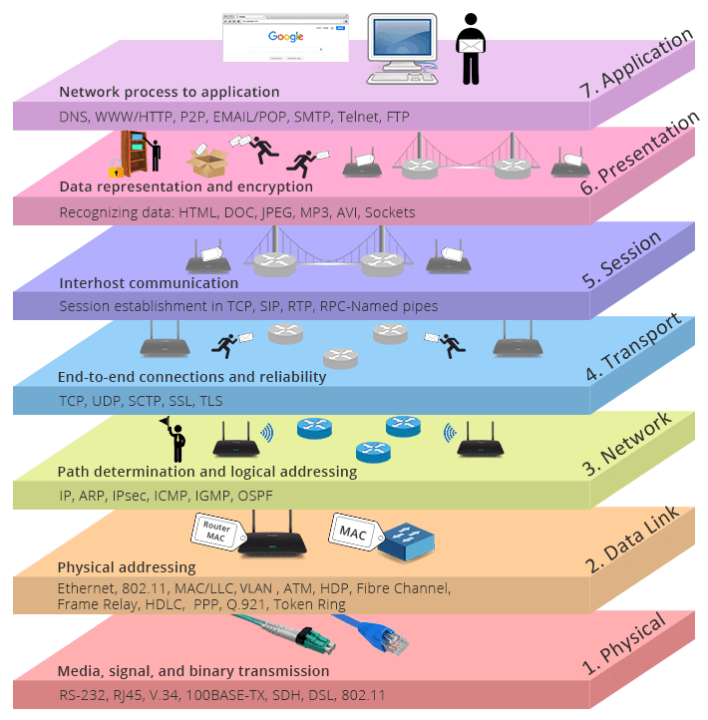
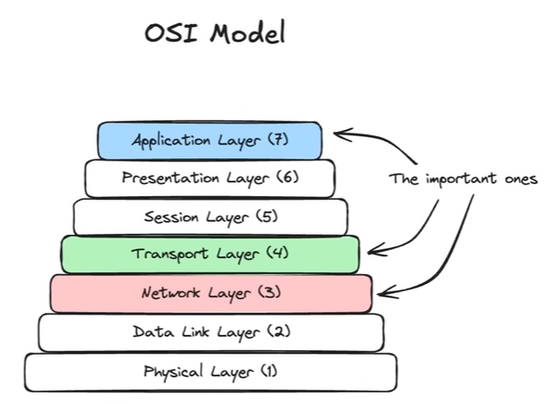
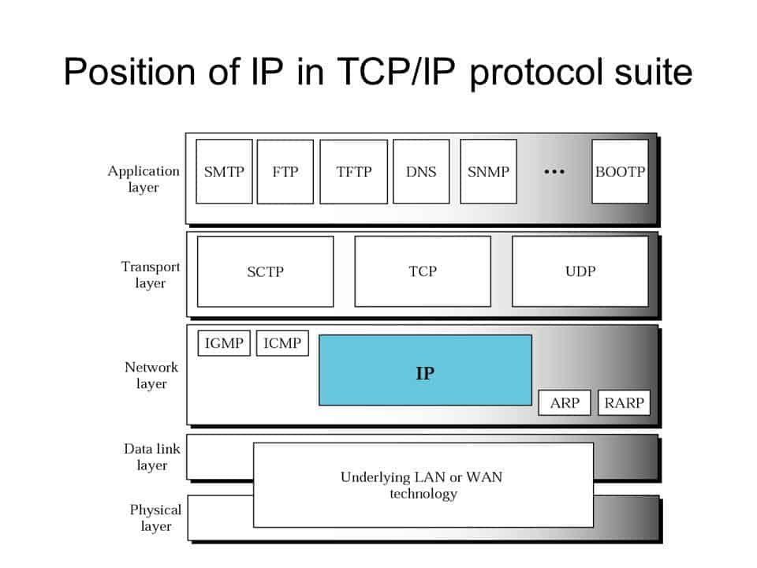
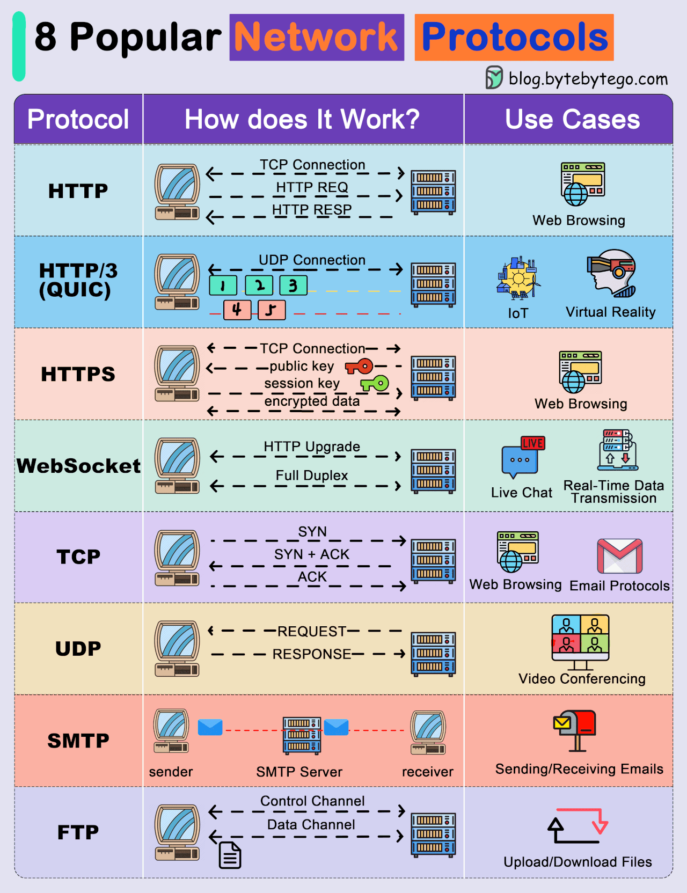

# 3.1 Network Protocols

## Network Protocol

Network protocols are sets of rules (format and structure ) and conventions that govern how devices communicate and exchange data over a network.

## OSI MODEL and TCP/IP Model:

The OSI (Open Systems Interconnection) model \[7 layers\] and the TCP/IP (Transmission Control Protocol/Internet Protocol) \[4 layers\] model are both frameworks that describe how networks communicate. The** OSI model is a conceptual**, layered model, while TCP/IP is a practical, protocol-specific model used for internet communication.

[OSI Model \| Simply Explained](<https://www.youtube.com/watch?v=Ia_iKerm50M>)

- Layer 7 Protocols - Application Layer - Where developers spend most of their time. - Define how applications communicate and what capabilities they have.

    - HTTP, REST, gRPC

    - SSE, WebSockets, WebRTC

    - DNS

- Layer 4 Protocols - Transport Layer - Adds functionality on top of Network Layer

    - TCP, UDP, QUIC

- Layer 3 Protocols - Network Layer - Handles addressing and routing.

    - IP

These layers are like abstractions.

## Application Layer Protocols:

## Transport Layer Protocols:

Abstractions over IP protocols, build upon IP protocol. Give functionality like reliability and ordering over IP.

## Network Layer Protocols:

    1. ## IP Protocol:

        1. Communication over internet.

        1. IP addresses - Every device on internet has a unique IP adress. 192.164.0.1.12

        1. IP Header - Source IP Address, Destination IP Address, IP Version: ipv4/ipv6, IP Packet size

        1. Data - actual data to be transferred

        1. Data broken in smaller chunks called IP packets while sending. Assembled during receiving. Best effort mechanism, doesn't gurantee ordering.

        1. Packet Loss - Unable to comprehend received data.

        1. Packet Ordering -  Odering during assembling.

