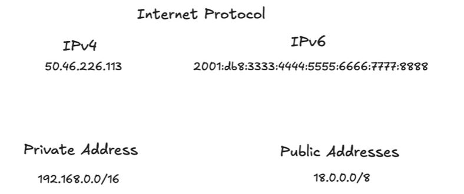

# 3.1.1 Layer 3: IP

IPv4 = 4 bytes

IPv6 = 16 bytes

- **Responsibility:** Assigning usable names (IP addresses) to nodes and enabling routing.

- **IP Versions:**

    - **IPv4:** 4 bytes. We have run out of public IPv4 addresses. Still used externally for compatibility.

    - **IPv6:** 16 bytes (8 groups of 2-byte pairs). More modern, often used for internal networks.

- **Address Types:**

    - **Public IP Addresses:**

        - Globally unique, known to the world, assigned by a central authority.

        - Internet routers know how to route them.

        - Example: Apple owns the 18.0.0.0/8 range. Any packet starting with 18 is routed to Apple's network.

        - **Interview Use Case:** API Gateways, Load Balancers, any public-facing component.

    - **Private IP Addresses:**

        - Used within a local/private network. You can assign them as you wish.

        - Special ranges (e.g., 192.168.0.0/16) are reserved to prevent conflicts with public IPs.

        - Example: Your home router is likely 192.168.0.1.

        - **Interview Use Case:** All internal components: microservices, databases, internal hosts. You are responsible for allocating and tracking these addresses.

IP Addressing:

    - Address/unique identifier to any device connected to a network using the internet.
