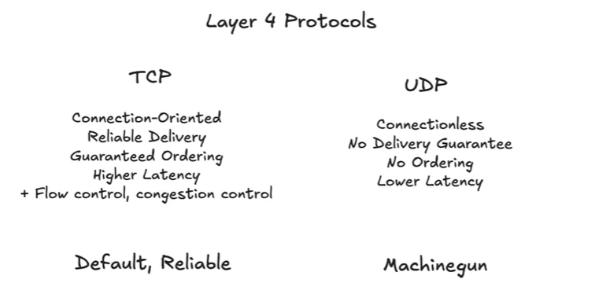

# 3.1.2 Layer 4: TCP and UDP

- **Transport Layer Protocols:** To solve problems IP doesn't handle: identifying the application (via **ports**) and ensuring reliable/ordered delivery.

- **Protocols:**

    - **QUIC:** A modern, high-performance substitute for TCP.

    - **TCP (Transmission Control Protocol): The Default Choice**

        - **Guarantees:** Guaranteed ordering and reliable delivery.

        - **Mechanism:** Uses sequence numbers on packets. If a packet is lost, the receiver knows and can request retransmission. If packets arrive out of order, the receiver reassembles them correctly before passing them to the application.

        - **Pros:** Reliable. Simplifies application logic by handling many network failures.

        - **Cons:** Higher latency and lower throughput due to the overhead of guarantees (e.g., waiting for retransmission).

        - **Nuance:** "Guaranteed delivery" only confirms receipt by the other *host*, not that the data was processed or written to disk. Can't comment on CAP theorem like concepts at other host, through TCP.

    - **UDP (User Datagram Protocol): For High Performance**

        - **Analogy:** "Machine gun" or "spray and pray." or "fire and forget" It sends data without any guarantees.

        - **Pros:** Very low latency, high throughput.

        - **Cons:** Packets can be lost, duplicated, or arrive out of order.

        - **Interview Use Case:** Use UDP *only when*:

            1. Latency is the most critical factor.

            1. The application can tolerate packet loss (it's "lossy").

        - **Examples:** Video/audio conferencing (dropping a frame is better than stalling), live streaming, online gaming.

        - **Limitation:** Not natively supported by web browsers. You'll need a TCP-based fallback for web clients.

[Google SWE teaches systems design | EP45: TCP versus UDP ](<https://www.youtube.com/watch?v=vPP2aoY7D4E&list=PLjTveVh7FakKjb4UYzUazqBNNF-WGurXp&index=45&pp=iAQB>)

[TCP (Transmission Control Protocol) vs UDP (User Datagram Protocol)](<https://www.youtube.com/watch?v=R6zjflp4z50>)

[TCP/IP vs OSI: What’s the Difference?](<https://www.youtube.com/watch?v=tpgoQwMg__M>)

[TCP vs. UDP in 12 minutes | Systems Design Interview 0 to 1 With Ex-Google SWE](<https://www.youtube.com/watch?v=hPSsPCNxta4>)

[TCP vs. UDP in 12 minutes | Systems Design Interview 0 to 1 With Ex-Google SWE](<https://www.youtube.com/watch?v=hPSsPCNxta4&list=PLjTveVh7FakLdTmm42TMxbN8PvVn5g4KJ&index=58&pp=iAQB>)
