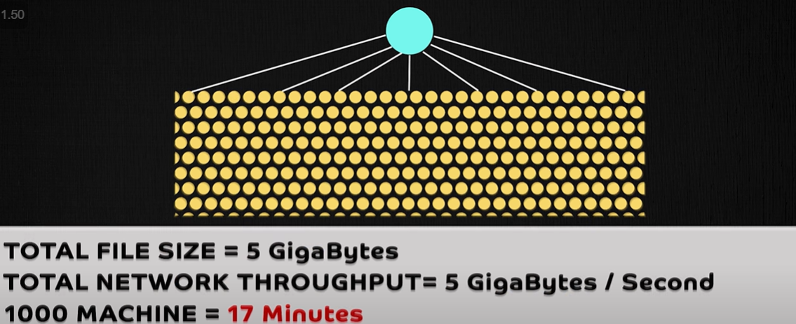
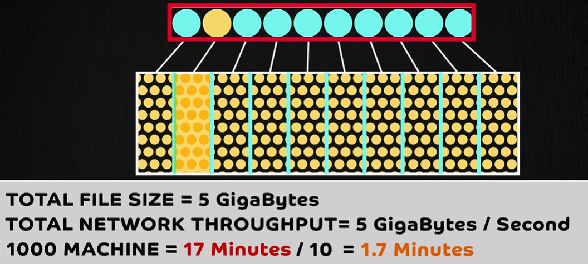
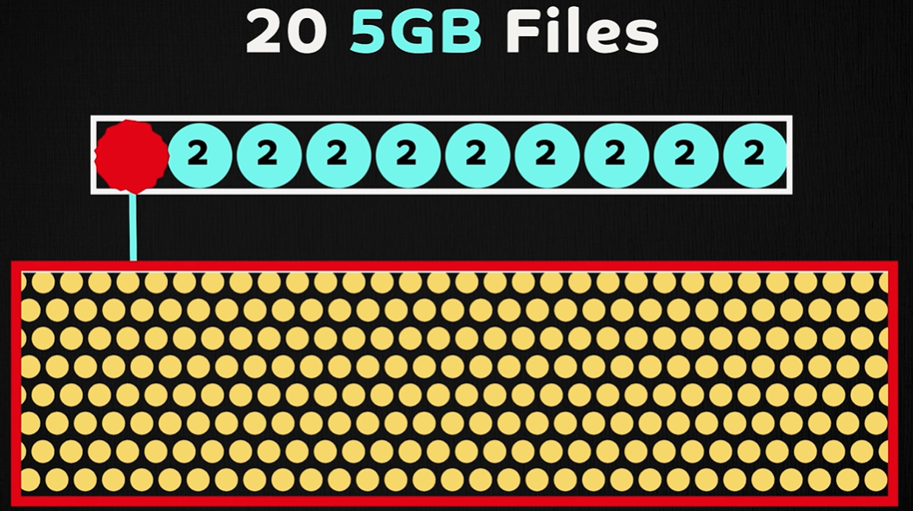
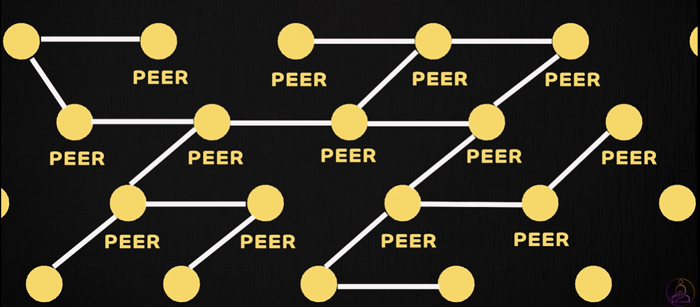
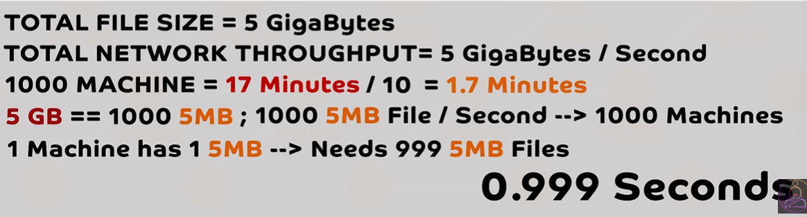
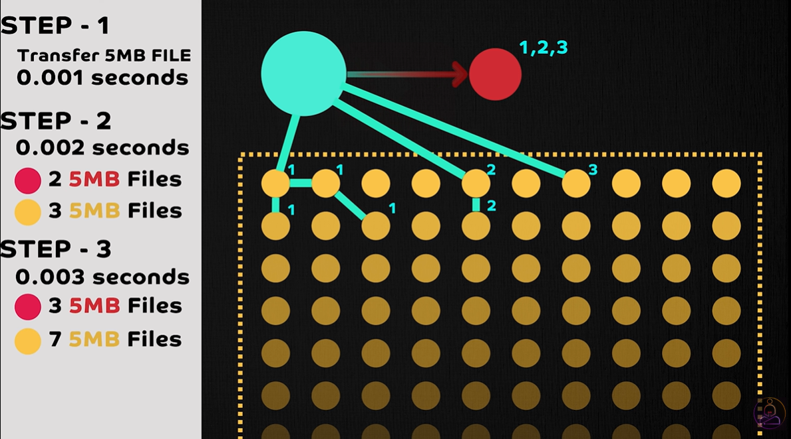
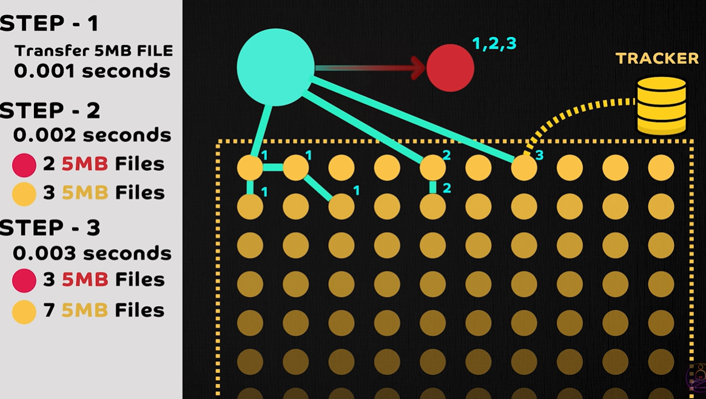
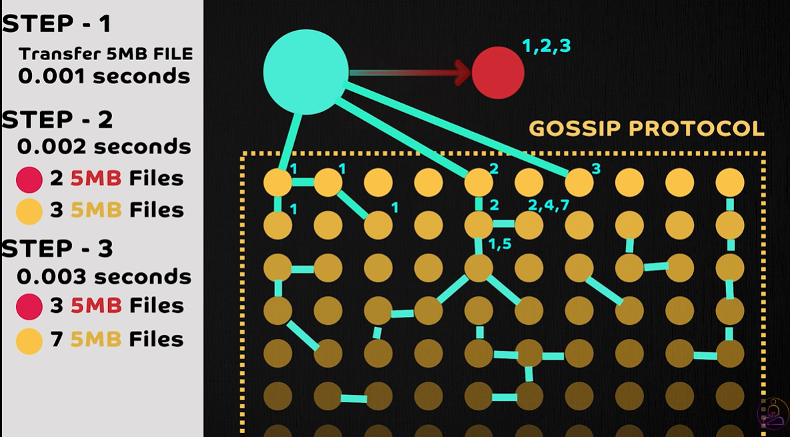
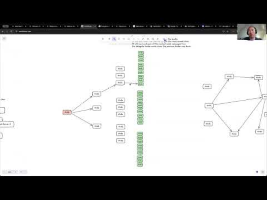

# 3.1.3 Peer To Peer

P2P in which each device can act as both server and client. Each client can host some information. P2P are advanced network architecture.

P2P architecture is a decentralized network model where each node, or peer, in the system has equal responsibilities and capabilities. Unlike the traditional client-server model, there is no central server coordinating activities. Instead, each peer can act as both a client and a server, sharing resources and data directly with other peers in the network.

## NEED FOR PEER TO PEER NETWORK

Horizontal Scaling: Replication Issue

Sharding: One Server bottleneck

PEER TO PEER SETUP:

Peer Discovery:

1. Central Database aka Tracker

1. Gossip Protocol

    - Uses Local Hash Tables to communicate which peer has which chunk. This is also known as DHT (Distributed Hash Tables)

    - Extremely Fast. Exponential File sharing.

    - 

[Bittorrent & P2P - Peer-to-Peer Network Applications | Computer Networks Ep. 2.5 | Kurose & Ross](<https://www.youtube.com/watch?v=23uTlbdCKbw&t=14s&pp=ygUMUDJQIHByb3RvY29s>)

Eg: Kraken by Uber (P2P Docker Registry), BitTorrent (P2P File Sharing Protocol)

[Peer-to-Peer (P2P) Architecture | The Art of System Design](<https://youtu.be/IKtSUdckgjA?si=uQSXX-Hh22axpPMr>)

[System Design Interview Preparation with Meta EM - How Peer-to-Peer (P2P) Networks Work](<https://youtu.be/WvYeFN8NdC8?si=R2aTLVfxzBFezs3S>)

