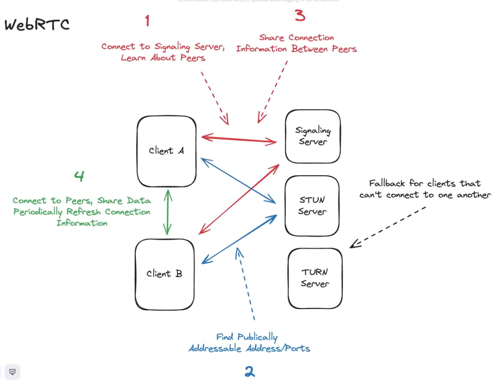

# 3.1.3.1 Layer 7: WebRTC

- **WebRTC (Web Real-Time Communication): For Peer-to-Peer (P2P)**

    - The most niche protocol, runs over **UDP**.

    - **Setup Process:**

        1. **Signaling Server:** A central server for clients to discover each other.

        1. **STUN/TURN Servers:** Help clients with NAT traversal \[NAT Hole Punching\] (punching a hole in firewalls) to establish a direct connection. TURN is a fallback relay if P2P fails.

        1. **P2P Connection:** Clients connect directly and exchange data (e.g., video stream).

    - **Interview Use Case:** Use it cautiously and specifically for:

        - **Audio/Video Calling.**

        - **Collaborative Editors** (advanced topic, often paired with CRDTs).
