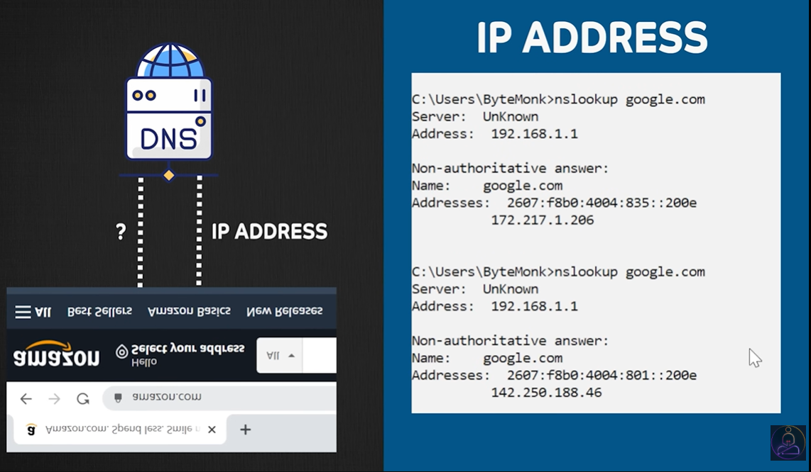
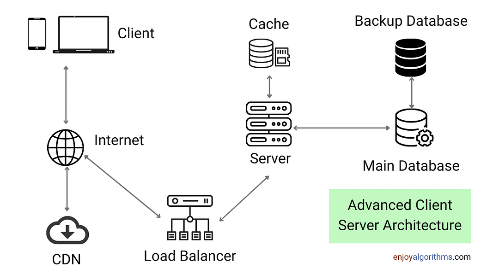

# 3.1.4 Client Server

- Client requests for service/data. Server offers the service/data.

- Server listens for clients on specific PORTS, and then speaks back to the clients.

- Eg: Web Hosting Service, Online payment service, Image storage service.

