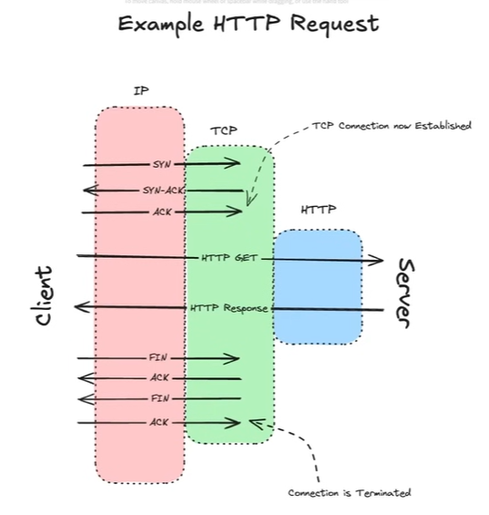
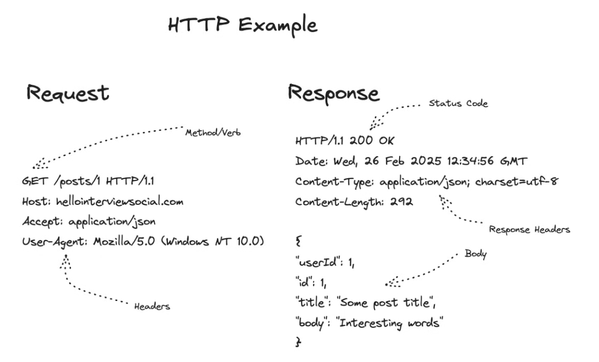

# 3.1.4.1 Layer 7: HTTP

Since a lot of back and forth communication is there, LATENCY gets involved. And also since there is a connection, STATE gets involved.

**An HTTP Request**

- The layers build on each other. HTTP depends on an established TCP connection, which in turn depends on IP for routing.

- **Process Flow:**

    1. **TCP Connection:** A **Three-Way Handshake** establishes the connection (Client sends SYN -> Server sends SYN-ACK -> Client sends ACK).

    1. **HTTP Traffic:** Once the TCP stream is established, HTTP requests and responses are sent over it.

    1. **Connection Termination:** The TCP connection is eventually closed.

- **Key  Takeaways from this example:**

    1. **Latency:** Connection setup involves significant back-and-forth communication.

    1. **Statefulness:** Connections are stateful (established/terminated) and are not "cheap" to create. Managing this state is a design consideration.

**HTTP (Hypertext Transfer Protocol): The Workhorse**

- Versatile, battle-tested, used for websites and APIs (RPC).

- **Mechanism:** Text-based request/response protocol.

- 

- **Request:** Verb URL HTTP/Version (e.g., GET /posts/1 HTTP/1.1), followed by key-value headers.

- **Response:** HTTP/Version StatusCode (e.g., HTTP/1.1 200 OK), headers, and the response body (data).

- **Content Negotiation:** Client uses Accept headers to state what formats it can handle (e.g., Accept-Encoding: gzip). The server uses Content-Type headers to state what format it is sending. This enables backward/forward compatibility.
