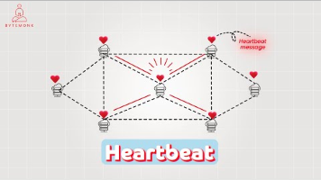

# 3.1.4.2 Layer 7: HTTPS, Keep-Alive

[Http vs Https - System Design](<https://www.youtube.com/watch?v=1my_YM1ZMkQ&list=PLt4nG7RVVk1g_LutiJ8_LvE914rIE5z4u&index=24&pp=iAQB>)

[Heartbeat \| HTTP Keep-Alive \| System Design](<https://www.youtube.com/watch?v=2LCyDvx7iIE&list=PLJq-63ZRPdBt423WbyAD1YZO0Ljo1pzvY&index=33&pp=iAQB>)

