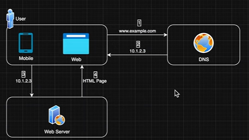

# 3.1.4.6 Layer 7: DNS

[DNS: The Hidden Engine of the Internet | Computer Networks](<https://www.youtube.com/watch?v=Lsd80uR9Shs>)

[How DNS works? | System Design of Domain Name System](<https://www.youtube.com/watch?v=QVdX34quUgU>)

## Single Server Setup

DNS is separate from Web Servers. DNS translates domain names (like "google.com") into IP addresses, while web servers handle the actual content and delivery of web pages. 1,2,3,4 flow mentioned.

Single Web Server (Monolith) = Single Point of Failure

## HOW WEB WORKS | DNS RESOLUTION

