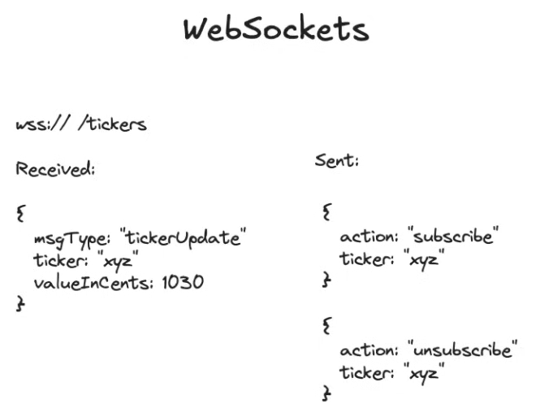

# 3.1.4.7 Layer 7: WebSocket

- **WebSockets: For Bidirectional, Low-Latency Communication**

    - **Warning:** Often overused by candidates. Consider polling or SSE first. Requires significant infrastructure.

    - **Mechanism:** Simulates a full-duplex TCP connection for browsers, allowing for high-frequency, bidirectional message passing.

    - **API Design:** Think in "messages" (subscribe, ticker_update), not request-response.

    - **Challenge: Statefulness.** A server must maintain an active connection for each client, which complicates deployments, scaling, and failure recovery.

    - **Interview Design Pattern:** Isolate the state. Use a dedicated **WebSocket Service** at the edge to handle connections. This service then communicates with stateless backend services using standard RPCs (REST/gRPC).

[Long Polling, Websockets, Server Sent Events - Who Wins? | Systems Design  with Ex-Google SWE](<https://www.youtube.com/watch?v=fIwOd4PToAY&list=PLjTveVh7FakLdTmm42TMxbN8PvVn5g4KJ&index=59&pp=iAQB>)

[Google SWE teaches systems design | EP38: WebSockets, Long Polling, Server Sent Events](<https://www.youtube.com/watch?v=c4F7Tfzl198&list=PLjTveVh7FakKjb4UYzUazqBNNF-WGurXp&index=38&pp=iAQB>)

[How Web Sockets work | System Design Interview Basics](<https://www.youtube.com/watch?v=pnj3Jbho5Ck&ab_channel=ByteMonk>)

[How Web Sockets work | Deep Dive](<https://www.youtube.com/watch?v=G0_e02DdH7I&ab_channel=ByteMonk>)
