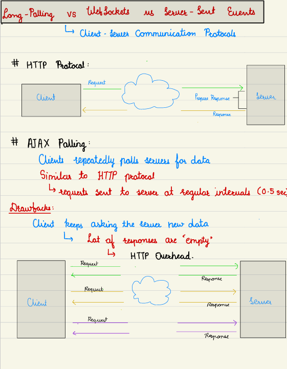
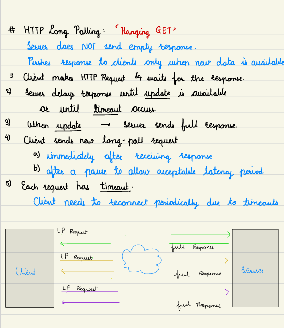
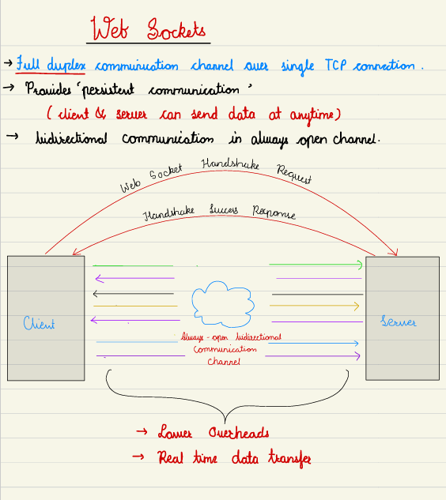
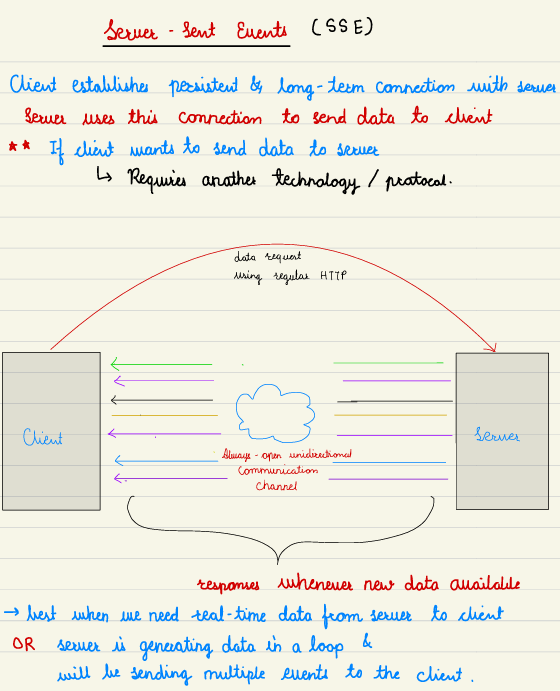
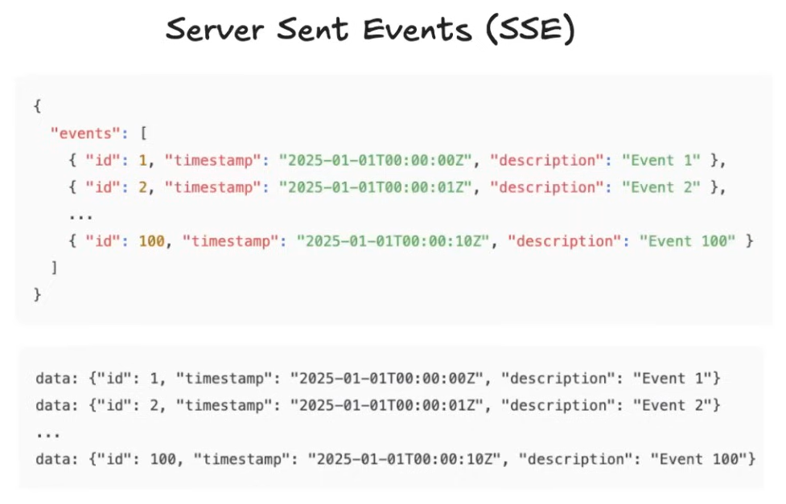

# 3.1.4.8 Layer 7: Long Polling v/s Web Sockets v/s SSE

[Long Polling vs SSE vs WebSockets vs QUIC | Simply Explained](<https://www.youtube.com/watch?v=3Ud6Ds2abO8>)

[Polling versus Streaming | System Design](<https://www.youtube.com/watch?v=b4qyOpGg748&list=PLJq-63ZRPdBt423WbyAD1YZO0Ljo1pzvY&index=12&pp=iAQB>)

[Short Polling vs Long Polling vs WebSockets | System Design Interview | Distributed Systems in Hindi](<https://www.youtube.com/watch?v=MpNX-1ApfC4>)

[Long Polling, Websockets, Server Sent Events - Who Wins? | Systems Design with Ex-Google SW](<https://www.youtube.com/watch?v=fIwOd4PToAY>)E

[Long polling, server sent Events and Web Sockets | Real time communication jargons in Hindi](<https://youtu.be/_CCyMWSZNU4?si=SPySFFVmPhMwLBd0>)

- **Server-Sent Events (SSE): For Server-to-Client Pushes**

    - **Mechanism:** An extension of HTTP. The client makes one request, and the server keeps the connection open, pushing new data (events) as they become available.

    - **Under the Hood:** Uses chunked encoding and a text/event-stream content type.

    - **Downside:** Long-lived HTTP connections are often timed out by proxies (30-60s). Clients must implement automatic reconnection logic, passing the last received event ID to avoid missing data. Described as "clunky" but effective.

    - **Interview Use Case:** Short-term UI updates (e.g., order status), streaming tokens from an AI model response.
